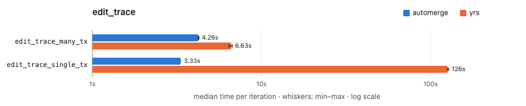
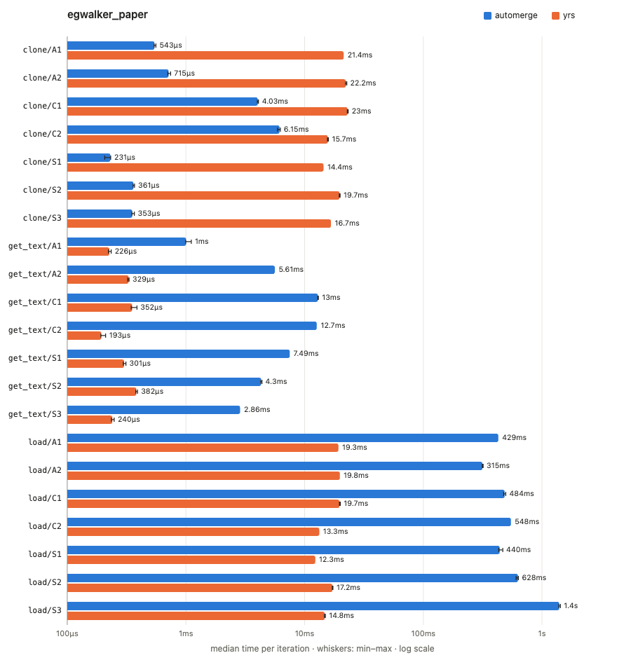
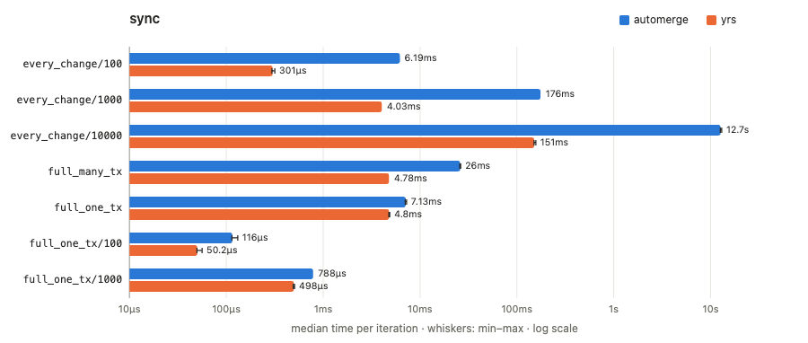
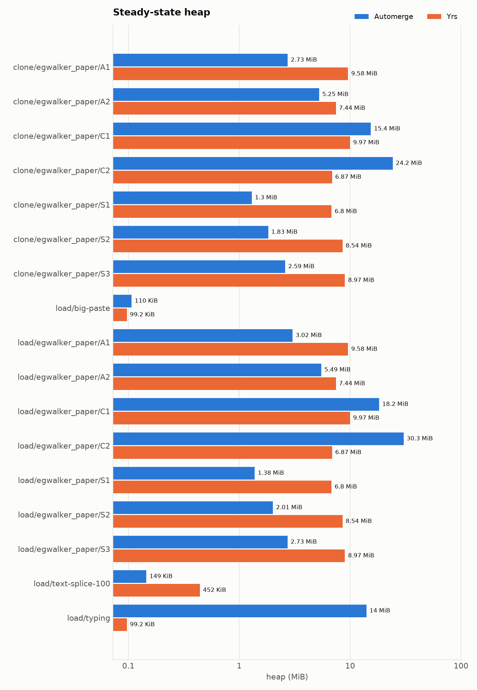
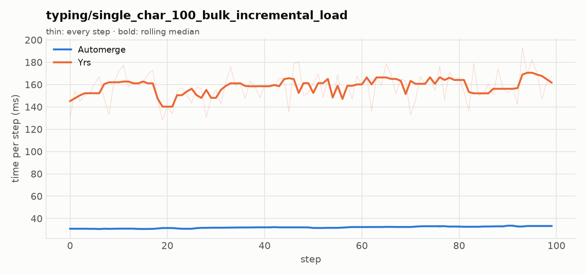

### Build

- These benchmarks create a document from scratch
- Comparing Automerge and Yrs on the build sampled benchmarks, Automerge is slower in workloads like this:

| `build/build_big_paste` | 45.51ms (137.9×) | **330.02µs** (1.0×) |
| --- | --- | --- |

This is because Automerge needs to split the big paste 100k chars into individual ops, and then insert them into the opset. And that takes 35 ms. whereas Yrs builds one big block, and code and item and split later on if users choose to insert in the middle.

| Phase | Automerge | Yrs |
| --- | --- | --- |
| `splice_text` / `insert` | 35.6 ms | 0.07 ms (with commit) |
| commit | 12.2 ms | (included above) |
| free the document | 0.006 ms | 0.002 ms |
| generating the random string (timed in the battery) | 0.27 ms | 0.27 ms |

### Edit traces

replaying the latex edit session:

However, in yrs, if edits are all over the place, then it has to constantly split the block/item, making it slower. The single txn case is even slower because editing near the end of the document requires walking the item list linearly, which is slow.

Well I guess all of these don’t matter that much, at least for the collaborative text editing workload. Because in practice people would just load documents rather than replaying an edit history

### Egwalker paper trace

For the egwalker paper trace, cloning on automerge is faster because automerge’s in memory data structure is more compact than yrs, and copying the structure is cheaper. But yrs deep copy requires a full encoding and decoding round trip.

For loading, it’s again the change graph reconstruction that takes most of the time (walking the opset data structure, allocations, etc)

### Syncing

These sync workloads exercises the syncing of CRDTS, for automerge this is the `generate_sync_message` and Yrs uses the y-sync protocol, which is based on state vector (clocks) to work out the difference.

- Automerge `BatchApply` walks through the whole op list linearly, so if there many small transactions, their cost adds up
- Yrs insert big items, and split as needed
- therefore Automerge gets closer to Yrs if it’s one big txn
- But I guess individual latency probably does not matter that much, as long as they are within a good threashold?

### Memory

- Comparing the steady state memory usage of automerge and Yrs
- when there are lots of changes, the change graph dominates the memory use, for example

| Trace | Changes | Actors | AM steady | AM peak | Yrs steady | Yrs peak |
| --- | --- | --- | --- | --- | --- | --- |
| S1 | 2 | 2 | 1.38 MiB | 234.7 MiB | 6.80 MiB | 7.7 MiB |
| S2 | 2 | 2 | 2.01 MiB | 317.5 MiB | 8.54 MiB | 9.8 MiB |
| S3 | 2 | 2 | 2.73 MiB | 680.1 MiB | 8.97 MiB | 10.1 MiB |
| A1 | 956 | 205 | 3.02 MiB | 91.3 MiB | 9.58 MiB | 10.7 MiB |
| A2 | 3,208 | 376 | 5.49 MiB | 57.7 MiB | 7.43 MiB | 8.4 MiB |
| C1 | 93,152 | 3 | 18.25 MiB | 180.9 MiB | 9.97 MiB | 11.4 MiB |
| C2 | 134,477 | 4 | 30.31 MiB | 208.1 MiB | 6.87 MiB | 7.8 MiB |
- C2 has lots of changes, and it is where automerge does worse compared to other workloads. And similarly for the load/typing workload. There will probably be lots of changes and hashes to store in memory for that.
- If we look at the change graph to see where the memory use is, seems that the hash are taking spaces. Also they are stored twice (`nodes_by_hash` and `hashes`, so perhaps storing just one copy and then a pointer to that would save us memory?

| Part of the document | MiB |
| --- | --- |
| Ops (`OpSet`, compressed columns) | 1.50 |
| **Change graph** | **26.5** |
| `authors` | 2.05 |

| `ChangeGraph` field | MiB | Share of graph | Bytes per change |
| --- | --- | --- | --- |
| `nodes_by_hash: HashMap<ChangeHash, NodeIdx>` | 9.25 | 35% | 72 |
| `hashes: Vec<ChangeHash>` | 8.00 | 30% | 62 |
| `clock_cache: HashMap<NodeIdx, SeqClock>` (35,947 entries) | 2.61 | 10% | 20 |
| `edges: Vec<Edge>` (230,849 dependency edges) | 2.00 | 7.5% | 16 |
| `actors`, `seq`, `max_ops` (`Vec<u32>`-sized, 1.00 each) | 3.00 | 11% | 23 |
| `seq_index`, `parents`, `num_ops` (hexane), the rest | 1.6 | 6% | 12 |
| **Total** | **26.5** |  | **207** |
- In the case of lots of actors (376), clock cache takes up a fair amount of spaces

| A2 field | MiB | Share of graph |
| --- | --- | --- |
| `clock_cache` | 3.11 | 86% |
| `nodes_by_hash` | 0.14 | 4% |
| `hashes` | 0.12 | 3.5% |
| `edges` | 0.12 | 3.5% |
| Everything else | 0.12 | 3% |
- Although again do we care about the difference between these if they are within a reasonable size?

### series benchmarks

For the series benchmark, in most cases yrs is faster, except the one below where Automerge beats Yrs. 

| Phase, per step | Automerge | Yrs |
| --- | --- | --- |
| 100 local inserts | 1.1 ms (11 µs each) | **153 ms (1.53 ms each)** |
| commit + `save_incremental` | 0.23 ms | 0.44 ms |
| `load_incremental` on the replica | **29.1 ms** | 0.26 ms |
| `same_version` check | ~0 | ~0 |
| **Total** | **30.5 ms** | **153.7 ms** |

This one inserts 100 chars in random positions as one transaction. For automerge local inserts are fast as it maintains a index on where the visible character should be, but yrs needs to a linear walk.