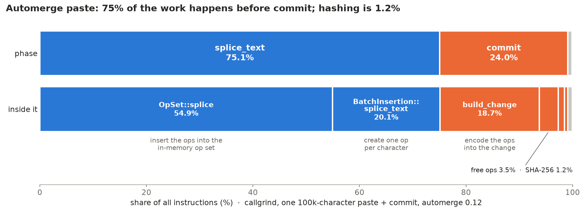
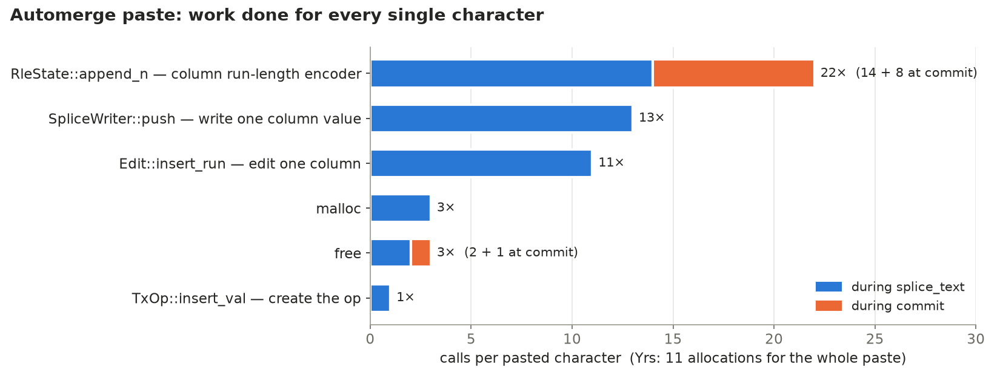
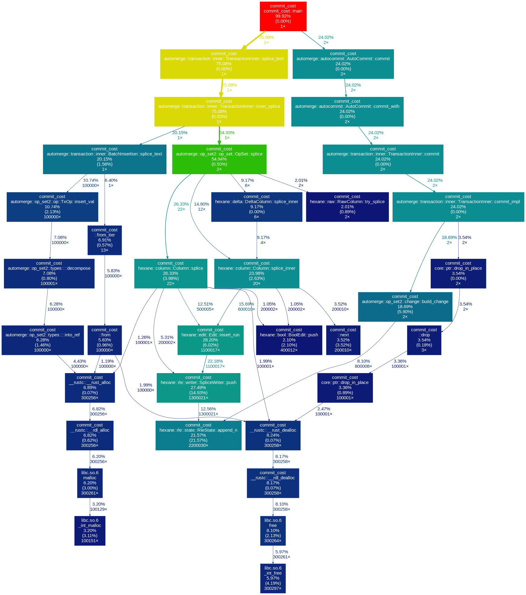

# Profiling: why Automerge's `build/build_big_paste` is slow

In this experiment `build/build_big_paste` took 45.5 ms with Automerge and
0.33 ms with Yrs. Both libraries insert the same 100,000 characters in one
transaction. These files show where Automerge's time goes. Profiled on
2026-11-20 with automerge 0.12.0, yrs 0.28.1 and rustc 1.96.1.

## Findings

Automerge turns the paste into **one op per character**, so it does
per-character work three times: it creates 100,000 op structs, inserts them
into the in-memory op set, and encodes them into the change at commit. Yrs
stores the paste as **one item** holding the whole string. Each character's
ID is implied by its offset in the run.



Phase timings (median of 30 runs, `probe` default binary):

| Phase | Automerge | Yrs |
|---|---:|---:|
| `splice_text` / `insert` | 35.6 ms | 0.07 ms (with commit) |
| commit | 12.2 ms | (included above) |
| free the document | 0.006 ms | 0.002 ms |
| generating the random string (timed in the battery) | 0.27 ms | 0.27 ms |

Commit cost depends on the number of ops, not the number of bytes (`commit_cost`):

| Case | Ops | Encoded change | Commit | SHA-256 |
|---|---:|---:|---:|---:|
| splice 100,000 chars into text | 100,000 | 100,125 B | 11.7 ms | 0.046 ms |
| put one 100,000-char string | 1 | 100,098 B | 0.055 ms | 0.046 ms |

Heap allocations (`alloc_count`): Automerge's `splice_text` makes 300,098
(3 per character, 76 MiB requested, mostly temporary) and its commit 35.
Yrs's insert and commit make 11.

The call graph counts the same per-character work inside Automerge's column store. One pasted character causes these calls:



The full call graph has each function's share of the cost and its call count. The 100,000× and 1,000,000× paths are loops over every pasted character. Open [the SVG](automerge-paste-100k-callgraph.svg) to zoom in.



Because the battery times string generation too, Yrs's 0.33 ms is mostly that
0.27 ms. The underlying ratio is about 48 / 0.07 ≈ 700×, not the 140× in the
results.

### One string as a map value vs as text

To separate Automerge's general per-transaction overhead from its text
representation, the same 100,000-character string was stored both ways in
both libraries (`value_vs_text`). Each iteration creates a document, makes the
edit in one transaction, commits and drops the document. Medians of 101 runs;
p10 and p90 are within about 5% of each median.

| 100k characters | Time | vs Yrs text |
|---|---:|---:|
| Yrs, map value (`Map::insert`) | 2.7 µs | 0.05× |
| Yrs, text (`Text::insert`) | 49.6 µs | 1× |
| **Automerge, map value (`put`)** | **79.8 µs** | **1.6×** |
| Automerge, text (`splice_text`) | 45,141 µs | 910× |

- **As a single map value, Automerge is close to Yrs's text paste** (80 µs
  vs 50 µs). The put is one op carrying the whole string. About 46 µs of it is
  the SHA-256 that every Automerge commit computes, here over a 100 KB change
  (see the `commit_cost` table). Yrs hashes nothing, which is why its own map
  value takes 2.7 µs. Yrs's text insert costs about 47 µs more than its map
  insert; that wasn't profiled.
- **Automerge's per-transaction overhead is therefore small.** Its map value
  vs its text splice is about 565×, so the 45 ms paste is almost entirely the
  one-op-per-character text representation.
- **The two storage forms aren't interchangeable.** A map value is atomic:
  it can't be edited character by character, and concurrent changes to it are
  a conflict on the whole value. A text (in either library) supports
  character-level merging, cursors and marks. Like-for-like gaps are text vs
  text (910×) and map value vs map value (about 30×).

### Is one op per character necessary?

A text CRDT needs an **identity** for every character, because later edits,
cursors and marks refer to characters by ID. It doesn't need a separate
**op** per character. Yrs stores a paste as one item covering clocks
`k … k+99,999` and splits it (`split_block`) only when an edit lands inside.
Automerge allocates the same consecutive IDs, and its change format already
compresses them to about one byte per character, but in memory it still creates
and processes every op. The run-length approach costs complexity elsewhere:
partial-run edits, per-character state stored as ranges, and history queries.
The map-value measurement shows the potential: one op carrying the paste costs
about 80 µs, against 45 ms for 100,000 ops.

## Files

| File | What it is |
|---|---|
| `automerge-paste-100k-cost-breakdown.png` | Share of instructions: `splice_text` 75.1% (op set insert 54.9%, creating ops 20.1%) vs commit 24.0% (encoding 18.7%, freeing ops 3.5%, SHA-256 1.2%). |
| `automerge-paste-100k-calls-per-char.png` | Calls per pasted character in Automerge's internals, coloured by phase: 22 run-length-encoder appends, 13 column writes, 11 column edits, 3 mallocs, 3 frees. |
| `automerge-paste-100k-callgraph.png`, `.svg` | Full call graph: share of cost and call count per function. Functions under 2% are hidden. |
| `automerge-paste-100k-callgraph.dot` | Graphviz source of the call graph. |
| `automerge-paste-100k.callgrind.out` | Raw callgrind profile of one paste and commit. Open it with `callgrind_annotate` or KCachegrind. |
| `make-automerge-paste-charts.py` | Draws the two summary charts. Its numbers are copied from the profile, so update them by hand after re-profiling. |
| `probe/` | Source of the probe programs: phase timings (default binary), `commit_cost` (per-op vs per-byte experiment, plus `profile` mode for callgrind), `alloc_count` and `value_vs_text` (string as map value vs as text, both libraries). |

Percentages are shares of executed instructions under callgrind, not
wall-clock time. They match the timed split (34 ms splice : 11.7 ms commit).
Valgrind forces the software SHA-256, so natively hashing is even smaller.

## Reproducing

```sh
cd probe
cargo +1.96.1 run --release                    # phase timings
cargo +1.96.1 run --release --bin commit_cost  # per-op vs per-byte commit cost
cargo +1.96.1 run --release --bin alloc_count  # heap allocations per phase
cargo +1.96.1 run --release --bin value_vs_text  # string as map value vs as text

valgrind --tool=callgrind --callgrind-out-file=../automerge-paste-100k.callgrind.out \
  target/release/commit_cost profile
cd ..
gprof2dot -f callgrind -n 2 -e 1 -s --root='commit_cost::main' \
  -o automerge-paste-100k-callgraph.dot automerge-paste-100k.callgrind.out
dot -Tsvg -o automerge-paste-100k-callgraph.svg automerge-paste-100k-callgraph.dot
dot -Tpng -Gdpi=110 -o automerge-paste-100k-callgraph.png automerge-paste-100k-callgraph.dot
python make-automerge-paste-charts.py          # needs matplotlib
```

`gprof2dot` comes from `pip install gprof2dot`. The probe's `[profile.release]
debug = 1` keeps symbols for callgrind.
