# CRDT benchmark battery

Each cell is the median; `(N.N×)` is relative to the best library on that row.

## Sampled benchmarks (median time per iteration)

| benchmark | automerge | yrs |
| --- | ---: | ---: |
| `build/build_big_paste` | 45.51ms (137.9×) | **330.02µs** (1.0×) |
| `build/build_deep_history_doc` | 2.86s (24.2×) | **118.05ms** (1.0×) |
| `build/build_maps_in_maps_doc` | 776.84ms (21.3×) | **36.40ms** (1.0×) |
| `build/build_text_splice_100` | 51.82ms (62.1×) | **834.46µs** (1.0×) |
| `build/build_typing` | 940.91ms (17.3×) | **54.40ms** (1.0×) |
| `edit_trace/edit_trace_many_tx` | **4.26s** (1.0×) | 6.63s (1.6×) |
| `edit_trace/edit_trace_single_tx` | **3.33s** (1.0×) | 126.32s (37.9×) |
| `egwalker_paper/clone/A1` | **542.86µs** (1.0×) | 21.35ms (39.3×) |
| `egwalker_paper/clone/A2` | **714.55µs** (1.0×) | 22.23ms (31.1×) |
| `egwalker_paper/clone/C1` | **4.03ms** (1.0×) | 23.04ms (5.7×) |
| `egwalker_paper/clone/C2` | **6.15ms** (1.0×) | 15.70ms (2.6×) |
| `egwalker_paper/clone/S1` | **231.18µs** (1.0×) | 14.44ms (62.5×) |
| `egwalker_paper/clone/S2` | **360.94µs** (1.0×) | 19.70ms (54.6×) |
| `egwalker_paper/clone/S3` | **353.46µs** (1.0×) | 16.69ms (47.2×) |
| `egwalker_paper/get_text/A1` | 1.00ms (4.4×) | **226.47µs** (1.0×) |
| `egwalker_paper/get_text/A2` | 5.61ms (17.1×) | **328.64µs** (1.0×) |
| `egwalker_paper/get_text/C1` | 12.96ms (36.8×) | **352.03µs** (1.0×) |
| `egwalker_paper/get_text/C2` | 12.66ms (65.5×) | **193.36µs** (1.0×) |
| `egwalker_paper/get_text/S1` | 7.49ms (24.9×) | **301.19µs** (1.0×) |
| `egwalker_paper/get_text/S2` | 4.30ms (11.3×) | **381.78µs** (1.0×) |
| `egwalker_paper/get_text/S3` | 2.86ms (11.9×) | **239.79µs** (1.0×) |
| `egwalker_paper/load/A1` | 428.93ms (22.3×) | **19.27ms** (1.0×) |
| `egwalker_paper/load/A2` | 314.96ms (15.9×) | **19.83ms** (1.0×) |
| `egwalker_paper/load/C1` | 484.45ms (24.6×) | **19.67ms** (1.0×) |
| `egwalker_paper/load/C2` | 547.84ms (41.2×) | **13.29ms** (1.0×) |
| `egwalker_paper/load/S1` | 440.08ms (35.8×) | **12.30ms** (1.0×) |
| `egwalker_paper/load/S2` | 627.56ms (36.5×) | **17.17ms** (1.0×) |
| `egwalker_paper/load/S3` | 1.40s (94.7×) | **14.77ms** (1.0×) |
| `length/list_len_now` | 513.64µs (10272.8×) | **50ns** (1.0×) |
| `length/map_len_now` | 1.33ms (2.3×) | **567.86µs** (1.0×) |
| `length/text_len_now` | 240ns (4.8×) | **50ns** (1.0×) |
| `list/list_cursor_now` | **8.85µs** (1.0×) | 9.42µs (1.1×) |
| `list/list_splice_index_now` | 19.88µs (2.5×) | **7.93µs** (1.0×) |
| `list/list_update_now` | 25.05µs (1.4×) | **17.83µs** (1.0×) |
| `load_save/load_actors/load/10` | 30.10µs (4.3×) | **6.96µs** (1.0×) |
| `load_save/load_actors/load/100` | 192.25µs (2.5×) | **77.69µs** (1.0×) |
| `load_save/load_actors/load/1000` | 2.54ms (3.2×) | **785.86µs** (1.0×) |
| `load_save/load_big_paste` | 37.50ms (492.7×) | **76.11µs** (1.0×) |
| `load_save/load_big_random` | 70.20ms (1.1×) | **65.50ms** (1.0×) |
| `load_save/load_deep_history/1000` | 230.79ms (3.7×) | **61.91ms** (1.0×) |
| `load_save/load_maps_in_maps` | 53.67ms (1.5×) | **35.77ms** (1.0×) |
| `load_save/load_text_splice_100` | 53.89ms (74.5×) | **723.21µs** (1.0×) |
| `load_save/load_typing` | 158.68ms (3054.3×) | **51.95µs** (1.0×) |
| `load_save/save_big_paste` | 1.99ms (19.0×) | **104.63µs** (1.0×) |
| `load_save/save_big_random` | 13.64ms (2.8×) | **4.86ms** (1.0×) |
| `load_save/save_deep_history/1000` | 14.34ms (2.1×) | **6.92ms** (1.0×) |
| `load_save/save_maps_in_maps` | 11.52ms (2.3×) | **5.01ms** (1.0×) |
| `load_save/save_text_splice_100` | 2.28ms (9.4×) | **241.65µs** (1.0×) |
| `load_save/save_typing` | 5.68ms (55.3×) | **102.78µs** (1.0×) |
| `map/apply/decreasing_put/100` | 92.67µs (2.0×) | **47.04µs** (1.0×) |
| `map/apply/decreasing_put/1000` | 757.11µs (1.6×) | **472.43µs** (1.0×) |
| `map/apply/decreasing_put/10000` | 7.21ms (1.6×) | **4.45ms** (1.0×) |
| `map/apply/increasing_put/100` | 94.34µs (2.0×) | **46.89µs** (1.0×) |
| `map/apply/increasing_put/1000` | 768.80µs (1.6×) | **475.84µs** (1.0×) |
| `map/apply/increasing_put/10000` | 7.18ms (1.6×) | **4.49ms** (1.0×) |
| `map/apply/repeated_put/100` | 86.90µs (53.7×) | **1.62µs** (1.0×) |
| `map/apply/repeated_put/1000` | 699.00µs (429.4×) | **1.63µs** (1.0×) |
| `map/apply/repeated_put/10000` | 6.92ms (4343.9×) | **1.59µs** (1.0×) |
| `map/decreasing_put/100` | 594.67µs (15.1×) | **39.39µs** (1.0×) |
| `map/decreasing_put/1000` | 6.16ms (14.4×) | **426.38µs** (1.0×) |
| `map/decreasing_put/10000` | 59.23ms (15.1×) | **3.92ms** (1.0×) |
| `map/deep_history/100` | 2.54ms (21.4×) | **118.62µs** (1.0×) |
| `map/deep_history/1000` | 25.54ms (21.9×) | **1.16ms** (1.0×) |
| `map/deep_history/10000` | 268.30ms (23.0×) | **11.67ms** (1.0×) |
| `map/increasing_put/100` | 822.25µs (20.4×) | **40.28µs** (1.0×) |
| `map/increasing_put/1000` | 11.51ms (26.9×) | **427.09µs** (1.0×) |
| `map/increasing_put/10000` | 114.95ms (29.2×) | **3.94ms** (1.0×) |
| `map/load/decreasing_put/100` | 83.48µs (1.6×) | **52.77µs** (1.0×) |
| `map/load/decreasing_put/1000` | 654.57µs (1.2×) | **531.16µs** (1.0×) |
| `map/load/decreasing_put/10000` | 6.01ms (1.2×) | **4.99ms** (1.0×) |
| `map/load/increasing_put/100` | 82.87µs (1.6×) | **52.47µs** (1.0×) |
| `map/load/increasing_put/1000` | 649.70µs (1.2×) | **534.20µs** (1.0×) |
| `map/load/increasing_put/10000` | 6.11ms (1.2×) | **5.01ms** (1.0×) |
| `map/load/repeated_put/100` | 74.72µs (40.3×) | **1.85µs** (1.0×) |
| `map/load/repeated_put/1000` | 572.98µs (314.1×) | **1.82µs** (1.0×) |
| `map/load/repeated_put/10000` | 5.46ms (2994.7×) | **1.82µs** (1.0×) |
| `map/repeated_put/100` | 934.59µs (23.9×) | **39.02µs** (1.0×) |
| `map/repeated_put/1000` | 9.33ms (25.1×) | **371.30µs** (1.0×) |
| `map/repeated_put/10000` | 92.69ms (25.9×) | **3.57ms** (1.0×) |
| `map/save/decreasing_put/100` | 13.30µs (3.7×) | **3.64µs** (1.0×) |
| `map/save/decreasing_put/1000` | 124.04µs (3.4×) | **36.41µs** (1.0×) |
| `map/save/decreasing_put/10000` | 970.57µs (2.6×) | **368.38µs** (1.0×) |
| `map/save/increasing_put/100` | 13.22µs (3.4×) | **3.92µs** (1.0×) |
| `map/save/increasing_put/1000` | 123.71µs (3.4×) | **36.26µs** (1.0×) |
| `map/save/increasing_put/10000` | 985.53µs (2.8×) | **352.49µs** (1.0×) |
| `map/save/repeated_put/100` | 2.34µs (6.9×) | **341ns** (1.0×) |
| `map/save/repeated_put/1000` | 41.58µs (121.9×) | **341ns** (1.0×) |
| `map/save/repeated_put/10000` | 322.05µs (958.5×) | **336ns** (1.0×) |
| `marks/add_mark` | 47.85µs (4.3×) | **11.22µs** (1.0×) |
| `marks/get_marks_at_end` | 17.12ms (175.8×) | **97.42µs** (1.0×) |
| `marks/splice_with_marks` | 424.61ms (3.8×) | **111.40ms** (1.0×) |
| `marks/splice_without_marks` | 34.25ms (1.8×) | **18.88ms** (1.0×) |
| `range/range/10000` | 2.38ms (5.7×) | **418.59µs** (1.0×) |
| `range/range/100000` | 24.64ms (2.1×) | **11.84ms** (1.0×) |
| `sync/every_change/100` | 6.19ms (20.6×) | **300.89µs** (1.0×) |
| `sync/every_change/1000` | 175.54ms (43.5×) | **4.03ms** (1.0×) |
| `sync/every_change/10000` | 12.68s (83.9×) | **151.10ms** (1.0×) |
| `sync/full_many_tx` | 25.96ms (5.4×) | **4.78ms** (1.0×) |
| `sync/full_one_tx` | 7.13ms (1.5×) | **4.80ms** (1.0×) |
| `sync/full_one_tx/100` | 115.63µs (2.3×) | **50.18µs** (1.0×) |
| `sync/full_one_tx/1000` | 787.87µs (1.6×) | **497.55µs** (1.0×) |

<!-- figures:sampled -->
One chart per group: the bar is the median, the whisker spans the fastest and slowest sample.

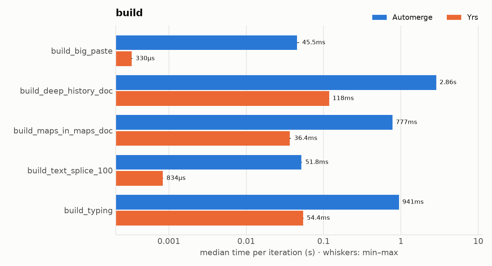

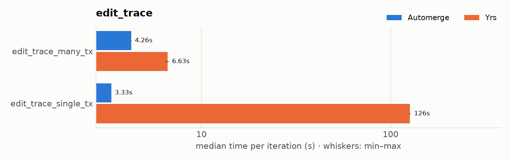

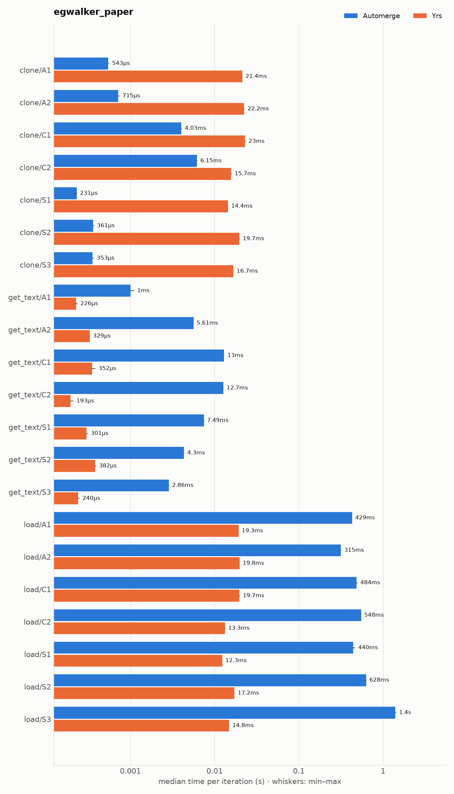

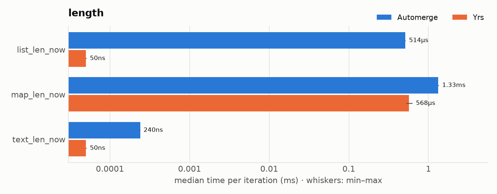

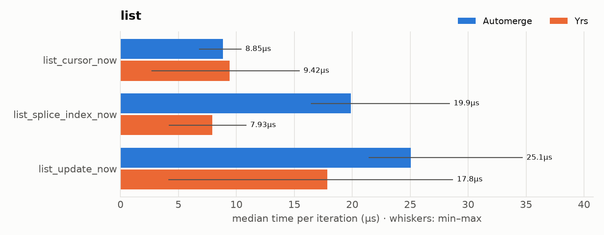

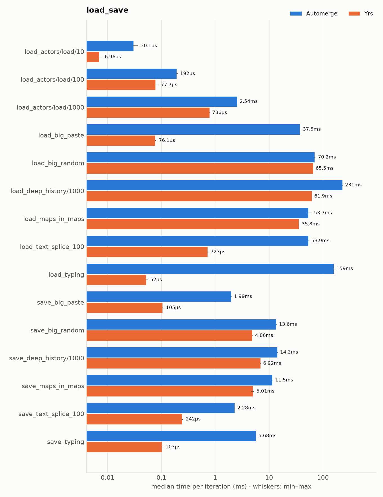

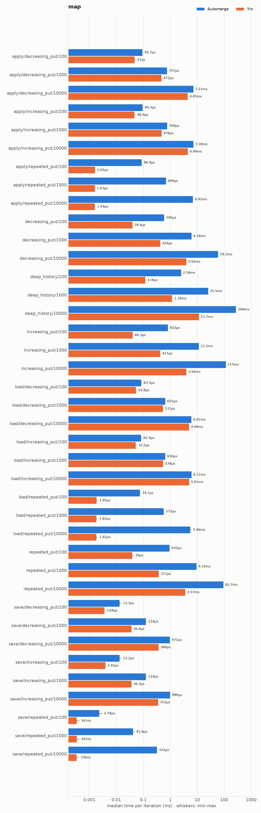

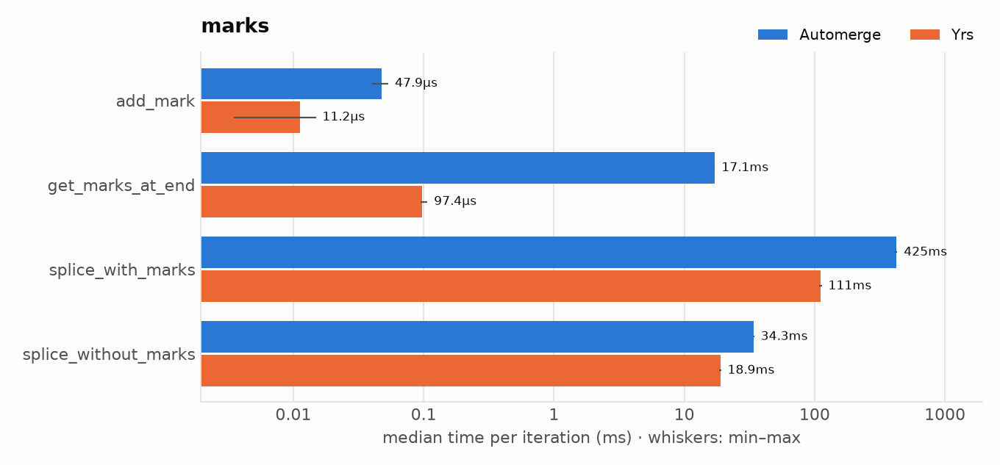

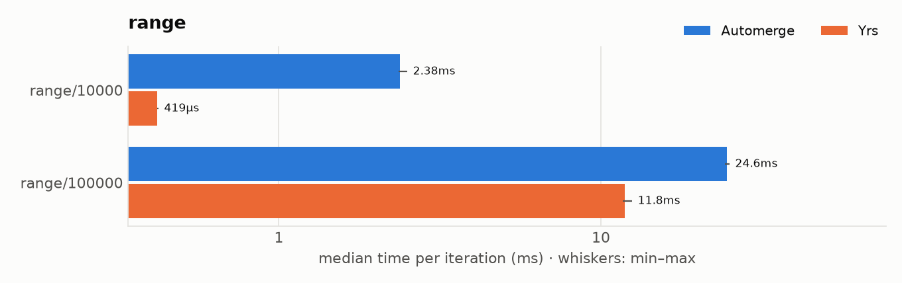

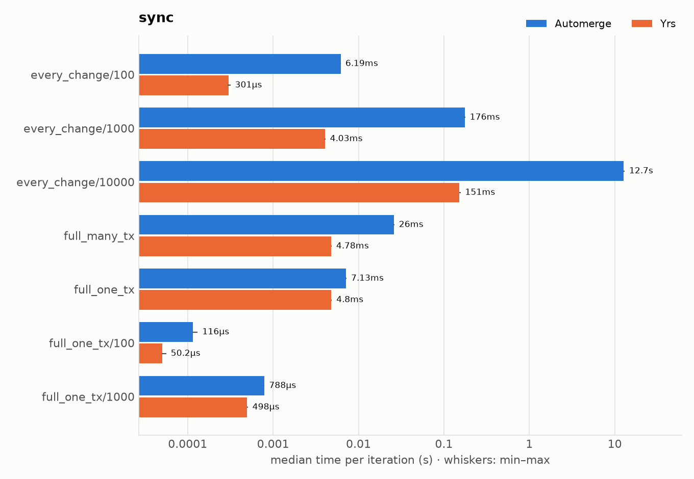

<!-- /figures:sampled -->

## Series benchmarks (total time over all steps)

| benchmark | automerge | yrs |
| --- | ---: | ---: |
| `apply/single_char_incremental_load` | 27.73s (10.7×) | **2.59s** (1.0×) |
| `sync/tiny_list` | 21.35s (746.0×) | **28.62ms** (1.0×) |
| `sync/tiny_text` | 25.71s (220.2×) | **116.74ms** (1.0×) |
| `typing/single_char_100_bulk_incremental_load` | **3.19s** (1.0×) | 15.76s (4.9×) |
| `typing/single_char_100_incremental_loads` | 293.60s (10.1×) | **29.14s** (1.0×) |
| `typing/single_char_apply_change` | 28.74s (19.2×) | **1.50s** (1.0×) |
| `typing/single_char_merge` | 28.12s (10.3×) | **2.72s** (1.0×) |
| `typing/single_char_sync` | 28.24s (6.0×) | **4.70s** (1.0×) |

## Peak memory

| benchmark | automerge | yrs |
| --- | ---: | ---: |
| `memory/clone/egwalker_paper/A1` | **2.73 MiB** (1.0×) | 11.72 MiB (4.3×) |
| `memory/clone/egwalker_paper/A2` | **5.25 MiB** (1.0×) | 9.44 MiB (1.8×) |
| `memory/clone/egwalker_paper/C1` | 15.38 MiB (1.1×) | **13.42 MiB** (1.0×) |
| `memory/clone/egwalker_paper/C2` | 24.20 MiB (2.7×) | **8.85 MiB** (1.0×) |
| `memory/clone/egwalker_paper/S1` | **1.30 MiB** (1.0×) | 8.68 MiB (6.7×) |
| `memory/clone/egwalker_paper/S2` | **1.83 MiB** (1.0×) | 10.83 MiB (5.9×) |
| `memory/clone/egwalker_paper/S3` | **2.59 MiB** (1.0×) | 11.11 MiB (4.3×) |
| `memory/load/big-paste` | 8.84 MiB (90.4×) | **100.09 KiB** (1.0×) |
| `memory/load/egwalker_paper/A1` | 91.32 MiB (8.5×) | **10.72 MiB** (1.0×) |
| `memory/load/egwalker_paper/A2` | 57.73 MiB (6.8×) | **8.44 MiB** (1.0×) |
| `memory/load/egwalker_paper/C1` | 180.91 MiB (15.8×) | **11.42 MiB** (1.0×) |
| `memory/load/egwalker_paper/C2` | 208.07 MiB (26.5×) | **7.85 MiB** (1.0×) |
| `memory/load/egwalker_paper/S1` | 234.70 MiB (30.6×) | **7.68 MiB** (1.0×) |
| `memory/load/egwalker_paper/S2` | 317.46 MiB (32.3×) | **9.83 MiB** (1.0×) |
| `memory/load/egwalker_paper/S3` | 680.13 MiB (67.3×) | **10.11 MiB** (1.0×) |
| `memory/load/text-splice-100` | 31.87 MiB (65.4×) | **499.04 KiB** (1.0×) |
| `memory/load/typing` | 92.61 MiB (947.5×) | **100.09 KiB** (1.0×) |

<!-- figures:memory-peak -->
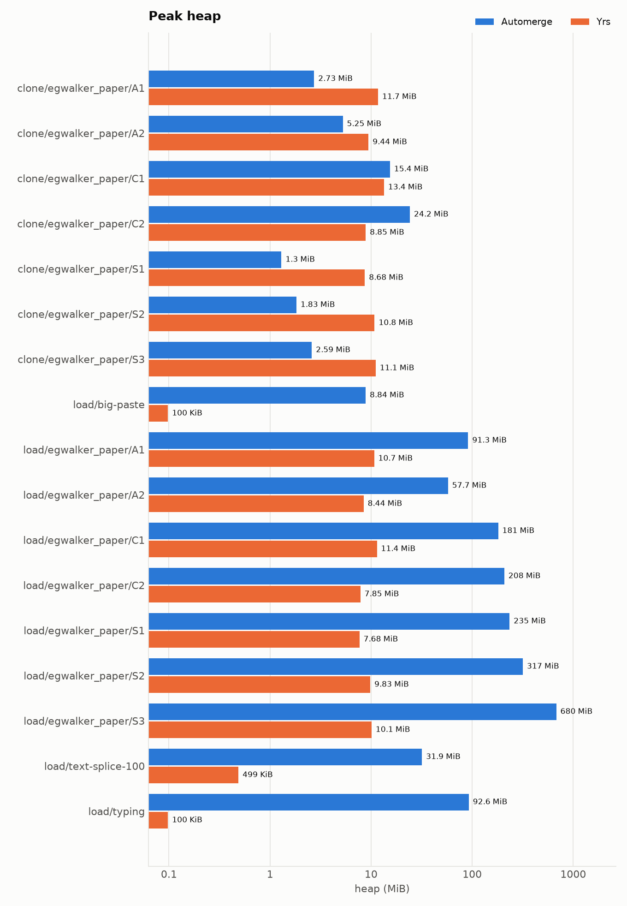

<!-- /figures:memory-peak -->

## Steady-state memory

| benchmark | automerge | yrs |
| --- | ---: | ---: |
| `memory/clone/egwalker_paper/A1` | **2.73 MiB** (1.0×) | 9.58 MiB (3.5×) |
| `memory/clone/egwalker_paper/A2` | **5.25 MiB** (1.0×) | 7.44 MiB (1.4×) |
| `memory/clone/egwalker_paper/C1` | 15.38 MiB (1.5×) | **9.97 MiB** (1.0×) |
| `memory/clone/egwalker_paper/C2` | 24.20 MiB (3.5×) | **6.87 MiB** (1.0×) |
| `memory/clone/egwalker_paper/S1` | **1.30 MiB** (1.0×) | 6.80 MiB (5.2×) |
| `memory/clone/egwalker_paper/S2` | **1.83 MiB** (1.0×) | 8.54 MiB (4.7×) |
| `memory/clone/egwalker_paper/S3` | **2.59 MiB** (1.0×) | 8.97 MiB (3.5×) |
| `memory/load/big-paste` | 109.57 KiB (1.1×) | **99.21 KiB** (1.0×) |
| `memory/load/egwalker_paper/A1` | **3.02 MiB** (1.0×) | 9.58 MiB (3.2×) |
| `memory/load/egwalker_paper/A2` | **5.49 MiB** (1.0×) | 7.44 MiB (1.4×) |
| `memory/load/egwalker_paper/C1` | 18.25 MiB (1.8×) | **9.97 MiB** (1.0×) |
| `memory/load/egwalker_paper/C2` | 30.31 MiB (4.4×) | **6.87 MiB** (1.0×) |
| `memory/load/egwalker_paper/S1` | **1.38 MiB** (1.0×) | 6.80 MiB (4.9×) |
| `memory/load/egwalker_paper/S2` | **2.01 MiB** (1.0×) | 8.54 MiB (4.2×) |
| `memory/load/egwalker_paper/S3` | **2.73 MiB** (1.0×) | 8.97 MiB (3.3×) |
| `memory/load/text-splice-100` | **149.02 KiB** (1.0×) | 452.28 KiB (3.0×) |
| `memory/load/typing` | 14.04 MiB (144.9×) | **99.21 KiB** (1.0×) |

<!-- figures:memory-steady -->
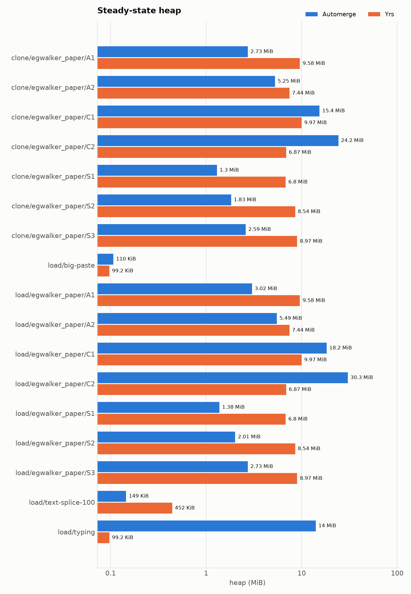

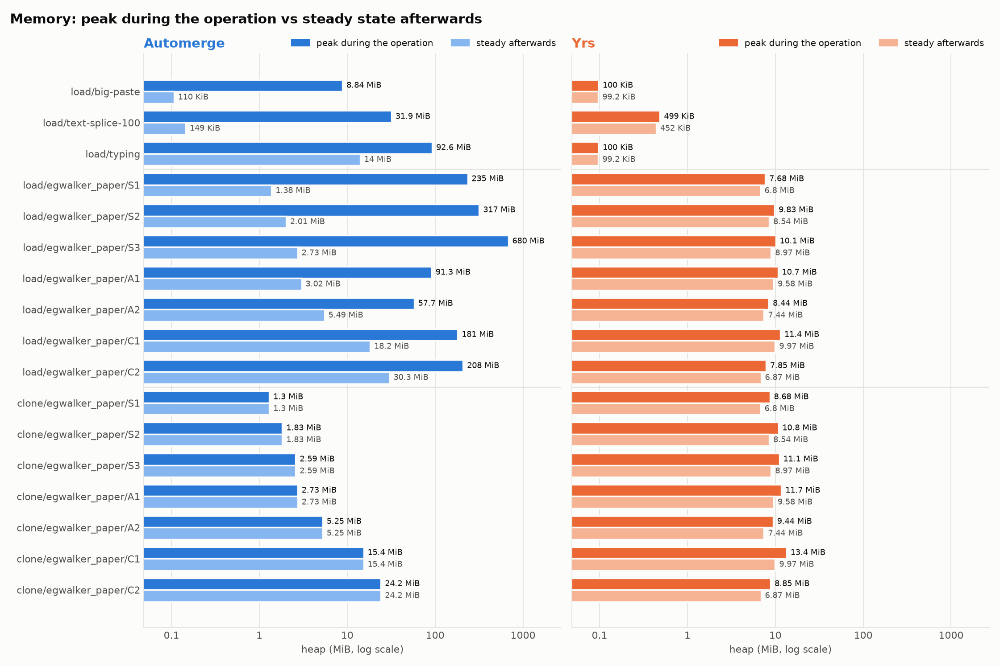

Peak against steady state, per library: a long dark bar over a short light one is memory the operation needed only while it ran.

<!-- /figures:memory-steady -->

## Series details

### `apply/single_char_incremental_load`

| library | total | median | mean | last-window median |
| --- | ---: | ---: | ---: | ---: |
| automerge | 27.73s | 27.77ms | 27.73ms | 27.19ms |
| yrs | 2.59s | 2.45ms | 2.59ms | 3.21ms |

<!-- figures:series:apply/single_char_incremental_load -->
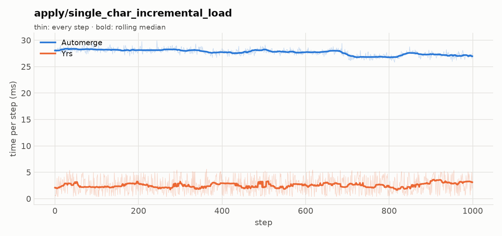

<!-- /figures:series:apply/single_char_incremental_load -->

### `sync/tiny_list`

| library | total | median | mean | last-window median |
| --- | ---: | ---: | ---: | ---: |
| automerge | 21.35s | 21.40ms | 21.35ms | 21.62ms |
| yrs | 28.62ms | 27.83µs | 28.62µs | 37.27µs |

<!-- figures:series:sync/tiny_list -->
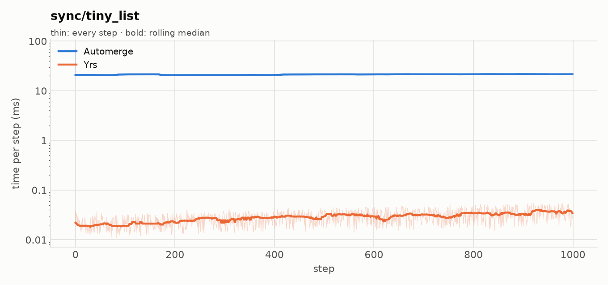

<!-- /figures:series:sync/tiny_list -->

### `sync/tiny_text`

| library | total | median | mean | last-window median |
| --- | ---: | ---: | ---: | ---: |
| automerge | 25.71s | 25.66ms | 25.71ms | 25.81ms |
| yrs | 116.74ms | 114.53µs | 116.74µs | 208.89µs |

<!-- figures:series:sync/tiny_text -->
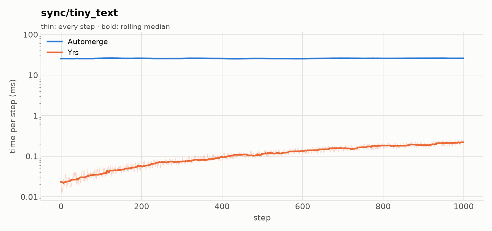

<!-- /figures:series:sync/tiny_text -->

### `typing/single_char_100_bulk_incremental_load`

| library | total | median | mean | last-window median |
| --- | ---: | ---: | ---: | ---: |
| automerge | 3.19s | 31.95ms | 31.94ms | 33.23ms |
| yrs | 15.76s | 158.61ms | 157.63ms | 164.74ms |

<!-- figures:series:typing/single_char_100_bulk_incremental_load -->
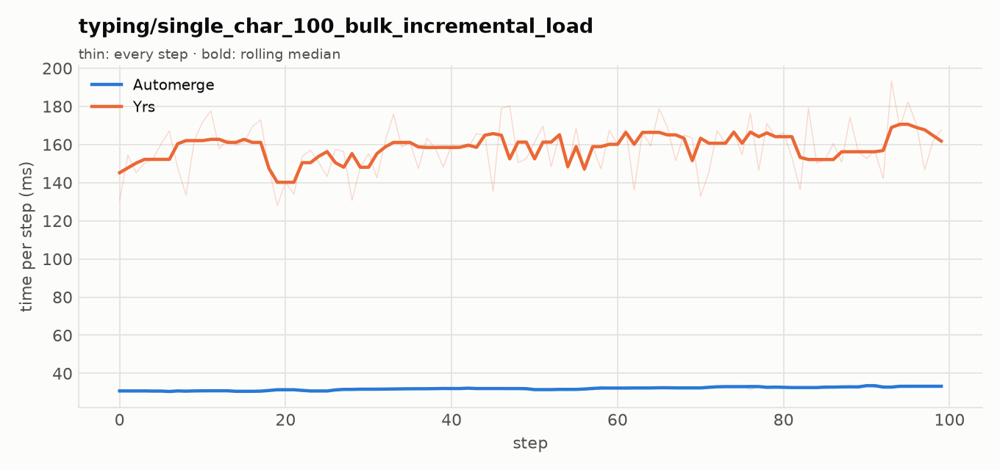

<!-- /figures:series:typing/single_char_100_bulk_incremental_load -->

#### Why Automerge wins this case (hand-written analysis, 2026-11-23)

This is the only series benchmark Automerge wins. It's also the only typing
case where local keystrokes outnumber transfers to the replica: each step
makes 100 local inserts and sends them in one change. Automerge is cheap per
keystroke and expensive per transfer; Yrs is the reverse.

**What a step does.** Setup (untimed) builds a 100k-character text with
`random_insert_text_doc(100_000, 1)` (100k one-character inserts at random
positions, in one transaction), forks it as the replica, and calls
`save_incremental` once. Each timed step then inserts `.` at 100 random
positions in one transaction, calls `save_incremental`, calls
`load_incremental` on the replica, and checks both sides have the same
version.

**Time per step, by phase.** Measured through crdt-bench's own adapters with
`profiling/typing-bulk-probe` (20 steps, mean). The totals match the median
times above.

| Phase, per step | Automerge | Yrs |
|---|---:|---:|
| 100 local inserts | 1.1 ms (11 µs each) | **153 ms (1.53 ms each)** |
| commit + `save_incremental` | 0.23 ms | 0.44 ms |
| `load_incremental` on the replica | **29.1 ms** | 0.26 ms |
| `same_version` check | ~0 | ~0 |
| **Total** | **30.5 ms** | **153.7 ms** |

- **Yrs walks the text on every insert.** `TextRef::insert` calls
  `find_position` (`yrs/src/types/text.rs:734`), which follows the item list
  from the start, counting lengths, until it reaches the index. That is 99.7%
  of insert time under callgrind. Because setup inserted every character at a
  random position, almost no inserts merge into runs, so the list has roughly
  100k items and a random insert walks about half of them. The cost depends on
  fragmentation: the same 100k characters appended in order are one Yrs item.
- **Automerge passes over the whole text for every applied change.**
  `load_incremental` reaches `BatchApply::apply`
  (`automerge/src/op_set2/change/batch.rs:865`). For each object the change
  touches, `walk_list` iterates the object's entire op range (about 100k ops),
  slotting the incoming ops into place and hydrating each value along the way.
  So the cost scales with the text's size, not the change's: one op
  (`single_char_apply_change`) and 100 ops (this case) both take about 29 ms.
  Local inserts don't go through this path; they use the op set's index.

**Why Automerge's local inserts are faster here: position lookup, not
splitting.** Both libraries have to find visible character `i` before
inserting:

- **Yrs:** walks the item list linearly from the first item.
- **Automerge:** `query_insert_at_text` calls `advance_prefix` on
  `index.text`, a hexane `PrefixColumn` of per-op visible widths. Its slabs
  sit in a `SlabBTree` whose nodes store subtree totals, so
  `find_slab_at_prefix` descends in O(log n), then scans within one slab.

Inserting at a fixed position in the same fragmented 100k text, one
transaction per insert, mean of 200 (`typing-bulk-probe pos`):

| Insert position | 0 | 1,000 | 25,000 | 50,000 | 75,000 | 99,000 |
|---|---:|---:|---:|---:|---:|---:|
| Automerge (µs) | 13.2 | 13.2 | 12.7 | 13.4 | 14.4 | 13.4 |
| Yrs (µs) | **0.7** | 5.6 | 364 | 879 | 2,270 | 4,165 |

- **Yrs's insert itself is cheap:** 0.7 µs at position 0, where there is
  nothing to walk, which is 19× faster than Automerge.
- **Yrs's cost is the walk to the position,** which grows with the number of
  items before it: about 15 ns per item at 25k, rising to about 40 ns per item
  near the end, as the walk outgrows the CPU caches.
- **Automerge pays a flat ~13 µs at every position.** That is a logarithmic
  lookup plus fixed per-insert work: splicing the op into each column's slab
  (and occasionally splitting a slab), and updating the B-tree totals.
- **Splitting isn't the difference.** Here Yrs items are almost all single
  characters, so a split is rare, and `split_block` is cheap when it happens.

The same per-insert costs show up in `build/build_typing` (appending in order,
so Yrs's walk is short): Automerge 9.4 µs per keystroke, Yrs 0.5 µs.

**Across the typing cases:**

| Case | Per step | Automerge | Yrs |
|---|---|---:|---:|
| `single_char_apply_change`, `_merge`, `_sync` | 1 insert + 1 transfer | ~28 ms | 1.3–4.8 ms |
| `single_char_100_incremental_loads` | 100 × (1 insert + 1 transfer) | 2.94 s | 292 ms |
| **`single_char_100_bulk_incremental_load`** | **100 inserts + 1 transfer** | **32 ms** | **159 ms** |

On this document the break-even is about 29 ms ÷ 1.5 ms ≈ 20 inserts per
transferred change. Below that Yrs wins; above it Automerge wins. Both costs
grow with document size: Yrs's with the number of items before the insert
position, Automerge's with the size of the object that receives the change.

### `typing/single_char_100_incremental_loads`

| library | total | median | mean | last-window median |
| --- | ---: | ---: | ---: | ---: |
| automerge | 293.60s | 2.94s | 2.94s | 3.06s |
| yrs | 29.14s | 292.38ms | 291.43ms | 308.01ms |

<!-- figures:series:typing/single_char_100_incremental_loads -->
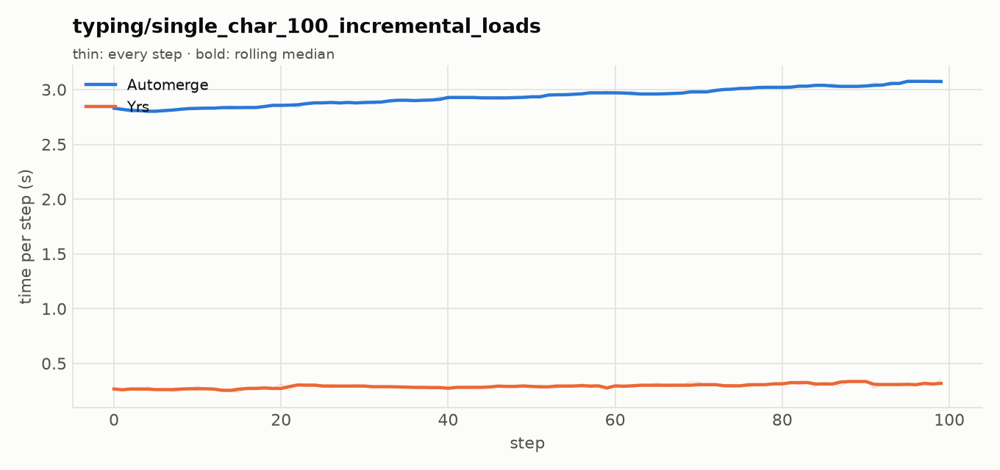

<!-- /figures:series:typing/single_char_100_incremental_loads -->

### `typing/single_char_apply_change`

| library | total | median | mean | last-window median |
| --- | ---: | ---: | ---: | ---: |
| automerge | 28.74s | 28.76ms | 28.74ms | 28.81ms |
| yrs | 1.50s | 1.34ms | 1.50ms | 1.32ms |

<!-- figures:series:typing/single_char_apply_change -->
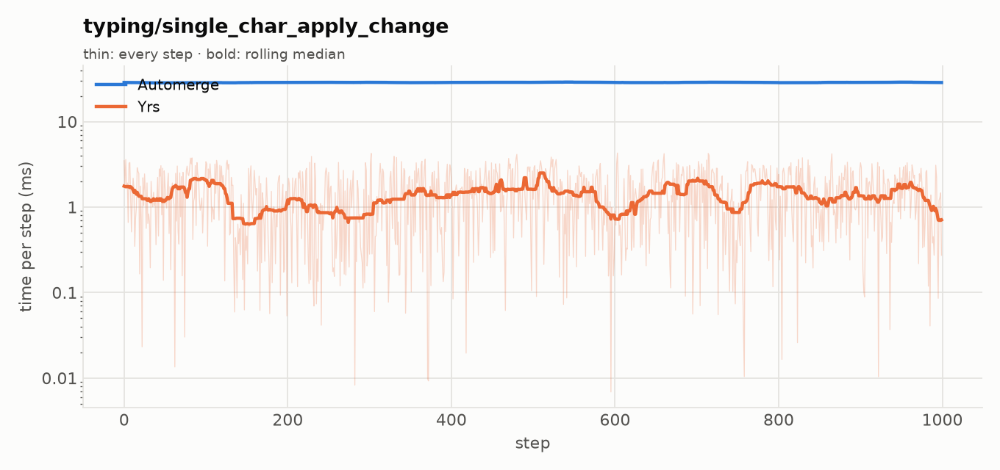

<!-- /figures:series:typing/single_char_apply_change -->

### `typing/single_char_merge`

| library | total | median | mean | last-window median |
| --- | ---: | ---: | ---: | ---: |
| automerge | 28.12s | 28.11ms | 28.12ms | 28.27ms |
| yrs | 2.72s | 2.70ms | 2.72ms | 2.66ms |

<!-- figures:series:typing/single_char_merge -->
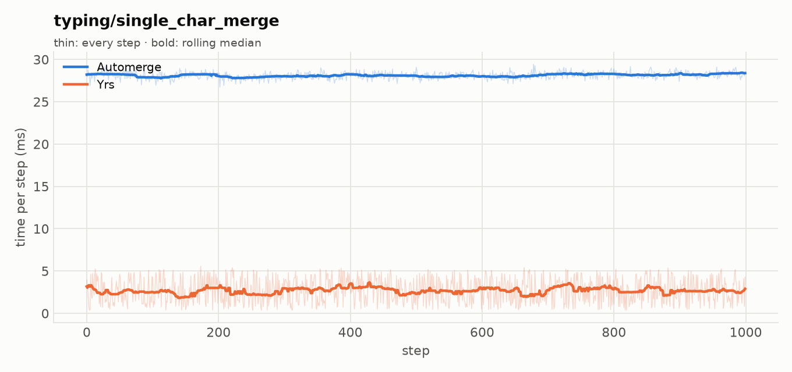

<!-- /figures:series:typing/single_char_merge -->

### `typing/single_char_sync`

| library | total | median | mean | last-window median |
| --- | ---: | ---: | ---: | ---: |
| automerge | 28.24s | 28.18ms | 28.24ms | 28.26ms |
| yrs | 4.70s | 4.78ms | 4.70ms | 4.50ms |

<!-- figures:series:typing/single_char_sync -->
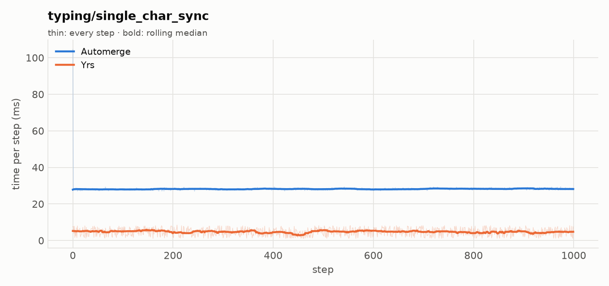

<!-- /figures:series:typing/single_char_sync -->

## Not runnable

| benchmark | library | reason |
| --- | --- | --- |
| `bestiary/fork/godot-modeled` | automerge | not ported yet: needs real-world fixtures for every library (docs/tickets/3-fixtures.md) |
| `bestiary/fork/godot-modeled` | yrs | not ported yet: needs real-world fixtures for every library (docs/tickets/3-fixtures.md) |
| `bestiary/fork/godot-thread` | automerge | not ported yet: needs real-world fixtures for every library (docs/tickets/3-fixtures.md) |
| `bestiary/fork/godot-thread` | yrs | not ported yet: needs real-world fixtures for every library (docs/tickets/3-fixtures.md) |
| `bestiary/iter/godot-modeled` | automerge | not ported yet: needs real-world fixtures for every library (docs/tickets/3-fixtures.md) |
| `bestiary/iter/godot-modeled` | yrs | not ported yet: needs real-world fixtures for every library (docs/tickets/3-fixtures.md) |
| `bestiary/iter/godot-thread` | automerge | not ported yet: needs real-world fixtures for every library (docs/tickets/3-fixtures.md) |
| `bestiary/iter/godot-thread` | yrs | not ported yet: needs real-world fixtures for every library (docs/tickets/3-fixtures.md) |
| `bestiary/load/godot-modeled` | automerge | not ported yet: needs real-world fixtures for every library (docs/tickets/3-fixtures.md) |
| `bestiary/load/godot-modeled` | yrs | not ported yet: needs real-world fixtures for every library (docs/tickets/3-fixtures.md) |
| `bestiary/load/godot-thread` | automerge | not ported yet: needs real-world fixtures for every library (docs/tickets/3-fixtures.md) |
| `bestiary/load/godot-thread` | yrs | not ported yet: needs real-world fixtures for every library (docs/tickets/3-fixtures.md) |
| `bestiary/reload/godot-modeled` | automerge | not ported yet: needs real-world fixtures for every library (docs/tickets/3-fixtures.md) |
| `bestiary/reload/godot-modeled` | yrs | not ported yet: needs real-world fixtures for every library (docs/tickets/3-fixtures.md) |
| `bestiary/reload/godot-thread` | automerge | not ported yet: needs real-world fixtures for every library (docs/tickets/3-fixtures.md) |
| `bestiary/reload/godot-thread` | yrs | not ported yet: needs real-world fixtures for every library (docs/tickets/3-fixtures.md) |
| `bestiary/save/godot-modeled` | automerge | not ported yet: needs real-world fixtures for every library (docs/tickets/3-fixtures.md) |
| `bestiary/save/godot-modeled` | yrs | not ported yet: needs real-world fixtures for every library (docs/tickets/3-fixtures.md) |
| `bestiary/save/godot-thread` | automerge | not ported yet: needs real-world fixtures for every library (docs/tickets/3-fixtures.md) |
| `bestiary/save/godot-thread` | yrs | not ported yet: needs real-world fixtures for every library (docs/tickets/3-fixtures.md) |
| `diff/diff` | automerge | not ported yet: needs real-world fixtures for every library (docs/tickets/3-fixtures.md) |
| `diff/diff` | yrs | not ported yet: needs real-world fixtures for every library (docs/tickets/3-fixtures.md) |
| `egwalker_paper/apply_fragment_to_clone/A1` | automerge | not ported yet: needs an Automerge-only feature (docs/tickets/2-automerge-only.md) |
| `egwalker_paper/apply_fragment_to_clone/A1` | yrs | not ported yet: needs an Automerge-only feature (docs/tickets/2-automerge-only.md) |
| `egwalker_paper/apply_fragment_to_clone/A2` | automerge | not ported yet: needs an Automerge-only feature (docs/tickets/2-automerge-only.md) |
| `egwalker_paper/apply_fragment_to_clone/A2` | yrs | not ported yet: needs an Automerge-only feature (docs/tickets/2-automerge-only.md) |
| `egwalker_paper/apply_fragment_to_clone/C1` | automerge | not ported yet: needs an Automerge-only feature (docs/tickets/2-automerge-only.md) |
| `egwalker_paper/apply_fragment_to_clone/C1` | yrs | not ported yet: needs an Automerge-only feature (docs/tickets/2-automerge-only.md) |
| `egwalker_paper/apply_fragment_to_clone/C2` | automerge | not ported yet: needs an Automerge-only feature (docs/tickets/2-automerge-only.md) |
| `egwalker_paper/apply_fragment_to_clone/C2` | yrs | not ported yet: needs an Automerge-only feature (docs/tickets/2-automerge-only.md) |
| `egwalker_paper/apply_fragment_to_clone/S1` | automerge | not ported yet: needs an Automerge-only feature (docs/tickets/2-automerge-only.md) |
| `egwalker_paper/apply_fragment_to_clone/S1` | yrs | not ported yet: needs an Automerge-only feature (docs/tickets/2-automerge-only.md) |
| `egwalker_paper/apply_fragment_to_clone/S2` | automerge | not ported yet: needs an Automerge-only feature (docs/tickets/2-automerge-only.md) |
| `egwalker_paper/apply_fragment_to_clone/S2` | yrs | not ported yet: needs an Automerge-only feature (docs/tickets/2-automerge-only.md) |
| `egwalker_paper/apply_fragment_to_clone/S3` | automerge | not ported yet: needs an Automerge-only feature (docs/tickets/2-automerge-only.md) |
| `egwalker_paper/apply_fragment_to_clone/S3` | yrs | not ported yet: needs an Automerge-only feature (docs/tickets/2-automerge-only.md) |
| `length/map_len_at` | automerge | not ported yet: needs an Automerge-only feature (docs/tickets/2-automerge-only.md) |
| `length/map_len_at` | yrs | not ported yet: needs an Automerge-only feature (docs/tickets/2-automerge-only.md) |
| `length/text_len_at` | automerge | not ported yet: needs an Automerge-only feature (docs/tickets/2-automerge-only.md) |
| `length/text_len_at` | yrs | not ported yet: needs an Automerge-only feature (docs/tickets/2-automerge-only.md) |
| `list/list_cursor_at` | automerge | not ported yet: needs an Automerge-only feature (docs/tickets/2-automerge-only.md) |
| `list/list_cursor_at` | yrs | not ported yet: needs an Automerge-only feature (docs/tickets/2-automerge-only.md) |
| `list/list_splice_index_at` | automerge | not ported yet: needs an Automerge-only feature (docs/tickets/2-automerge-only.md) |
| `list/list_splice_index_at` | yrs | not ported yet: needs an Automerge-only feature (docs/tickets/2-automerge-only.md) |
| `list/list_update_at` | automerge | not ported yet: needs an Automerge-only feature (docs/tickets/2-automerge-only.md) |
| `list/list_update_at` | yrs | not ported yet: needs an Automerge-only feature (docs/tickets/2-automerge-only.md) |
| `load_save/load_actors/load_masked_half/10` | automerge | not ported yet: needs an Automerge-only feature (docs/tickets/2-automerge-only.md) |
| `load_save/load_actors/load_masked_half/10` | yrs | not ported yet: needs an Automerge-only feature (docs/tickets/2-automerge-only.md) |
| `load_save/load_actors/load_masked_half/100` | automerge | not ported yet: needs an Automerge-only feature (docs/tickets/2-automerge-only.md) |
| `load_save/load_actors/load_masked_half/100` | yrs | not ported yet: needs an Automerge-only feature (docs/tickets/2-automerge-only.md) |
| `load_save/load_actors/load_masked_half/1000` | automerge | not ported yet: needs an Automerge-only feature (docs/tickets/2-automerge-only.md) |
| `load_save/load_actors/load_masked_half/1000` | yrs | not ported yet: needs an Automerge-only feature (docs/tickets/2-automerge-only.md) |
| `map/apply/repeated_increment/100` | automerge | not ported yet: needs an Automerge-only feature (docs/tickets/2-automerge-only.md) |
| `map/apply/repeated_increment/100` | yrs | not ported yet: needs an Automerge-only feature (docs/tickets/2-automerge-only.md) |
| `map/apply/repeated_increment/1000` | automerge | not ported yet: needs an Automerge-only feature (docs/tickets/2-automerge-only.md) |
| `map/apply/repeated_increment/1000` | yrs | not ported yet: needs an Automerge-only feature (docs/tickets/2-automerge-only.md) |
| `map/apply/repeated_increment/10000` | automerge | not ported yet: needs an Automerge-only feature (docs/tickets/2-automerge-only.md) |
| `map/apply/repeated_increment/10000` | yrs | not ported yet: needs an Automerge-only feature (docs/tickets/2-automerge-only.md) |
| `map/load/repeated_increment/100` | automerge | not ported yet: needs an Automerge-only feature (docs/tickets/2-automerge-only.md) |
| `map/load/repeated_increment/100` | yrs | not ported yet: needs an Automerge-only feature (docs/tickets/2-automerge-only.md) |
| `map/load/repeated_increment/1000` | automerge | not ported yet: needs an Automerge-only feature (docs/tickets/2-automerge-only.md) |
| `map/load/repeated_increment/1000` | yrs | not ported yet: needs an Automerge-only feature (docs/tickets/2-automerge-only.md) |
| `map/load/repeated_increment/10000` | automerge | not ported yet: needs an Automerge-only feature (docs/tickets/2-automerge-only.md) |
| `map/load/repeated_increment/10000` | yrs | not ported yet: needs an Automerge-only feature (docs/tickets/2-automerge-only.md) |
| `map/repeated_increment/100` | automerge | not ported yet: needs an Automerge-only feature (docs/tickets/2-automerge-only.md) |
| `map/repeated_increment/100` | yrs | not ported yet: needs an Automerge-only feature (docs/tickets/2-automerge-only.md) |
| `map/repeated_increment/1000` | automerge | not ported yet: needs an Automerge-only feature (docs/tickets/2-automerge-only.md) |
| `map/repeated_increment/1000` | yrs | not ported yet: needs an Automerge-only feature (docs/tickets/2-automerge-only.md) |
| `map/repeated_increment/10000` | automerge | not ported yet: needs an Automerge-only feature (docs/tickets/2-automerge-only.md) |
| `map/repeated_increment/10000` | yrs | not ported yet: needs an Automerge-only feature (docs/tickets/2-automerge-only.md) |
| `map/save/repeated_increment/100` | automerge | not ported yet: needs an Automerge-only feature (docs/tickets/2-automerge-only.md) |
| `map/save/repeated_increment/100` | yrs | not ported yet: needs an Automerge-only feature (docs/tickets/2-automerge-only.md) |
| `map/save/repeated_increment/1000` | automerge | not ported yet: needs an Automerge-only feature (docs/tickets/2-automerge-only.md) |
| `map/save/repeated_increment/1000` | yrs | not ported yet: needs an Automerge-only feature (docs/tickets/2-automerge-only.md) |
| `map/save/repeated_increment/10000` | automerge | not ported yet: needs an Automerge-only feature (docs/tickets/2-automerge-only.md) |
| `map/save/repeated_increment/10000` | yrs | not ported yet: needs an Automerge-only feature (docs/tickets/2-automerge-only.md) |
| `memory/load/essay` | automerge | not ported yet: needs real-world fixtures for every library (docs/tickets/3-fixtures.md) |
| `memory/load/essay` | yrs | not ported yet: needs real-world fixtures for every library (docs/tickets/3-fixtures.md) |
| `memory/load/moby-dick` | automerge | not ported yet: needs real-world fixtures for every library (docs/tickets/3-fixtures.md) |
| `memory/load/moby-dick` | yrs | not ported yet: needs real-world fixtures for every library (docs/tickets/3-fixtures.md) |
| `memory/load/monday-meeting-notes` | automerge | not ported yet: needs real-world fixtures for every library (docs/tickets/3-fixtures.md) |
| `memory/load/monday-meeting-notes` | yrs | not ported yet: needs real-world fixtures for every library (docs/tickets/3-fixtures.md) |
| `memory/load/pathological` | automerge | not ported yet: needs real-world fixtures for every library (docs/tickets/3-fixtures.md) |
| `memory/load/pathological` | yrs | not ported yet: needs real-world fixtures for every library (docs/tickets/3-fixtures.md) |
| `memory/load/stephen` | automerge | not ported yet: needs real-world fixtures for every library (docs/tickets/3-fixtures.md) |
| `memory/load/stephen` | yrs | not ported yet: needs real-world fixtures for every library (docs/tickets/3-fixtures.md) |
| `memory/load/unsinkable` | automerge | not ported yet: needs real-world fixtures for every library (docs/tickets/3-fixtures.md) |
| `memory/load/unsinkable` | yrs | not ported yet: needs real-world fixtures for every library (docs/tickets/3-fixtures.md) |
| `memory/load/webstraits` | automerge | not ported yet: needs real-world fixtures for every library (docs/tickets/3-fixtures.md) |
| `memory/load/webstraits` | yrs | not ported yet: needs real-world fixtures for every library (docs/tickets/3-fixtures.md) |
| `range/range_at/10000` | automerge | not ported yet: needs an Automerge-only feature (docs/tickets/2-automerge-only.md) |
| `range/range_at/10000` | yrs | not ported yet: needs an Automerge-only feature (docs/tickets/2-automerge-only.md) |
| `range/range_at/100000` | automerge | not ported yet: needs an Automerge-only feature (docs/tickets/2-automerge-only.md) |
| `range/range_at/100000` | yrs | not ported yet: needs an Automerge-only feature (docs/tickets/2-automerge-only.md) |
| `sync/big_chunky_sync_message` | automerge | not ported yet: needs an Automerge-only feature (docs/tickets/2-automerge-only.md) |
| `sync/big_chunky_sync_message` | yrs | not ported yet: needs an Automerge-only feature (docs/tickets/2-automerge-only.md) |

