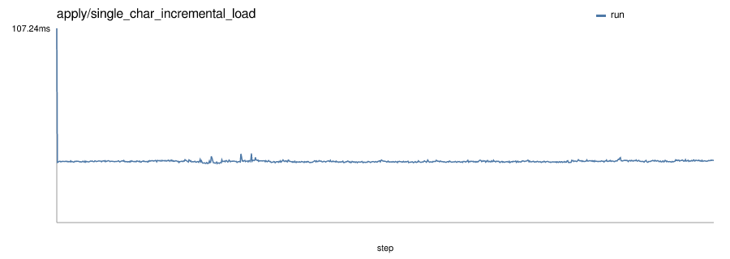
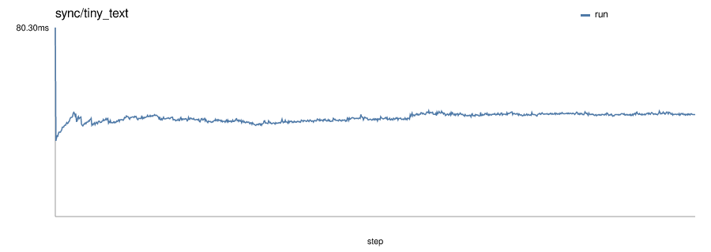
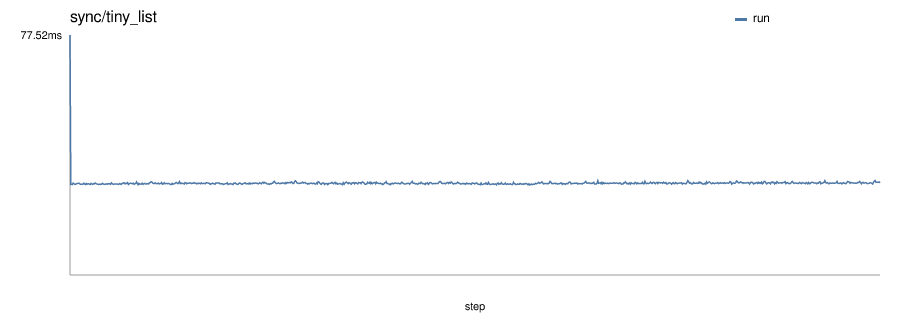
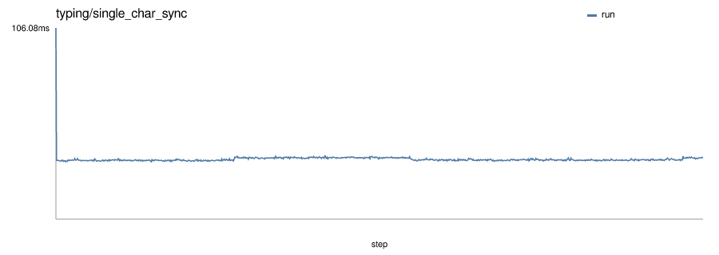
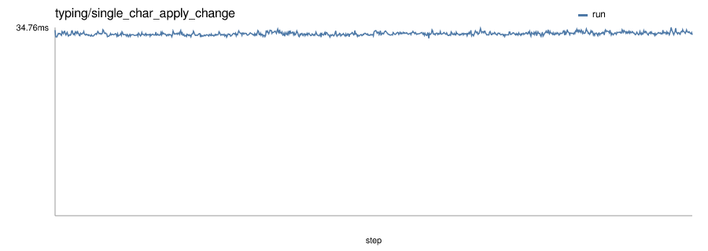
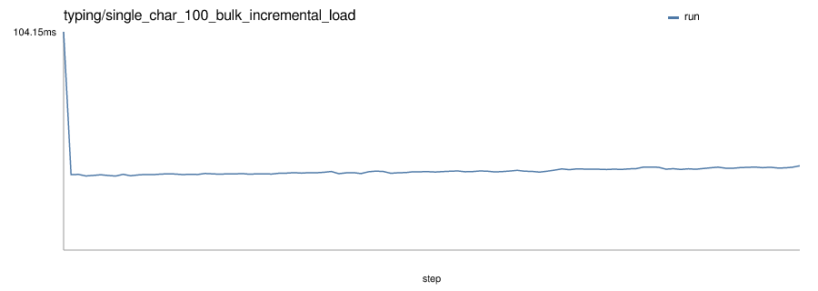
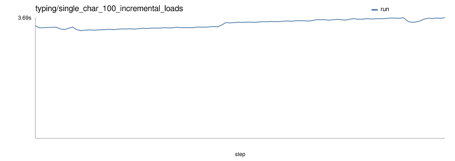
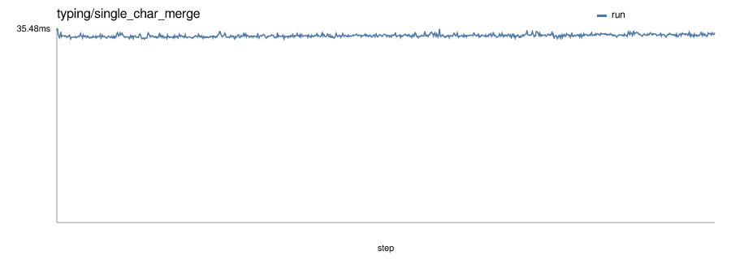

# Automerge battery run

## Sampled benchmarks

| benchmark | median | mean | min | max |
| --- | ---: | ---: | ---: | ---: |
| `bestiary/load/godot-modeled` | 73.62ms | 73.65ms | 73.35ms | 73.95ms |
| `bestiary/reload/godot-modeled` | 73.62ms | 73.76ms | 73.38ms | 74.34ms |
| `bestiary/fork/godot-modeled` | 4.19ms | 4.19ms | 4.17ms | 4.22ms |
| `bestiary/save/godot-modeled` | 4.06ms | 4.06ms | 4.03ms | 4.09ms |
| `bestiary/iter/godot-modeled` | 10.09ms | 10.09ms | 10.05ms | 10.16ms |
| `bestiary/load/godot-thread` | 4.07s | 4.07s | 4.06s | 4.09s |
| `bestiary/reload/godot-thread` | 4.04s | 4.04s | 4.01s | 4.06s |
| `bestiary/fork/godot-thread` | 135.25ms | 135.27ms | 134.91ms | 136.05ms |
| `bestiary/save/godot-thread` | 135.82ms | 135.93ms | 135.05ms | 137.23ms |
| `bestiary/iter/godot-thread` | 305.46ms | 305.58ms | 302.07ms | 309.67ms |
| `build/build_typing` | 818.90ms | 818.36ms | 812.61ms | 824.14ms |
| `build/build_big_paste` | 44.21ms | 44.25ms | 44.02ms | 44.56ms |
| `build/build_text_splice_100` | 47.05ms | 47.07ms | 46.82ms | 47.47ms |
| `build/build_maps_in_maps_doc` | 637.95ms | 637.90ms | 635.44ms | 639.83ms |
| `build/build_deep_history_doc` | 2.41s | 2.41s | 2.39s | 2.42s |
| `diff/diff` | 97.81ms | 101.78ms | 87.35ms | 120.98ms |
| `edit_trace/edit_trace_single_tx` | 2.55s | 2.55s | 2.54s | 2.56s |
| `edit_trace/edit_trace_many_tx` | 3.63s | 3.61s | 3.55s | 3.65s |
| `egwalker_paper/load/S1` | 431.92ms | 431.11ms | 420.40ms | 433.71ms |
| `egwalker_paper/get_text/S1` | 8.05ms | 8.07ms | 7.94ms | 8.18ms |
| `egwalker_paper/clone/S1` | 200.00µs | 199.96µs | 195.75µs | 204.30µs |
| `egwalker_paper/apply_fragment_to_clone/S1` | 4.99µs | 4.99µs | 4.71µs | 5.49µs |
| `egwalker_paper/load/S3` | 1.39s | 1.40s | 1.39s | 1.42s |
| `egwalker_paper/get_text/S3` | 3.22ms | 3.20ms | 3.12ms | 3.24ms |
| `egwalker_paper/clone/S3` | 354.41µs | 354.99µs | 352.27µs | 362.99µs |
| `egwalker_paper/apply_fragment_to_clone/S3` | 5.13µs | 5.16µs | 4.87µs | 5.58µs |
| `egwalker_paper/load/A1` | 428.20ms | 427.99ms | 426.35ms | 428.74ms |
| `egwalker_paper/get_text/A1` | 1.03ms | 1.03ms | 1.02ms | 1.04ms |
| `egwalker_paper/clone/A1` | 475.87µs | 477.41µs | 471.45µs | 487.96µs |
| `egwalker_paper/apply_fragment_to_clone/A1` | 75.26µs | 76.85µs | 74.26µs | 85.61µs |
| `egwalker_paper/load/A2` | 315.11ms | 315.02ms | 314.44ms | 315.41ms |
| `egwalker_paper/get_text/A2` | 5.90ms | 5.92ms | 5.86ms | 6.00ms |
| `egwalker_paper/clone/A2` | 691.44µs | 691.21µs | 674.73µs | 712.71µs |
| `egwalker_paper/apply_fragment_to_clone/A2` | 375.81µs | 390.62µs | 373.05µs | 495.25µs |
| `egwalker_paper/load/C1` | 477.07ms | 476.84ms | 474.31ms | 479.67ms |
| `egwalker_paper/get_text/C1` | 13.24ms | 13.24ms | 13.13ms | 13.35ms |
| `egwalker_paper/clone/C1` | 3.84ms | 3.85ms | 3.81ms | 3.89ms |
| `egwalker_paper/apply_fragment_to_clone/C1` | 998.53µs | 1.00ms | 991.86µs | 1.03ms |
| `egwalker_paper/load/C2` | 530.81ms | 530.37ms | 526.37ms | 534.73ms |
| `egwalker_paper/get_text/C2` | 12.68ms | 12.68ms | 12.62ms | 12.74ms |
| `egwalker_paper/clone/C2` | 5.88ms | 5.88ms | 5.67ms | 5.97ms |
| `egwalker_paper/apply_fragment_to_clone/C2` | 2.45ms | 2.45ms | 2.41ms | 2.49ms |
| `length/text_len_now` | 210ns | 216ns | 210ns | 271ns |
| `length/list_len_now` | 430.03µs | 429.63µs | 425.77µs | 433.89µs |
| `length/text_len_at` | 8.49ms | 8.46ms | 8.31ms | 8.62ms |
| `length/map_len_now` | 1.52ms | 1.52ms | 1.51ms | 1.54ms |
| `length/map_len_at` | 5.97ms | 5.97ms | 5.94ms | 6.02ms |
| `list/list_cursor_now` | 7.09µs | 8.02µs | 5.33µs | 13.55µs |
| `list/list_cursor_at` | 24.24ms | 26.20ms | 11.77ms | 46.44ms |
| `list/list_update_at` | 12.40ms | 11.69ms | 3.27ms | 20.28ms |
| `list/list_update_now` | 19.29µs | 19.59µs | 16.32µs | 23.17µs |
| `list/list_splice_index_now` | 15.58µs | 15.42µs | 13.04µs | 16.64µs |
| `list/list_splice_index_at` | 9.32ms | 10.02ms | 2.31ms | 15.22ms |
| `load_save/load_typing` | 150.11ms | 150.23ms | 149.72ms | 151.60ms |
| `load_save/save_typing` | 4.97ms | 4.97ms | 4.93ms | 4.99ms |
| `load_save/load_big_paste` | 35.84ms | 35.88ms | 35.50ms | 36.64ms |
| `load_save/save_big_paste` | 1.68ms | 1.68ms | 1.67ms | 1.69ms |
| `load_save/load_deep_history/1000` | 225.07ms | 225.62ms | 223.65ms | 227.85ms |
| `load_save/save_deep_history/1000` | 13.99ms | 14.01ms | 13.94ms | 14.22ms |
| `load_save/load_text_splice_100` | 54.09ms | 54.12ms | 53.61ms | 54.87ms |
| `load_save/save_text_splice_100` | 2.05ms | 2.05ms | 2.04ms | 2.07ms |
| `load_save/load_maps_in_maps` | 51.42ms | 51.41ms | 51.14ms | 51.74ms |
| `load_save/save_maps_in_maps` | 10.32ms | 10.33ms | 10.31ms | 10.37ms |
| `load_save/load_big_random` | 69.41ms | 69.41ms | 67.77ms | 71.72ms |
| `load_save/save_big_random` | 12.07ms | 12.04ms | 11.88ms | 12.16ms |
| `load_actors/load/10` | 29.27µs | 31.43µs | 28.05µs | 39.15µs |
| `load_actors/load_masked_half/10` | 31.37µs | 31.96µs | 31.14µs | 36.03µs |
| `load_actors/load/100` | 213.00µs | 213.06µs | 209.33µs | 217.99µs |
| `load_actors/load_masked_half/100` | 369.12µs | 368.85µs | 363.50µs | 373.77µs |
| `load_actors/load/1000` | 3.50ms | 3.50ms | 3.47ms | 3.54ms |
| `load_actors/load_masked_half/1000` | 18.82ms | 18.85ms | 18.72ms | 19.12ms |
| `map/repeated_increment/100` | 824.47µs | 828.84µs | 817.08µs | 843.45µs |
| `map/save/repeated_increment/100` | 2.57µs | 2.60µs | 2.46µs | 3.00µs |
| `map/load/repeated_increment/100` | 80.52µs | 81.73µs | 79.71µs | 87.03µs |
| `map/apply/repeated_increment/100` | 62.70µs | 63.38µs | 61.75µs | 67.34µs |
| `map/repeated_put/100` | 773.79µs | 776.59µs | 765.37µs | 800.65µs |
| `map/save/repeated_put/100` | 2.34µs | 2.38µs | 2.22µs | 2.67µs |
| `map/load/repeated_put/100` | 66.71µs | 67.49µs | 66.11µs | 72.95µs |
| `map/apply/repeated_put/100` | 66.82µs | 67.72µs | 66.23µs | 71.62µs |
| `map/increasing_put/100` | 658.64µs | 660.06µs | 649.62µs | 677.35µs |
| `map/save/increasing_put/100` | 13.63µs | 13.85µs | 13.46µs | 15.48µs |
| `map/load/increasing_put/100` | 70.11µs | 70.81µs | 69.89µs | 75.49µs |
| `map/apply/increasing_put/100` | 73.87µs | 74.61µs | 73.26µs | 79.10µs |
| `map/decreasing_put/100` | 488.12µs | 489.84µs | 478.55µs | 511.41µs |
| `map/save/decreasing_put/100` | 14.02µs | 14.05µs | 13.62µs | 15.16µs |
| `map/load/decreasing_put/100` | 72.47µs | 72.95µs | 71.62µs | 76.16µs |
| `map/apply/decreasing_put/100` | 72.01µs | 72.94µs | 71.20µs | 77.73µs |
| `map/deep_history/100` | 2.13ms | 2.13ms | 2.12ms | 2.15ms |
| `map/repeated_increment/1000` | 16.57ms | 16.56ms | 16.25ms | 17.05ms |
| `map/save/repeated_increment/1000` | 10.29µs | 10.41µs | 9.89µs | 11.75µs |
| `map/load/repeated_increment/1000` | 641.94µs | 643.44µs | 635.92µs | 658.49µs |
| `map/apply/repeated_increment/1000` | 498.39µs | 497.75µs | 489.37µs | 505.89µs |
| `map/repeated_put/1000` | 7.68ms | 7.68ms | 7.66ms | 7.73ms |
| `map/save/repeated_put/1000` | 40.47µs | 41.16µs | 39.90µs | 45.72µs |
| `map/load/repeated_put/1000` | 526.73µs | 528.06µs | 523.87µs | 536.76µs |
| `map/apply/repeated_put/1000` | 535.24µs | 536.26µs | 531.85µs | 543.18µs |
| `map/increasing_put/1000` | 8.55ms | 8.51ms | 8.41ms | 8.56ms |
| `map/save/increasing_put/1000` | 123.64µs | 125.10µs | 121.22µs | 131.10µs |
| `map/load/increasing_put/1000` | 602.06µs | 602.04µs | 596.39µs | 609.82µs |
| `map/apply/increasing_put/1000` | 605.78µs | 616.41µs | 599.58µs | 670.41µs |
| `map/decreasing_put/1000` | 4.94ms | 4.94ms | 4.91ms | 4.98ms |
| `map/save/decreasing_put/1000` | 119.58µs | 121.48µs | 117.99µs | 130.12µs |
| `map/load/decreasing_put/1000` | 594.47µs | 595.27µs | 587.95µs | 606.61µs |
| `map/apply/decreasing_put/1000` | 601.00µs | 601.51µs | 595.39µs | 608.74µs |
| `map/deep_history/1000` | 21.60ms | 21.61ms | 21.50ms | 21.79ms |
| `map/repeated_increment/10000` | 988.23ms | 988.95ms | 961.32ms | 1.01s |
| `map/save/repeated_increment/10000` | 17.20µs | 17.47µs | 17.06µs | 19.06µs |
| `map/load/repeated_increment/10000` | 6.20ms | 6.20ms | 6.15ms | 6.23ms |
| `map/apply/repeated_increment/10000` | 4.86ms | 4.85ms | 4.79ms | 4.90ms |
| `map/repeated_put/10000` | 76.70ms | 76.69ms | 76.37ms | 77.03ms |
| `map/save/repeated_put/10000` | 223.66µs | 223.95µs | 219.36µs | 234.06µs |
| `map/load/repeated_put/10000` | 5.07ms | 5.07ms | 5.02ms | 5.11ms |
| `map/apply/repeated_put/10000` | 5.34ms | 5.35ms | 5.31ms | 5.42ms |
| `map/increasing_put/10000` | 90.20ms | 90.20ms | 89.73ms | 90.86ms |
| `map/save/increasing_put/10000` | 850.78µs | 852.85µs | 841.50µs | 870.72µs |
| `map/load/increasing_put/10000` | 5.77ms | 5.78ms | 5.75ms | 5.83ms |
| `map/apply/increasing_put/10000` | 5.97ms | 5.97ms | 5.89ms | 6.08ms |
| `map/decreasing_put/10000` | 49.57ms | 49.60ms | 49.40ms | 50.18ms |
| `map/save/decreasing_put/10000` | 844.18µs | 850.36µs | 831.04µs | 875.02µs |
| `map/load/decreasing_put/10000` | 5.71ms | 5.71ms | 5.68ms | 5.74ms |
| `map/apply/decreasing_put/10000` | 5.97ms | 5.97ms | 5.92ms | 6.00ms |
| `map/deep_history/10000` | 230.00ms | 230.42ms | 227.70ms | 234.73ms |
| `marks/add_mark` | 39.91µs | 39.61µs | 35.13µs | 48.64µs |
| `marks/get_marks_at_end` | 1.84µs | 1.87µs | 1.81µs | 1.98µs |
| `marks/splice_with_marks` | 405.28ms | 405.89ms | 396.70ms | 419.68ms |
| `marks/splice_without_marks` | 27.96ms | 27.98ms | 27.85ms | 28.20ms |
| `range/range/10000` | 2.21ms | 2.22ms | 2.21ms | 2.24ms |
| `range/range_at/10000` | 2.28ms | 2.29ms | 2.28ms | 2.31ms |
| `range/range/100000` | 22.01ms | 22.02ms | 21.92ms | 22.20ms |
| `range/range_at/100000` | 22.95ms | 23.03ms | 22.87ms | 23.24ms |
| `sync/full_many_tx` | 22.49ms | 22.78ms | 21.88ms | 25.81ms |
| `sync/full_one_tx/100` | 100.67µs | 102.20µs | 99.01µs | 113.03µs |
| `sync/full_one_tx/1000` | 734.87µs | 738.82µs | 730.05µs | 757.86µs |
| `sync/full_one_tx` | 6.54ms | 6.56ms | 6.52ms | 6.74ms |
| `sync/every_change/100` | 5.28ms | 5.39ms | 5.27ms | 6.34ms |
| `sync/every_change/1000` | 194.54ms | 195.05ms | 193.89ms | 198.15ms |
| `sync/every_change/10000` | 15.92s | 15.87s | 15.63s | 15.99s |
| `sync/big_chunky_sync_message` | 84.56ms | 84.65ms | 84.36ms | 85.34ms |

## Peak memory usage

| benchmark | peak heap |
| --- | ---: |
| `memory/load/typing` | 92.61 MiB |
| `memory/load/big-paste` | 8.84 MiB |
| `memory/load/text-splice-100` | 31.77 MiB |
| `memory/load/unsinkable` | 3.21 GiB |
| `memory/load/moby-dick` | 109.51 MiB |
| `memory/load/essay` | 308.37 MiB |
| `memory/load/stephen` | 7.72 MiB |
| `memory/load/webstraits` | 84.08 MiB |
| `memory/load/monday-meeting-notes` | 20.21 MiB |
| `memory/load/pathological` | 2.63 GiB |
| `memory/load/egwalker_paper/S1` | 234.70 MiB |
| `memory/clone/egwalker_paper/S1` | 1.30 MiB |
| `memory/load/egwalker_paper/S3` | 680.13 MiB |
| `memory/clone/egwalker_paper/S3` | 2.59 MiB |
| `memory/load/egwalker_paper/A1` | 91.29 MiB |
| `memory/clone/egwalker_paper/A1` | 2.73 MiB |
| `memory/load/egwalker_paper/A2` | 57.71 MiB |
| `memory/clone/egwalker_paper/A2` | 5.21 MiB |
| `memory/load/egwalker_paper/C1` | 180.91 MiB |
| `memory/clone/egwalker_paper/C1` | 14.72 MiB |
| `memory/load/egwalker_paper/C2` | 208.07 MiB |
| `memory/clone/egwalker_paper/C2` | 23.36 MiB |

## Steady-state memory usage

| benchmark | steady heap |
| --- | ---: |
| `memory/load/typing` | 13.20 MiB |
| `memory/load/big-paste` | 109.57 KiB |
| `memory/load/text-splice-100` | 148.98 KiB |
| `memory/load/unsinkable` | 239.38 MiB |
| `memory/load/moby-dick` | 1.28 MiB |
| `memory/load/essay` | 78.21 MiB |
| `memory/load/stephen` | 1.44 MiB |
| `memory/load/webstraits` | 1.70 MiB |
| `memory/load/monday-meeting-notes` | 4.57 MiB |
| `memory/load/pathological` | 1.06 GiB |
| `memory/load/egwalker_paper/S1` | 1.38 MiB |
| `memory/clone/egwalker_paper/S1` | 1.30 MiB |
| `memory/load/egwalker_paper/S3` | 2.73 MiB |
| `memory/clone/egwalker_paper/S3` | 2.59 MiB |
| `memory/load/egwalker_paper/A1` | 3.02 MiB |
| `memory/clone/egwalker_paper/A1` | 2.73 MiB |
| `memory/load/egwalker_paper/A2` | 5.44 MiB |
| `memory/clone/egwalker_paper/A2` | 5.21 MiB |
| `memory/load/egwalker_paper/C1` | 17.91 MiB |
| `memory/clone/egwalker_paper/C1` | 14.72 MiB |
| `memory/load/egwalker_paper/C2` | 30.41 MiB |
| `memory/clone/egwalker_paper/C2` | 23.36 MiB |

## Series benchmarks

### `apply/single_char_incremental_load`

| total | median | mean | last-window median |
| ---: | ---: | ---: | ---: |
| 33.85s | 33.74ms | 33.85ms | 34.06ms |

### `sync/tiny_text`

| total | median | mean | last-window median |
| ---: | ---: | ---: | ---: |
| 42.07s | 42.16ms | 42.07ms | 43.53ms |

### `sync/tiny_list`

| total | median | mean | last-window median |
| ---: | ---: | ---: | ---: |
| 29.67s | 29.61ms | 29.67ms | 29.72ms |

### `typing/single_char_sync`

| total | median | mean | last-window median |
| ---: | ---: | ---: | ---: |
| 33.21s | 32.90ms | 33.21ms | 33.08ms |

### `typing/single_char_apply_change`

| total | median | mean | last-window median |
| ---: | ---: | ---: | ---: |
| 33.61s | 33.59ms | 33.61ms | 33.74ms |

### `typing/single_char_100_bulk_incremental_load`

| total | median | mean | last-window median |
| ---: | ---: | ---: | ---: |
| 3.82s | 37.43ms | 38.19ms | 39.44ms |

### `typing/single_char_100_incremental_loads`

| total | median | mean | last-window median |
| ---: | ---: | ---: | ---: |
| 349.87s | 3.54s | 3.50s | 3.66s |

### `typing/single_char_merge`

| total | median | mean | last-window median |
| ---: | ---: | ---: | ---: |
| 34.15s | 34.13ms | 34.15ms | 34.34ms |

