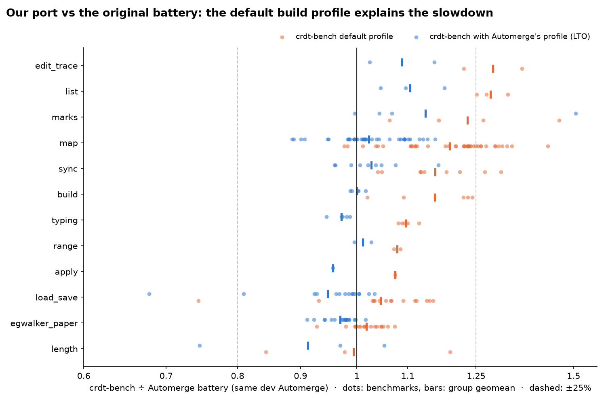

# Cross-check: Automerge's benchmark battery vs crdt-bench's port

Both batteries were run on the same machine, one after the other, against the **same development Automerge** (the automerge checkout at `09b19d508`, *rust/automerge: prototype bounded fragment boundary memoization*), all tiers, 10 samples, 1 warmup, rustc 1.96.1. Only the `automerge` results of crdt-bench are compared.

| Run | Battery | Automerge | Build profile |
|---|---|---|---|
| theirs | `rust/benchmark-battery` | dev `09b19d508` | fat LTO, 1 codegen unit (their workspace) |
| ours default | crdt-bench port | dev `09b19d508` | Cargo default (no fat LTO, 16 codegen units) |
| ours LTO | crdt-bench port | dev `09b19d508` | fat LTO, 1 codegen unit (copied from theirs) |
| ours 0.12.0 | crdt-bench port | crates.io 0.12.0 | Cargo default (`20261119-170021-battery-all-tiers`) |

## Summary

- **106 timing metrics and 30 memory metrics** are measured by both batteries (47 benchmarks only theirs, 5 only ours).
- **Memory agrees exactly:** geomean ratio 1.000 over 30 metrics.
- **Timing with crdt-bench's default profile:** geomean 1.126; within ±10%: 46/106, within ±25%: 86/106.
- **Timing with Automerge's profile (fat LTO, 1 codegen unit):** geomean 1.003; within ±10%: 89/106, within ±25%: 103/106.
- The port's workloads match the original. Most of the earlier gap came from the build profile, not from the benchmarks: crdt-bench's release build doesn't use fat LTO, which costs most where a benchmark makes many small calls into Automerge.

## Remaining differences (LTO build, beyond ±15%)

| Benchmark | Theirs | Ours (LTO) | Ratio | Ranges overlap |
|---|---:|---:|---:|---|
| `marks/get_marks_at_end` (median) | 1.84 µs | 2.77 µs | 1.51 | no |
| `load_save/load_actors/load/1000` (median) | 3.50 ms | 2.37 ms | 0.68 | no |
| `length/map_len_now` (median) | 1.52 ms | 1.13 ms | 0.75 | no |
| `load_save/load_actors/load/100` (median) | 213.00 µs | 172.39 µs | 0.81 | no |
| `list/list_cursor_now` (median) | 7.09 µs | 8.36 µs | 1.18 | yes |
| `sync/tiny_text` (total) | 42.07 s | 49.02 s | 1.16 | – |
| `map/save/repeated_put/10000` (median) | 223.66 µs | 259.01 µs | 1.16 | no |
| `edit_trace/edit_trace_single_tx` (median) | 2.55 s | 2.95 s | 1.16 | no |

Why they remain:

- **`marks/get_marks_at_end`**: data-dependent. The original battery places its 10 marks with an unseeded RNG, the port with a seeded one, so the two documents have different marks on their last character.
- **`load_save/load_actors/load/{100,1000}`**: different documents. The original gives every writer an Automerge *author* (`with_author`) and a random 16-byte actor ID; the port's cross-library API has no authors and uses 8-byte actor IDs. Loading the author records is extra work, so the original is slower.
- **`sync/tiny_text`**: the port encodes every sync message to bytes and decodes it again (as on a network, the same for every library); the original passes `Message` values directly.
- **`length/map_len_now`**: same keys and values, but the original builds the map with the low-level `Automerge` API and the port with `AutoCommit`. Not investigated; both are under 2 ms.
- **`edit_trace/edit_trace_single_tx`, `map/save/repeated_put/10000`, `list/list_cursor_now`**: 16–18%, the last within its min–max range. Not investigated.

## Automerge dev vs 0.12.0 (our harness, default profile)

Same harness and machine, only the Automerge version differs. Largest changes:

| Benchmark | 0.12.0 | dev | dev ÷ 0.12.0 |
|---|---:|---:|---:|
| `marks/get_marks_at_end` (median) | 17.12 ms | 2.69 µs | 0.000157 |
| `sync/tiny_text` (total) | 25.71 s | 53.44 s | 2.08 |
| `sync/tiny_list` (total) | 21.35 s | 30.86 s | 1.45 |
| `typing/single_char_sync` (total) | 28.24 s | 37.31 s | 1.32 |
| `typing/single_char_merge` (total) | 28.12 s | 37.15 s | 1.32 |
| `sync/every_change/10000` (median) | 12.68 s | 16.68 s | 1.32 |
| `apply/single_char_incremental_load` (total) | 27.73 s | 36.36 s | 1.31 |
| `typing/single_char_100_incremental_loads` (total) | 293.60 s | 384.79 s | 1.31 |
| `typing/single_char_100_bulk_incremental_load` (total) | 3.19 s | 4.13 s | 1.29 |
| `typing/single_char_apply_change` (total) | 28.74 s | 36.72 s | 1.28 |
| `sync/every_change/1000` (median) | 175.54 ms | 218.96 ms | 1.25 |
| `length/list_len_now` (median) | 513.64 µs | 420.29 µs | 0.818 |

## All shared metrics

| Benchmark | Metric | Theirs | Ours default | ÷ | Ours LTO | ÷ |
|---|---|---:|---:|---:|---:|---:|
| `apply/single_char_incremental_load` | total | 33.85 s | 36.36 s | 1.07 | 32.38 s | 0.96 |
| `build/build_big_paste` | median | 44.21 ms | 45.07 ms | 1.02 | 44.29 ms | 1.00 |
| `build/build_deep_history_doc` | median | 2.41 s | 2.97 s | 1.23 | 2.39 s | 0.99 |
| `build/build_maps_in_maps_doc` | median | 637.95 ms | 791.78 ms | 1.24 | 648.70 ms | 1.02 |
| `build/build_text_splice_100` | median | 47.05 ms | 51.34 ms | 1.09 | 47.17 ms | 1.00 |
| `build/build_typing` | median | 818.90 ms | 999.22 ms | 1.22 | 808.75 ms | 0.99 |
| `edit_trace/edit_trace_many_tx` | median | 3.63 s | 4.43 s | 1.22 | 3.71 s | 1.02 |
| `edit_trace/edit_trace_single_tx` | median | 2.55 s | 3.47 s | 1.36 | 2.95 s | 1.16 |
| `egwalker_paper/clone/A1` | median | 475.87 µs | 474.40 µs | 1.00 | 463.52 µs | 0.97 |
| `egwalker_paper/clone/A2` | median | 691.44 µs | 694.09 µs | 1.00 | 676.82 µs | 0.98 |
| `egwalker_paper/clone/C1` | median | 3.84 ms | 3.87 ms | 1.01 | 3.79 ms | 0.99 |
| `egwalker_paper/clone/C2` | median | 5.88 ms | 5.96 ms | 1.01 | 5.86 ms | 1.00 |
| `egwalker_paper/clone/S1` | median | 200.00 µs | 195.93 µs | 0.98 | 196.07 µs | 0.98 |
| `egwalker_paper/clone/S3` | median | 354.41 µs | 360.80 µs | 1.02 | 347.93 µs | 0.98 |
| `egwalker_paper/get_text/A1` | median | 1.03 ms | 1.06 ms | 1.03 | 947.39 µs | 0.92 |
| `egwalker_paper/get_text/A2` | median | 5.90 ms | 6.06 ms | 1.03 | 5.56 ms | 0.94 |
| `egwalker_paper/get_text/C1` | median | 13.24 ms | 13.19 ms | 1.00 | 12.62 ms | 0.95 |
| `egwalker_paper/get_text/C2` | median | 12.68 ms | 12.85 ms | 1.01 | 12.15 ms | 0.96 |
| `egwalker_paper/get_text/S1` | median | 8.05 ms | 8.04 ms | 1.00 | 7.58 ms | 0.94 |
| `egwalker_paper/get_text/S3` | median | 3.22 ms | 2.99 ms | 0.93 | 2.93 ms | 0.91 |
| `egwalker_paper/load/A1` | median | 428.20 ms | 448.34 ms | 1.05 | 418.75 ms | 0.98 |
| `egwalker_paper/load/A2` | median | 315.11 ms | 329.59 ms | 1.05 | 306.76 ms | 0.97 |
| `egwalker_paper/load/C1` | median | 477.07 ms | 501.51 ms | 1.05 | 466.95 ms | 0.98 |
| `egwalker_paper/load/C2` | median | 530.81 ms | 569.86 ms | 1.07 | 528.20 ms | 1.00 |
| `egwalker_paper/load/S1` | median | 431.92 ms | 448.60 ms | 1.04 | 425.60 ms | 0.99 |
| `egwalker_paper/load/S3` | median | 1.39 s | 1.48 s | 1.06 | 1.42 s | 1.02 |
| `length/list_len_now` | median | 430.03 µs | 420.29 µs | 0.98 | 416.71 µs | 0.97 |
| `length/map_len_now` | median | 1.52 ms | 1.28 ms | 0.84 | 1.13 ms | 0.75 |
| `length/text_len_now` | median | 210 ns | 250 ns | 1.19 | 221 ns | 1.05 |
| `list/list_cursor_now` | median | 7.09 µs | 9.41 µs | 1.33 | 8.36 µs | 1.18 |
| `list/list_splice_index_now` | median | 15.58 µs | 19.50 µs | 1.25 | 16.29 µs | 1.05 |
| `list/list_update_now` | median | 19.29 µs | 24.59 µs | 1.27 | 21.14 µs | 1.10 |
| `load_save/load_actors/load/10` | median | 29.27 µs | 32.63 µs | 1.11 | 27.03 µs | 0.92 |
| `load_save/load_actors/load/100` | median | 213.00 µs | 198.38 µs | 0.93 | 172.39 µs | 0.81 |
| `load_save/load_actors/load/1000` | median | 3.50 ms | 2.60 ms | 0.74 | 2.37 ms | 0.68 |
| `load_save/load_big_paste` | median | 35.84 ms | 38.25 ms | 1.07 | 34.69 ms | 0.97 |
| `load_save/load_big_random` | median | 69.41 ms | 72.39 ms | 1.04 | 68.75 ms | 0.99 |
| `load_save/load_deep_history/1000` | median | 225.07 ms | 237.58 ms | 1.06 | 220.14 ms | 0.98 |
| `load_save/load_maps_in_maps` | median | 51.42 ms | 53.08 ms | 1.03 | 47.70 ms | 0.93 |
| `load_save/load_text_splice_100` | median | 54.09 ms | 55.69 ms | 1.03 | 52.03 ms | 0.96 |
| `load_save/load_typing` | median | 150.11 ms | 159.98 ms | 1.07 | 149.46 ms | 1.00 |
| `load_save/save_big_paste` | median | 1.68 ms | 1.93 ms | 1.15 | 1.73 ms | 1.03 |
| `load_save/save_big_random` | median | 12.07 ms | 13.75 ms | 1.14 | 11.98 ms | 0.99 |
| `load_save/save_deep_history/1000` | median | 13.99 ms | 14.46 ms | 1.03 | 13.77 ms | 0.98 |
| `load_save/save_maps_in_maps` | median | 10.32 ms | 11.26 ms | 1.09 | 10.37 ms | 1.00 |
| `load_save/save_text_splice_100` | median | 2.05 ms | 2.29 ms | 1.12 | 2.06 ms | 1.00 |
| `load_save/save_typing` | median | 4.97 ms | 5.70 ms | 1.15 | 5.09 ms | 1.02 |
| `map/apply/decreasing_put/100` | median | 72.01 µs | 90.82 µs | 1.26 | 78.78 µs | 1.09 |
| `map/apply/decreasing_put/1000` | median | 601.00 µs | 753.90 µs | 1.25 | 656.77 µs | 1.09 |
| `map/apply/decreasing_put/10000` | median | 5.97 ms | 7.47 ms | 1.25 | 6.52 ms | 1.09 |
| `map/apply/increasing_put/100` | median | 73.87 µs | 94.04 µs | 1.27 | 81.35 µs | 1.10 |
| `map/apply/increasing_put/1000` | median | 605.78 µs | 754.39 µs | 1.25 | 662.40 µs | 1.09 |
| `map/apply/increasing_put/10000` | median | 5.97 ms | 7.29 ms | 1.22 | 6.48 ms | 1.09 |
| `map/apply/repeated_put/100` | median | 66.82 µs | 88.52 µs | 1.32 | 75.10 µs | 1.12 |
| `map/apply/repeated_put/1000` | median | 535.24 µs | 702.67 µs | 1.31 | 605.68 µs | 1.13 |
| `map/apply/repeated_put/10000` | median | 5.34 ms | 6.96 ms | 1.30 | 6.09 ms | 1.14 |
| `map/decreasing_put/100` | median | 488.12 µs | 615.65 µs | 1.26 | 485.81 µs | 1.00 |
| `map/decreasing_put/1000` | median | 4.94 ms | 6.08 ms | 1.23 | 4.93 ms | 1.00 |
| `map/decreasing_put/10000` | median | 49.57 ms | 61.03 ms | 1.23 | 50.36 ms | 1.02 |
| `map/deep_history/100` | median | 2.13 ms | 2.64 ms | 1.24 | 2.12 ms | 1.00 |
| `map/deep_history/1000` | median | 21.60 ms | 26.54 ms | 1.23 | 21.48 ms | 0.99 |
| `map/deep_history/10000` | median | 230.00 ms | 283.58 ms | 1.23 | 230.07 ms | 1.00 |
| `map/increasing_put/100` | median | 658.64 µs | 852.88 µs | 1.29 | 700.30 µs | 1.06 |
| `map/increasing_put/1000` | median | 8.55 ms | 11.42 ms | 1.34 | 9.44 ms | 1.10 |
| `map/increasing_put/10000` | median | 90.20 ms | 116.84 ms | 1.30 | 97.57 ms | 1.08 |
| `map/load/decreasing_put/100` | median | 72.47 µs | 86.01 µs | 1.19 | 73.69 µs | 1.02 |
| `map/load/decreasing_put/1000` | median | 594.47 µs | 662.75 µs | 1.11 | 584.89 µs | 0.98 |
| `map/load/decreasing_put/10000` | median | 5.71 ms | 6.33 ms | 1.11 | 5.63 ms | 0.99 |
| `map/load/increasing_put/100` | median | 70.11 µs | 84.41 µs | 1.20 | 71.59 µs | 1.02 |
| `map/load/increasing_put/1000` | median | 602.06 µs | 666.23 µs | 1.11 | 593.61 µs | 0.99 |
| `map/load/increasing_put/10000` | median | 5.77 ms | 6.46 ms | 1.12 | 5.67 ms | 0.98 |
| `map/load/repeated_put/100` | median | 66.71 µs | 76.17 µs | 1.14 | 68.59 µs | 1.03 |
| `map/load/repeated_put/1000` | median | 526.73 µs | 587.46 µs | 1.12 | 533.53 µs | 1.01 |
| `map/load/repeated_put/10000` | median | 5.07 ms | 5.60 ms | 1.11 | 5.12 ms | 1.01 |
| `map/repeated_put/100` | median | 773.79 µs | 956.12 µs | 1.24 | 785.39 µs | 1.02 |
| `map/repeated_put/1000` | median | 7.68 ms | 9.39 ms | 1.22 | 7.78 ms | 1.01 |
| `map/repeated_put/10000` | median | 76.70 ms | 93.72 ms | 1.22 | 77.34 ms | 1.01 |
| `map/save/decreasing_put/100` | median | 14.02 µs | 14.72 µs | 1.05 | 13.28 µs | 0.95 |
| `map/save/decreasing_put/1000` | median | 119.58 µs | 123.88 µs | 1.04 | 107.71 µs | 0.90 |
| `map/save/decreasing_put/10000` | median | 844.18 µs | 1.01 ms | 1.20 | 879.63 µs | 1.04 |
| `map/save/increasing_put/100` | median | 13.63 µs | 13.31 µs | 0.98 | 12.92 µs | 0.95 |
| `map/save/increasing_put/1000` | median | 123.64 µs | 125.02 µs | 1.01 | 109.51 µs | 0.89 |
| `map/save/increasing_put/10000` | median | 850.78 µs | 1.00 ms | 1.18 | 882.90 µs | 1.04 |
| `map/save/repeated_put/100` | median | 2.34 µs | 2.30 µs | 0.98 | 2.08 µs | 0.89 |
| `map/save/repeated_put/1000` | median | 40.47 µs | 42.07 µs | 1.04 | 36.71 µs | 0.91 |
| `map/save/repeated_put/10000` | median | 223.66 µs | 319.84 µs | 1.43 | 259.01 µs | 1.16 |
| `marks/add_mark` | median | 39.91 µs | 46.52 µs | 1.17 | 39.76 µs | 1.00 |
| `marks/get_marks_at_end` | median | 1.84 µs | 2.69 µs | 1.46 | 2.77 µs | 1.51 |
| `marks/splice_with_marks` | median | 405.28 ms | 430.93 ms | 1.06 | 422.76 ms | 1.04 |
| `marks/splice_without_marks` | median | 27.96 ms | 35.42 ms | 1.27 | 29.87 ms | 1.07 |
| `memory/clone/egwalker_paper/A1` | peak | 2.73 MiB | 2.73 MiB | 1.00 | – | – |
| `memory/clone/egwalker_paper/A1` | steady | 2.73 MiB | 2.73 MiB | 1.00 | – | – |
| `memory/clone/egwalker_paper/A2` | peak | 5.21 MiB | 5.22 MiB | 1.00 | – | – |
| `memory/clone/egwalker_paper/A2` | steady | 5.21 MiB | 5.22 MiB | 1.00 | – | – |
| `memory/clone/egwalker_paper/C1` | peak | 14.72 MiB | 14.72 MiB | 1.00 | – | – |
| `memory/clone/egwalker_paper/C1` | steady | 14.72 MiB | 14.72 MiB | 1.00 | – | – |
| `memory/clone/egwalker_paper/C2` | peak | 23.36 MiB | 23.36 MiB | 1.00 | – | – |
| `memory/clone/egwalker_paper/C2` | steady | 23.36 MiB | 23.36 MiB | 1.00 | – | – |
| `memory/clone/egwalker_paper/S1` | peak | 1.30 MiB | 1.30 MiB | 1.00 | – | – |
| `memory/clone/egwalker_paper/S1` | steady | 1.30 MiB | 1.30 MiB | 1.00 | – | – |
| `memory/clone/egwalker_paper/S3` | peak | 2.59 MiB | 2.59 MiB | 1.00 | – | – |
| `memory/clone/egwalker_paper/S3` | steady | 2.59 MiB | 2.59 MiB | 1.00 | – | – |
| `memory/load/big-paste` | peak | 8.84 MiB | 8.84 MiB | 1.00 | – | – |
| `memory/load/big-paste` | steady | 0.11 MiB | 0.11 MiB | 1.00 | – | – |
| `memory/load/egwalker_paper/A1` | peak | 91.29 MiB | 91.32 MiB | 1.00 | – | – |
| `memory/load/egwalker_paper/A1` | steady | 3.02 MiB | 3.02 MiB | 1.00 | – | – |
| `memory/load/egwalker_paper/A2` | peak | 57.71 MiB | 57.73 MiB | 1.00 | – | – |
| `memory/load/egwalker_paper/A2` | steady | 5.44 MiB | 5.46 MiB | 1.00 | – | – |
| `memory/load/egwalker_paper/C1` | peak | 180.91 MiB | 180.91 MiB | 1.00 | – | – |
| `memory/load/egwalker_paper/C1` | steady | 17.91 MiB | 17.91 MiB | 1.00 | – | – |
| `memory/load/egwalker_paper/C2` | peak | 208.07 MiB | 208.07 MiB | 1.00 | – | – |
| `memory/load/egwalker_paper/C2` | steady | 30.41 MiB | 30.41 MiB | 1.00 | – | – |
| `memory/load/egwalker_paper/S1` | peak | 234.70 MiB | 234.70 MiB | 1.00 | – | – |
| `memory/load/egwalker_paper/S1` | steady | 1.38 MiB | 1.38 MiB | 1.00 | – | – |
| `memory/load/egwalker_paper/S3` | peak | 680.13 MiB | 680.13 MiB | 1.00 | – | – |
| `memory/load/egwalker_paper/S3` | steady | 2.73 MiB | 2.73 MiB | 1.00 | – | – |
| `memory/load/text-splice-100` | peak | 31.77 MiB | 31.87 MiB | 1.00 | – | – |
| `memory/load/text-splice-100` | steady | 0.15 MiB | 0.15 MiB | 1.00 | – | – |
| `memory/load/typing` | peak | 92.61 MiB | 92.61 MiB | 1.00 | – | – |
| `memory/load/typing` | steady | 13.20 MiB | 13.19 MiB | 1.00 | – | – |
| `range/range/10000` | median | 2.21 ms | 2.37 ms | 1.07 | 2.20 ms | 1.00 |
| `range/range/100000` | median | 22.01 ms | 23.89 ms | 1.09 | 22.62 ms | 1.03 |
| `sync/every_change/100` | median | 5.28 ms | 6.92 ms | 1.31 | 5.53 ms | 1.05 |
| `sync/every_change/1000` | median | 194.54 ms | 218.96 ms | 1.13 | 192.48 ms | 0.99 |
| `sync/every_change/10000` | median | 15.92 s | 16.68 s | 1.05 | 15.26 s | 0.96 |
| `sync/full_many_tx` | median | 22.49 ms | 26.59 ms | 1.18 | 24.17 ms | 1.07 |
| `sync/full_one_tx` | median | 6.54 ms | 7.42 ms | 1.13 | 6.68 ms | 1.02 |
| `sync/full_one_tx/100` | median | 100.67 µs | 122.08 µs | 1.21 | 104.29 µs | 1.04 |
| `sync/full_one_tx/1000` | median | 734.87 µs | 828.49 µs | 1.13 | 739.44 µs | 1.01 |
| `sync/tiny_list` | total | 29.67 s | 30.86 s | 1.04 | 28.50 s | 0.96 |
| `sync/tiny_text` | total | 42.07 s | 53.44 s | 1.27 | 49.02 s | 1.16 |
| `typing/single_char_100_bulk_incremental_load` | total | 3.82 s | 4.13 s | 1.08 | 3.61 s | 0.94 |
| `typing/single_char_100_incremental_loads` | total | 349.87 s | 384.79 s | 1.10 | 343.25 s | 0.98 |
| `typing/single_char_apply_change` | total | 33.61 s | 36.72 s | 1.09 | 32.73 s | 0.97 |
| `typing/single_char_merge` | total | 34.15 s | 37.15 s | 1.09 | 33.17 s | 0.97 |
| `typing/single_char_sync` | total | 33.21 s | 37.31 s | 1.12 | 32.79 s | 0.99 |

## Only in one battery

**Only theirs** (47): Automerge-only features (ticket 2) and real-world fixtures (ticket 3), which crdt-bench registers as not run:

`bestiary/fork/godot-modeled`, `bestiary/fork/godot-thread`, `bestiary/iter/godot-modeled`, `bestiary/iter/godot-thread`, `bestiary/load/godot-modeled`, `bestiary/load/godot-thread`, `bestiary/reload/godot-modeled`, `bestiary/reload/godot-thread`, `bestiary/save/godot-modeled`, `bestiary/save/godot-thread`, `diff/diff`, `egwalker_paper/apply_fragment_to_clone/A1`, `egwalker_paper/apply_fragment_to_clone/A2`, `egwalker_paper/apply_fragment_to_clone/C1`, `egwalker_paper/apply_fragment_to_clone/C2`, `egwalker_paper/apply_fragment_to_clone/S1`, `egwalker_paper/apply_fragment_to_clone/S3`, `length/map_len_at`, `length/text_len_at`, `list/list_cursor_at`, `list/list_splice_index_at`, `list/list_update_at`, `load_save/load_actors/load_masked_half/10`, `load_save/load_actors/load_masked_half/100`, `load_save/load_actors/load_masked_half/1000`, `map/apply/repeated_increment/100`, `map/apply/repeated_increment/1000`, `map/apply/repeated_increment/10000`, `map/load/repeated_increment/100`, `map/load/repeated_increment/1000`, `map/load/repeated_increment/10000`, `map/repeated_increment/100`, `map/repeated_increment/1000`, `map/repeated_increment/10000`, `map/save/repeated_increment/100`, `map/save/repeated_increment/1000`, `map/save/repeated_increment/10000`, `memory/load/essay`, `memory/load/moby-dick`, `memory/load/monday-meeting-notes`, `memory/load/pathological`, `memory/load/stephen`, `memory/load/unsinkable`, `memory/load/webstraits`, `range/range_at/10000`, `range/range_at/100000`, `sync/big_chunky_sync_message`

**Only ours** (5): the S2 trace, which the original battery leaves out: `egwalker_paper/clone/S2`, `egwalker_paper/get_text/S2`, `egwalker_paper/load/S2`, `memory/clone/egwalker_paper/S2`, `memory/load/egwalker_paper/S2`

## Files

- `automerge-battery/`: their results (`battery.json`) and Markdown report
- `crdt-bench-dev-automerge/`, `crdt-bench-dev-automerge-lto/`: our experiments (`battery.json`, `meta.json`, `report.md`)
- `comparison.csv`: every shared metric with both ratios; `harness-ratio-by-group.png`: the chart above
