# CRDT benchmark battery

Each cell is the median; `(N.N×)` is relative to the best library on that row.

## Sampled benchmarks (median time per iteration)

| benchmark | automerge | yrs |
| --- | ---: | ---: |
| `build/build_big_paste` | 44.29ms | – |
| `build/build_deep_history_doc` | 2.39s | – |
| `build/build_maps_in_maps_doc` | 648.70ms | – |
| `build/build_text_splice_100` | 47.17ms | – |
| `build/build_typing` | 808.75ms | – |
| `edit_trace/edit_trace_many_tx` | 3.71s | – |
| `edit_trace/edit_trace_single_tx` | 2.95s | – |
| `egwalker_paper/clone/A1` | 463.52µs | – |
| `egwalker_paper/clone/A2` | 676.82µs | – |
| `egwalker_paper/clone/C1` | 3.79ms | – |
| `egwalker_paper/clone/C2` | 5.86ms | – |
| `egwalker_paper/clone/S1` | 196.07µs | – |
| `egwalker_paper/clone/S2` | 283.05µs | – |
| `egwalker_paper/clone/S3` | 347.93µs | – |
| `egwalker_paper/get_text/A1` | 947.39µs | – |
| `egwalker_paper/get_text/A2` | 5.56ms | – |
| `egwalker_paper/get_text/C1` | 12.62ms | – |
| `egwalker_paper/get_text/C2` | 12.15ms | – |
| `egwalker_paper/get_text/S1` | 7.58ms | – |
| `egwalker_paper/get_text/S2` | 3.98ms | – |
| `egwalker_paper/get_text/S3` | 2.93ms | – |
| `egwalker_paper/load/A1` | 418.75ms | – |
| `egwalker_paper/load/A2` | 306.76ms | – |
| `egwalker_paper/load/C1` | 466.95ms | – |
| `egwalker_paper/load/C2` | 528.20ms | – |
| `egwalker_paper/load/S1` | 425.60ms | – |
| `egwalker_paper/load/S2` | 596.83ms | – |
| `egwalker_paper/load/S3` | 1.42s | – |
| `length/list_len_now` | 416.71µs | – |
| `length/map_len_now` | 1.13ms | – |
| `length/text_len_now` | 221ns | – |
| `list/list_cursor_now` | 8.36µs | – |
| `list/list_splice_index_now` | 16.29µs | – |
| `list/list_update_now` | 21.14µs | – |
| `load_save/load_actors/load/10` | 27.03µs | – |
| `load_save/load_actors/load/100` | 172.39µs | – |
| `load_save/load_actors/load/1000` | 2.37ms | – |
| `load_save/load_big_paste` | 34.69ms | – |
| `load_save/load_big_random` | 68.75ms | – |
| `load_save/load_deep_history/1000` | 220.14ms | – |
| `load_save/load_maps_in_maps` | 47.70ms | – |
| `load_save/load_text_splice_100` | 52.03ms | – |
| `load_save/load_typing` | 149.46ms | – |
| `load_save/save_big_paste` | 1.73ms | – |
| `load_save/save_big_random` | 11.98ms | – |
| `load_save/save_deep_history/1000` | 13.77ms | – |
| `load_save/save_maps_in_maps` | 10.37ms | – |
| `load_save/save_text_splice_100` | 2.06ms | – |
| `load_save/save_typing` | 5.09ms | – |
| `map/apply/decreasing_put/100` | 78.78µs | – |
| `map/apply/decreasing_put/1000` | 656.77µs | – |
| `map/apply/decreasing_put/10000` | 6.52ms | – |
| `map/apply/increasing_put/100` | 81.35µs | – |
| `map/apply/increasing_put/1000` | 662.40µs | – |
| `map/apply/increasing_put/10000` | 6.48ms | – |
| `map/apply/repeated_put/100` | 75.10µs | – |
| `map/apply/repeated_put/1000` | 605.68µs | – |
| `map/apply/repeated_put/10000` | 6.09ms | – |
| `map/decreasing_put/100` | 485.81µs | – |
| `map/decreasing_put/1000` | 4.93ms | – |
| `map/decreasing_put/10000` | 50.36ms | – |
| `map/deep_history/100` | 2.12ms | – |
| `map/deep_history/1000` | 21.48ms | – |
| `map/deep_history/10000` | 230.07ms | – |
| `map/increasing_put/100` | 700.30µs | – |
| `map/increasing_put/1000` | 9.44ms | – |
| `map/increasing_put/10000` | 97.57ms | – |
| `map/load/decreasing_put/100` | 73.69µs | – |
| `map/load/decreasing_put/1000` | 584.89µs | – |
| `map/load/decreasing_put/10000` | 5.63ms | – |
| `map/load/increasing_put/100` | 71.59µs | – |
| `map/load/increasing_put/1000` | 593.61µs | – |
| `map/load/increasing_put/10000` | 5.67ms | – |
| `map/load/repeated_put/100` | 68.59µs | – |
| `map/load/repeated_put/1000` | 533.53µs | – |
| `map/load/repeated_put/10000` | 5.12ms | – |
| `map/repeated_put/100` | 785.39µs | – |
| `map/repeated_put/1000` | 7.78ms | – |
| `map/repeated_put/10000` | 77.34ms | – |
| `map/save/decreasing_put/100` | 13.28µs | – |
| `map/save/decreasing_put/1000` | 107.71µs | – |
| `map/save/decreasing_put/10000` | 879.63µs | – |
| `map/save/increasing_put/100` | 12.92µs | – |
| `map/save/increasing_put/1000` | 109.51µs | – |
| `map/save/increasing_put/10000` | 882.90µs | – |
| `map/save/repeated_put/100` | 2.08µs | – |
| `map/save/repeated_put/1000` | 36.71µs | – |
| `map/save/repeated_put/10000` | 259.01µs | – |
| `marks/add_mark` | 39.76µs | – |
| `marks/get_marks_at_end` | 2.77µs | – |
| `marks/splice_with_marks` | 422.76ms | – |
| `marks/splice_without_marks` | 29.87ms | – |
| `range/range/10000` | 2.20ms | – |
| `range/range/100000` | 22.62ms | – |
| `sync/every_change/100` | 5.53ms | – |
| `sync/every_change/1000` | 192.48ms | – |
| `sync/every_change/10000` | 15.26s | – |
| `sync/full_many_tx` | 24.17ms | – |
| `sync/full_one_tx` | 6.68ms | – |
| `sync/full_one_tx/100` | 104.29µs | – |
| `sync/full_one_tx/1000` | 739.44µs | – |

### Sampled benchmark charts

One chart per group: the bar is the median, the whisker spans the fastest and slowest sample.

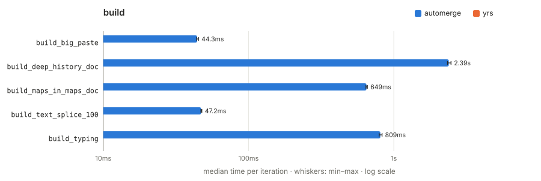

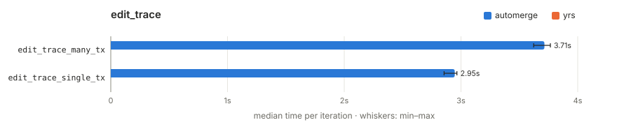

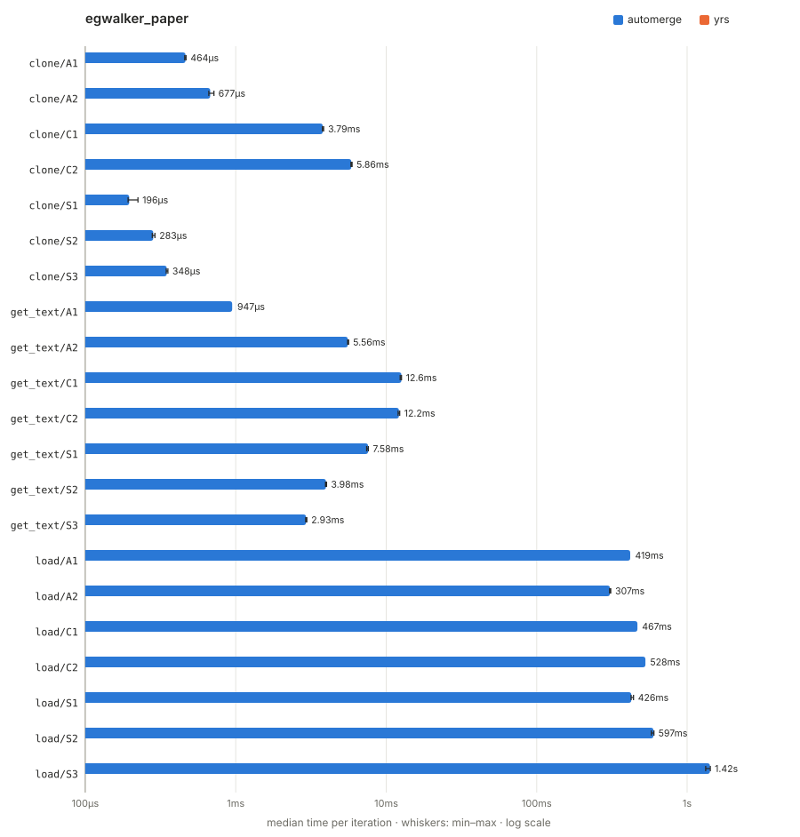

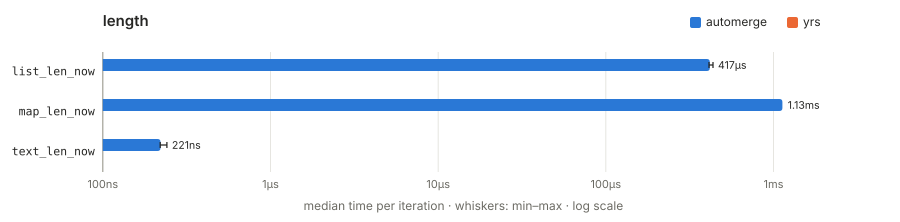

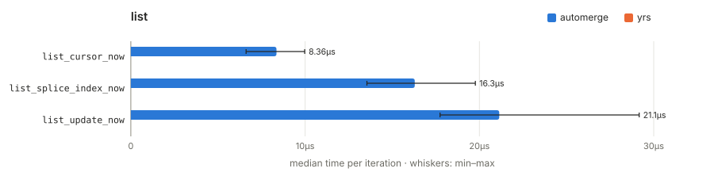

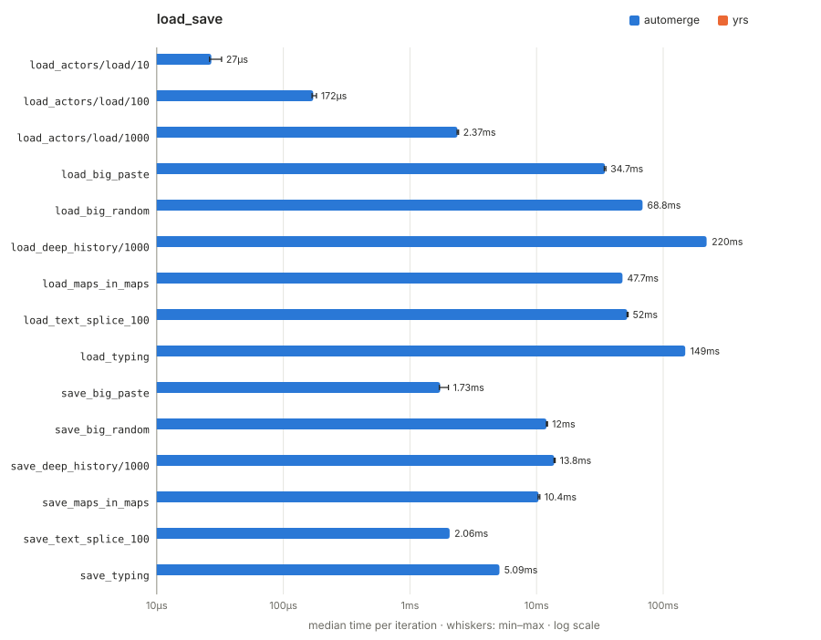

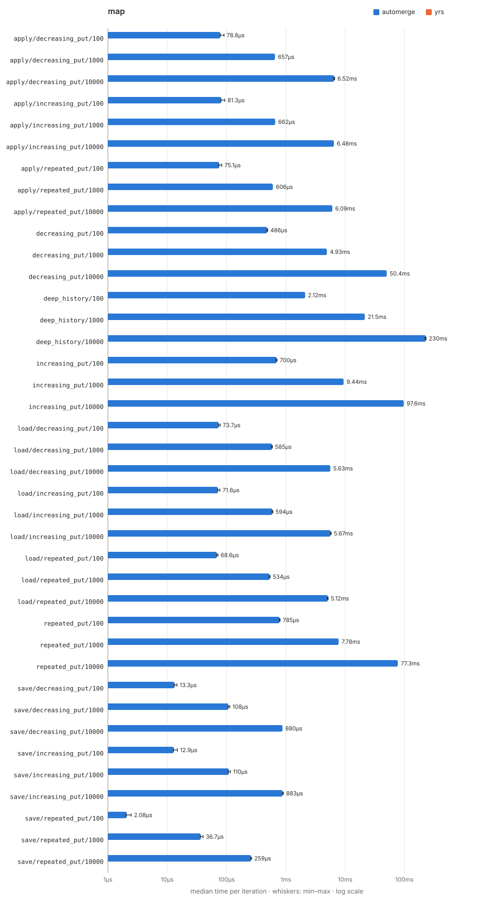

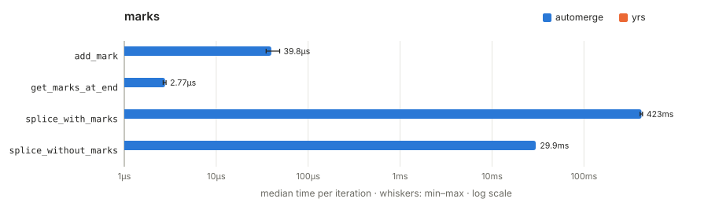

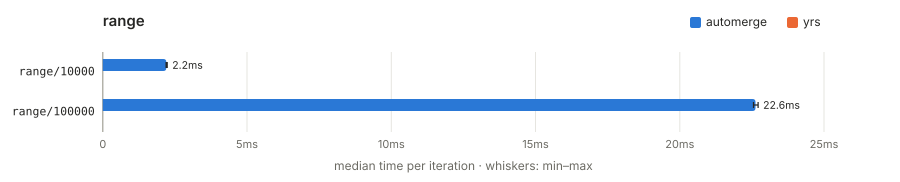

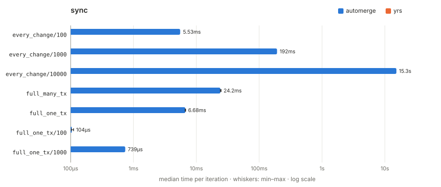

## Series benchmarks (total time over all steps)

| benchmark | automerge | yrs |
| --- | ---: | ---: |
| `apply/single_char_incremental_load` | 32.38s | – |
| `sync/tiny_list` | 28.50s | – |
| `sync/tiny_text` | 49.02s | – |
| `typing/single_char_100_bulk_incremental_load` | 3.61s | – |
| `typing/single_char_100_incremental_loads` | 343.25s | – |
| `typing/single_char_apply_change` | 32.73s | – |
| `typing/single_char_merge` | 33.17s | – |
| `typing/single_char_sync` | 32.79s | – |

## Series details

### `apply/single_char_incremental_load`

| library | total | median | mean | last-window median |
| --- | ---: | ---: | ---: | ---: |
| automerge | 32.38s | 32.39ms | 32.38ms | 33.00ms |

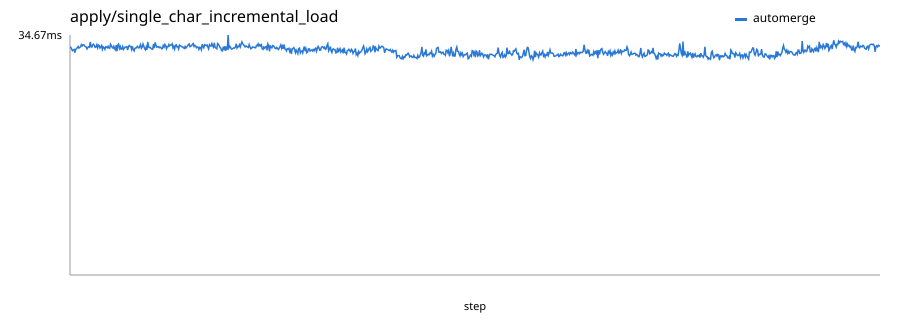

### `sync/tiny_list`

| library | total | median | mean | last-window median |
| --- | ---: | ---: | ---: | ---: |
| automerge | 28.50s | 28.33ms | 28.50ms | 29.49ms |

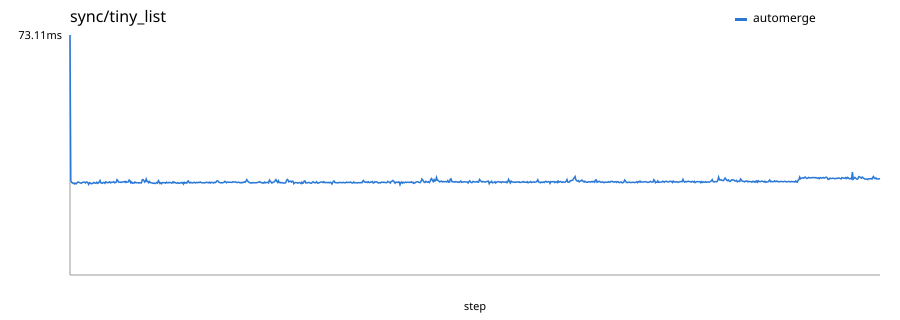

### `sync/tiny_text`

| library | total | median | mean | last-window median |
| --- | ---: | ---: | ---: | ---: |
| automerge | 49.02s | 49.04ms | 49.02ms | 49.23ms |

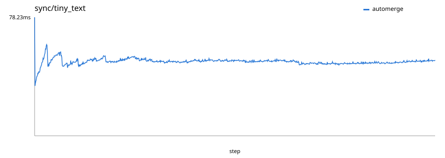

### `typing/single_char_100_bulk_incremental_load`

| library | total | median | mean | last-window median |
| --- | ---: | ---: | ---: | ---: |
| automerge | 3.61s | 36.06ms | 36.07ms | 37.33ms |

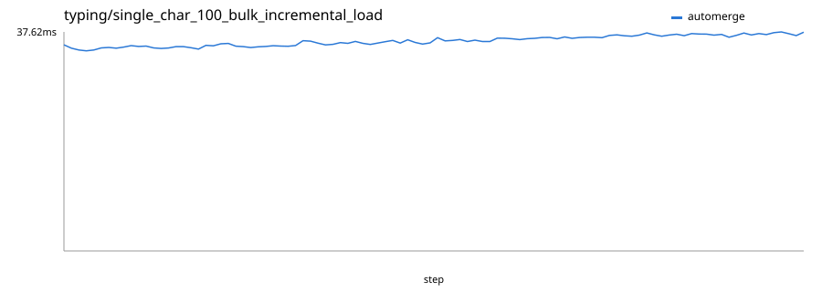

### `typing/single_char_100_incremental_loads`

| library | total | median | mean | last-window median |
| --- | ---: | ---: | ---: | ---: |
| automerge | 343.25s | 3.43s | 3.43s | 3.60s |

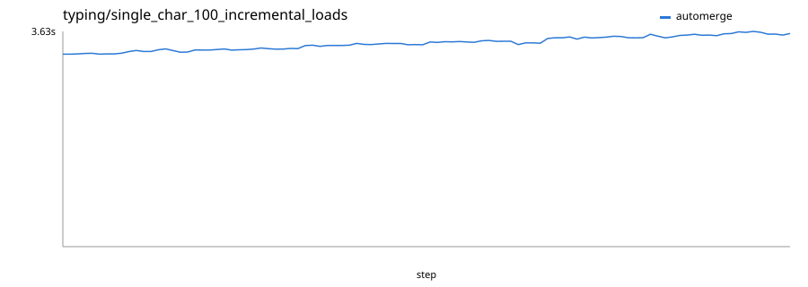

### `typing/single_char_apply_change`

| library | total | median | mean | last-window median |
| --- | ---: | ---: | ---: | ---: |
| automerge | 32.73s | 32.71ms | 32.73ms | 32.69ms |

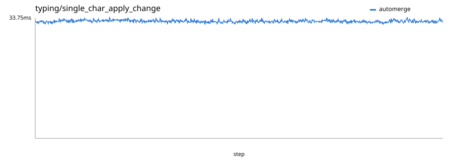

### `typing/single_char_merge`

| library | total | median | mean | last-window median |
| --- | ---: | ---: | ---: | ---: |
| automerge | 33.17s | 33.15ms | 33.17ms | 33.20ms |

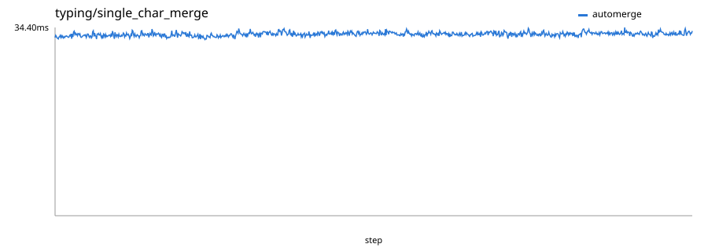

### `typing/single_char_sync`

| library | total | median | mean | last-window median |
| --- | ---: | ---: | ---: | ---: |
| automerge | 32.79s | 32.69ms | 32.79ms | 33.00ms |

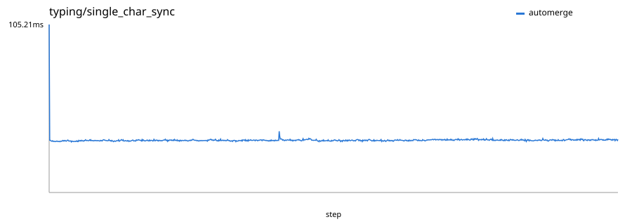

## Not runnable

| benchmark | library | reason |
| --- | --- | --- |
| `bestiary/fork/godot-modeled` | automerge | not ported yet: needs real-world fixtures for every library (docs/tickets/3-fixtures.md) |
| `bestiary/fork/godot-modeled` | yrs | not ported yet: needs real-world fixtures for every library (docs/tickets/3-fixtures.md) |
| `bestiary/fork/godot-thread` | automerge | not ported yet: needs real-world fixtures for every library (docs/tickets/3-fixtures.md) |
| `bestiary/fork/godot-thread` | yrs | not ported yet: needs real-world fixtures for every library (docs/tickets/3-fixtures.md) |
| `bestiary/iter/godot-modeled` | automerge | not ported yet: needs real-world fixtures for every library (docs/tickets/3-fixtures.md) |
| `bestiary/iter/godot-modeled` | yrs | not ported yet: needs real-world fixtures for every library (docs/tickets/3-fixtures.md) |
| `bestiary/iter/godot-thread` | automerge | not ported yet: needs real-world fixtures for every library (docs/tickets/3-fixtures.md) |
| `bestiary/iter/godot-thread` | yrs | not ported yet: needs real-world fixtures for every library (docs/tickets/3-fixtures.md) |
| `bestiary/load/godot-modeled` | automerge | not ported yet: needs real-world fixtures for every library (docs/tickets/3-fixtures.md) |
| `bestiary/load/godot-modeled` | yrs | not ported yet: needs real-world fixtures for every library (docs/tickets/3-fixtures.md) |
| `bestiary/load/godot-thread` | automerge | not ported yet: needs real-world fixtures for every library (docs/tickets/3-fixtures.md) |
| `bestiary/load/godot-thread` | yrs | not ported yet: needs real-world fixtures for every library (docs/tickets/3-fixtures.md) |
| `bestiary/reload/godot-modeled` | automerge | not ported yet: needs real-world fixtures for every library (docs/tickets/3-fixtures.md) |
| `bestiary/reload/godot-modeled` | yrs | not ported yet: needs real-world fixtures for every library (docs/tickets/3-fixtures.md) |
| `bestiary/reload/godot-thread` | automerge | not ported yet: needs real-world fixtures for every library (docs/tickets/3-fixtures.md) |
| `bestiary/reload/godot-thread` | yrs | not ported yet: needs real-world fixtures for every library (docs/tickets/3-fixtures.md) |
| `bestiary/save/godot-modeled` | automerge | not ported yet: needs real-world fixtures for every library (docs/tickets/3-fixtures.md) |
| `bestiary/save/godot-modeled` | yrs | not ported yet: needs real-world fixtures for every library (docs/tickets/3-fixtures.md) |
| `bestiary/save/godot-thread` | automerge | not ported yet: needs real-world fixtures for every library (docs/tickets/3-fixtures.md) |
| `bestiary/save/godot-thread` | yrs | not ported yet: needs real-world fixtures for every library (docs/tickets/3-fixtures.md) |
| `diff/diff` | automerge | not ported yet: needs real-world fixtures for every library (docs/tickets/3-fixtures.md) |
| `diff/diff` | yrs | not ported yet: needs real-world fixtures for every library (docs/tickets/3-fixtures.md) |
| `egwalker_paper/apply_fragment_to_clone/A1` | automerge | not ported yet: needs an Automerge-only feature (docs/tickets/2-automerge-only.md) |
| `egwalker_paper/apply_fragment_to_clone/A1` | yrs | not ported yet: needs an Automerge-only feature (docs/tickets/2-automerge-only.md) |
| `egwalker_paper/apply_fragment_to_clone/A2` | automerge | not ported yet: needs an Automerge-only feature (docs/tickets/2-automerge-only.md) |
| `egwalker_paper/apply_fragment_to_clone/A2` | yrs | not ported yet: needs an Automerge-only feature (docs/tickets/2-automerge-only.md) |
| `egwalker_paper/apply_fragment_to_clone/C1` | automerge | not ported yet: needs an Automerge-only feature (docs/tickets/2-automerge-only.md) |
| `egwalker_paper/apply_fragment_to_clone/C1` | yrs | not ported yet: needs an Automerge-only feature (docs/tickets/2-automerge-only.md) |
| `egwalker_paper/apply_fragment_to_clone/C2` | automerge | not ported yet: needs an Automerge-only feature (docs/tickets/2-automerge-only.md) |
| `egwalker_paper/apply_fragment_to_clone/C2` | yrs | not ported yet: needs an Automerge-only feature (docs/tickets/2-automerge-only.md) |
| `egwalker_paper/apply_fragment_to_clone/S1` | automerge | not ported yet: needs an Automerge-only feature (docs/tickets/2-automerge-only.md) |
| `egwalker_paper/apply_fragment_to_clone/S1` | yrs | not ported yet: needs an Automerge-only feature (docs/tickets/2-automerge-only.md) |
| `egwalker_paper/apply_fragment_to_clone/S2` | automerge | not ported yet: needs an Automerge-only feature (docs/tickets/2-automerge-only.md) |
| `egwalker_paper/apply_fragment_to_clone/S2` | yrs | not ported yet: needs an Automerge-only feature (docs/tickets/2-automerge-only.md) |
| `egwalker_paper/apply_fragment_to_clone/S3` | automerge | not ported yet: needs an Automerge-only feature (docs/tickets/2-automerge-only.md) |
| `egwalker_paper/apply_fragment_to_clone/S3` | yrs | not ported yet: needs an Automerge-only feature (docs/tickets/2-automerge-only.md) |
| `length/map_len_at` | automerge | not ported yet: needs an Automerge-only feature (docs/tickets/2-automerge-only.md) |
| `length/map_len_at` | yrs | not ported yet: needs an Automerge-only feature (docs/tickets/2-automerge-only.md) |
| `length/text_len_at` | automerge | not ported yet: needs an Automerge-only feature (docs/tickets/2-automerge-only.md) |
| `length/text_len_at` | yrs | not ported yet: needs an Automerge-only feature (docs/tickets/2-automerge-only.md) |
| `list/list_cursor_at` | automerge | not ported yet: needs an Automerge-only feature (docs/tickets/2-automerge-only.md) |
| `list/list_cursor_at` | yrs | not ported yet: needs an Automerge-only feature (docs/tickets/2-automerge-only.md) |
| `list/list_splice_index_at` | automerge | not ported yet: needs an Automerge-only feature (docs/tickets/2-automerge-only.md) |
| `list/list_splice_index_at` | yrs | not ported yet: needs an Automerge-only feature (docs/tickets/2-automerge-only.md) |
| `list/list_update_at` | automerge | not ported yet: needs an Automerge-only feature (docs/tickets/2-automerge-only.md) |
| `list/list_update_at` | yrs | not ported yet: needs an Automerge-only feature (docs/tickets/2-automerge-only.md) |
| `load_save/load_actors/load_masked_half/10` | automerge | not ported yet: needs an Automerge-only feature (docs/tickets/2-automerge-only.md) |
| `load_save/load_actors/load_masked_half/10` | yrs | not ported yet: needs an Automerge-only feature (docs/tickets/2-automerge-only.md) |
| `load_save/load_actors/load_masked_half/100` | automerge | not ported yet: needs an Automerge-only feature (docs/tickets/2-automerge-only.md) |
| `load_save/load_actors/load_masked_half/100` | yrs | not ported yet: needs an Automerge-only feature (docs/tickets/2-automerge-only.md) |
| `load_save/load_actors/load_masked_half/1000` | automerge | not ported yet: needs an Automerge-only feature (docs/tickets/2-automerge-only.md) |
| `load_save/load_actors/load_masked_half/1000` | yrs | not ported yet: needs an Automerge-only feature (docs/tickets/2-automerge-only.md) |
| `map/apply/repeated_increment/100` | automerge | not ported yet: needs an Automerge-only feature (docs/tickets/2-automerge-only.md) |
| `map/apply/repeated_increment/100` | yrs | not ported yet: needs an Automerge-only feature (docs/tickets/2-automerge-only.md) |
| `map/apply/repeated_increment/1000` | automerge | not ported yet: needs an Automerge-only feature (docs/tickets/2-automerge-only.md) |
| `map/apply/repeated_increment/1000` | yrs | not ported yet: needs an Automerge-only feature (docs/tickets/2-automerge-only.md) |
| `map/apply/repeated_increment/10000` | automerge | not ported yet: needs an Automerge-only feature (docs/tickets/2-automerge-only.md) |
| `map/apply/repeated_increment/10000` | yrs | not ported yet: needs an Automerge-only feature (docs/tickets/2-automerge-only.md) |
| `map/load/repeated_increment/100` | automerge | not ported yet: needs an Automerge-only feature (docs/tickets/2-automerge-only.md) |
| `map/load/repeated_increment/100` | yrs | not ported yet: needs an Automerge-only feature (docs/tickets/2-automerge-only.md) |
| `map/load/repeated_increment/1000` | automerge | not ported yet: needs an Automerge-only feature (docs/tickets/2-automerge-only.md) |
| `map/load/repeated_increment/1000` | yrs | not ported yet: needs an Automerge-only feature (docs/tickets/2-automerge-only.md) |
| `map/load/repeated_increment/10000` | automerge | not ported yet: needs an Automerge-only feature (docs/tickets/2-automerge-only.md) |
| `map/load/repeated_increment/10000` | yrs | not ported yet: needs an Automerge-only feature (docs/tickets/2-automerge-only.md) |
| `map/repeated_increment/100` | automerge | not ported yet: needs an Automerge-only feature (docs/tickets/2-automerge-only.md) |
| `map/repeated_increment/100` | yrs | not ported yet: needs an Automerge-only feature (docs/tickets/2-automerge-only.md) |
| `map/repeated_increment/1000` | automerge | not ported yet: needs an Automerge-only feature (docs/tickets/2-automerge-only.md) |
| `map/repeated_increment/1000` | yrs | not ported yet: needs an Automerge-only feature (docs/tickets/2-automerge-only.md) |
| `map/repeated_increment/10000` | automerge | not ported yet: needs an Automerge-only feature (docs/tickets/2-automerge-only.md) |
| `map/repeated_increment/10000` | yrs | not ported yet: needs an Automerge-only feature (docs/tickets/2-automerge-only.md) |
| `map/save/repeated_increment/100` | automerge | not ported yet: needs an Automerge-only feature (docs/tickets/2-automerge-only.md) |
| `map/save/repeated_increment/100` | yrs | not ported yet: needs an Automerge-only feature (docs/tickets/2-automerge-only.md) |
| `map/save/repeated_increment/1000` | automerge | not ported yet: needs an Automerge-only feature (docs/tickets/2-automerge-only.md) |
| `map/save/repeated_increment/1000` | yrs | not ported yet: needs an Automerge-only feature (docs/tickets/2-automerge-only.md) |
| `map/save/repeated_increment/10000` | automerge | not ported yet: needs an Automerge-only feature (docs/tickets/2-automerge-only.md) |
| `map/save/repeated_increment/10000` | yrs | not ported yet: needs an Automerge-only feature (docs/tickets/2-automerge-only.md) |
| `memory/clone/egwalker_paper/A1` | automerge | built without the `memory` feature |
| `memory/clone/egwalker_paper/A1` | yrs | built without the `memory` feature |
| `memory/clone/egwalker_paper/A2` | automerge | built without the `memory` feature |
| `memory/clone/egwalker_paper/A2` | yrs | built without the `memory` feature |
| `memory/clone/egwalker_paper/C1` | automerge | built without the `memory` feature |
| `memory/clone/egwalker_paper/C1` | yrs | built without the `memory` feature |
| `memory/clone/egwalker_paper/C2` | automerge | built without the `memory` feature |
| `memory/clone/egwalker_paper/C2` | yrs | built without the `memory` feature |
| `memory/clone/egwalker_paper/S1` | automerge | built without the `memory` feature |
| `memory/clone/egwalker_paper/S1` | yrs | built without the `memory` feature |
| `memory/clone/egwalker_paper/S2` | automerge | built without the `memory` feature |
| `memory/clone/egwalker_paper/S2` | yrs | built without the `memory` feature |
| `memory/clone/egwalker_paper/S3` | automerge | built without the `memory` feature |
| `memory/clone/egwalker_paper/S3` | yrs | built without the `memory` feature |
| `memory/load/big-paste` | automerge | built without the `memory` feature |
| `memory/load/big-paste` | yrs | built without the `memory` feature |
| `memory/load/egwalker_paper/A1` | automerge | built without the `memory` feature |
| `memory/load/egwalker_paper/A1` | yrs | built without the `memory` feature |
| `memory/load/egwalker_paper/A2` | automerge | built without the `memory` feature |
| `memory/load/egwalker_paper/A2` | yrs | built without the `memory` feature |
| `memory/load/egwalker_paper/C1` | automerge | built without the `memory` feature |
| `memory/load/egwalker_paper/C1` | yrs | built without the `memory` feature |
| `memory/load/egwalker_paper/C2` | automerge | built without the `memory` feature |
| `memory/load/egwalker_paper/C2` | yrs | built without the `memory` feature |
| `memory/load/egwalker_paper/S1` | automerge | built without the `memory` feature |
| `memory/load/egwalker_paper/S1` | yrs | built without the `memory` feature |
| `memory/load/egwalker_paper/S2` | automerge | built without the `memory` feature |
| `memory/load/egwalker_paper/S2` | yrs | built without the `memory` feature |
| `memory/load/egwalker_paper/S3` | automerge | built without the `memory` feature |
| `memory/load/egwalker_paper/S3` | yrs | built without the `memory` feature |
| `memory/load/essay` | automerge | not ported yet: needs real-world fixtures for every library (docs/tickets/3-fixtures.md) |
| `memory/load/essay` | yrs | not ported yet: needs real-world fixtures for every library (docs/tickets/3-fixtures.md) |
| `memory/load/moby-dick` | automerge | not ported yet: needs real-world fixtures for every library (docs/tickets/3-fixtures.md) |
| `memory/load/moby-dick` | yrs | not ported yet: needs real-world fixtures for every library (docs/tickets/3-fixtures.md) |
| `memory/load/monday-meeting-notes` | automerge | not ported yet: needs real-world fixtures for every library (docs/tickets/3-fixtures.md) |
| `memory/load/monday-meeting-notes` | yrs | not ported yet: needs real-world fixtures for every library (docs/tickets/3-fixtures.md) |
| `memory/load/pathological` | automerge | not ported yet: needs real-world fixtures for every library (docs/tickets/3-fixtures.md) |
| `memory/load/pathological` | yrs | not ported yet: needs real-world fixtures for every library (docs/tickets/3-fixtures.md) |
| `memory/load/stephen` | automerge | not ported yet: needs real-world fixtures for every library (docs/tickets/3-fixtures.md) |
| `memory/load/stephen` | yrs | not ported yet: needs real-world fixtures for every library (docs/tickets/3-fixtures.md) |
| `memory/load/text-splice-100` | automerge | built without the `memory` feature |
| `memory/load/text-splice-100` | yrs | built without the `memory` feature |
| `memory/load/typing` | automerge | built without the `memory` feature |
| `memory/load/typing` | yrs | built without the `memory` feature |
| `memory/load/unsinkable` | automerge | not ported yet: needs real-world fixtures for every library (docs/tickets/3-fixtures.md) |
| `memory/load/unsinkable` | yrs | not ported yet: needs real-world fixtures for every library (docs/tickets/3-fixtures.md) |
| `memory/load/webstraits` | automerge | not ported yet: needs real-world fixtures for every library (docs/tickets/3-fixtures.md) |
| `memory/load/webstraits` | yrs | not ported yet: needs real-world fixtures for every library (docs/tickets/3-fixtures.md) |
| `range/range_at/10000` | automerge | not ported yet: needs an Automerge-only feature (docs/tickets/2-automerge-only.md) |
| `range/range_at/10000` | yrs | not ported yet: needs an Automerge-only feature (docs/tickets/2-automerge-only.md) |
| `range/range_at/100000` | automerge | not ported yet: needs an Automerge-only feature (docs/tickets/2-automerge-only.md) |
| `range/range_at/100000` | yrs | not ported yet: needs an Automerge-only feature (docs/tickets/2-automerge-only.md) |
| `sync/big_chunky_sync_message` | automerge | not ported yet: needs an Automerge-only feature (docs/tickets/2-automerge-only.md) |
| `sync/big_chunky_sync_message` | yrs | not ported yet: needs an Automerge-only feature (docs/tickets/2-automerge-only.md) |

