# CRDT benchmark battery

Each cell is the median; `(N.N×)` is relative to the best library on that row.

## Sampled benchmarks (median time per iteration)

| benchmark | automerge | yrs |
| --- | ---: | ---: |
| `build/build_big_paste` | 45.07ms | – |
| `build/build_deep_history_doc` | 2.97s | – |
| `build/build_maps_in_maps_doc` | 791.78ms | – |
| `build/build_text_splice_100` | 51.34ms | – |
| `build/build_typing` | 999.22ms | – |
| `edit_trace/edit_trace_many_tx` | 4.43s | – |
| `edit_trace/edit_trace_single_tx` | 3.47s | – |
| `egwalker_paper/clone/A1` | 474.40µs | – |
| `egwalker_paper/clone/A2` | 694.09µs | – |
| `egwalker_paper/clone/C1` | 3.87ms | – |
| `egwalker_paper/clone/C2` | 5.96ms | – |
| `egwalker_paper/clone/S1` | 195.93µs | – |
| `egwalker_paper/clone/S2` | 299.05µs | – |
| `egwalker_paper/clone/S3` | 360.80µs | – |
| `egwalker_paper/get_text/A1` | 1.06ms | – |
| `egwalker_paper/get_text/A2` | 6.06ms | – |
| `egwalker_paper/get_text/C1` | 13.19ms | – |
| `egwalker_paper/get_text/C2` | 12.85ms | – |
| `egwalker_paper/get_text/S1` | 8.04ms | – |
| `egwalker_paper/get_text/S2` | 4.52ms | – |
| `egwalker_paper/get_text/S3` | 2.99ms | – |
| `egwalker_paper/load/A1` | 448.34ms | – |
| `egwalker_paper/load/A2` | 329.59ms | – |
| `egwalker_paper/load/C1` | 501.51ms | – |
| `egwalker_paper/load/C2` | 569.86ms | – |
| `egwalker_paper/load/S1` | 448.60ms | – |
| `egwalker_paper/load/S2` | 627.09ms | – |
| `egwalker_paper/load/S3` | 1.48s | – |
| `length/list_len_now` | 420.29µs | – |
| `length/map_len_now` | 1.28ms | – |
| `length/text_len_now` | 250ns | – |
| `list/list_cursor_now` | 9.41µs | – |
| `list/list_splice_index_now` | 19.50µs | – |
| `list/list_update_now` | 24.59µs | – |
| `load_save/load_actors/load/10` | 32.63µs | – |
| `load_save/load_actors/load/100` | 198.38µs | – |
| `load_save/load_actors/load/1000` | 2.60ms | – |
| `load_save/load_big_paste` | 38.25ms | – |
| `load_save/load_big_random` | 72.39ms | – |
| `load_save/load_deep_history/1000` | 237.58ms | – |
| `load_save/load_maps_in_maps` | 53.08ms | – |
| `load_save/load_text_splice_100` | 55.69ms | – |
| `load_save/load_typing` | 159.98ms | – |
| `load_save/save_big_paste` | 1.93ms | – |
| `load_save/save_big_random` | 13.75ms | – |
| `load_save/save_deep_history/1000` | 14.46ms | – |
| `load_save/save_maps_in_maps` | 11.26ms | – |
| `load_save/save_text_splice_100` | 2.29ms | – |
| `load_save/save_typing` | 5.70ms | – |
| `map/apply/decreasing_put/100` | 90.82µs | – |
| `map/apply/decreasing_put/1000` | 753.90µs | – |
| `map/apply/decreasing_put/10000` | 7.47ms | – |
| `map/apply/increasing_put/100` | 94.04µs | – |
| `map/apply/increasing_put/1000` | 754.39µs | – |
| `map/apply/increasing_put/10000` | 7.29ms | – |
| `map/apply/repeated_put/100` | 88.52µs | – |
| `map/apply/repeated_put/1000` | 702.67µs | – |
| `map/apply/repeated_put/10000` | 6.96ms | – |
| `map/decreasing_put/100` | 615.65µs | – |
| `map/decreasing_put/1000` | 6.08ms | – |
| `map/decreasing_put/10000` | 61.03ms | – |
| `map/deep_history/100` | 2.64ms | – |
| `map/deep_history/1000` | 26.54ms | – |
| `map/deep_history/10000` | 283.58ms | – |
| `map/increasing_put/100` | 852.88µs | – |
| `map/increasing_put/1000` | 11.42ms | – |
| `map/increasing_put/10000` | 116.84ms | – |
| `map/load/decreasing_put/100` | 86.01µs | – |
| `map/load/decreasing_put/1000` | 662.75µs | – |
| `map/load/decreasing_put/10000` | 6.33ms | – |
| `map/load/increasing_put/100` | 84.41µs | – |
| `map/load/increasing_put/1000` | 666.23µs | – |
| `map/load/increasing_put/10000` | 6.46ms | – |
| `map/load/repeated_put/100` | 76.17µs | – |
| `map/load/repeated_put/1000` | 587.46µs | – |
| `map/load/repeated_put/10000` | 5.60ms | – |
| `map/repeated_put/100` | 956.12µs | – |
| `map/repeated_put/1000` | 9.39ms | – |
| `map/repeated_put/10000` | 93.72ms | – |
| `map/save/decreasing_put/100` | 14.72µs | – |
| `map/save/decreasing_put/1000` | 123.88µs | – |
| `map/save/decreasing_put/10000` | 1.01ms | – |
| `map/save/increasing_put/100` | 13.31µs | – |
| `map/save/increasing_put/1000` | 125.02µs | – |
| `map/save/increasing_put/10000` | 1.00ms | – |
| `map/save/repeated_put/100` | 2.30µs | – |
| `map/save/repeated_put/1000` | 42.07µs | – |
| `map/save/repeated_put/10000` | 319.84µs | – |
| `marks/add_mark` | 46.52µs | – |
| `marks/get_marks_at_end` | 2.69µs | – |
| `marks/splice_with_marks` | 430.93ms | – |
| `marks/splice_without_marks` | 35.42ms | – |
| `range/range/10000` | 2.37ms | – |
| `range/range/100000` | 23.89ms | – |
| `sync/every_change/100` | 6.92ms | – |
| `sync/every_change/1000` | 218.96ms | – |
| `sync/every_change/10000` | 16.68s | – |
| `sync/full_many_tx` | 26.59ms | – |
| `sync/full_one_tx` | 7.42ms | – |
| `sync/full_one_tx/100` | 122.08µs | – |
| `sync/full_one_tx/1000` | 828.49µs | – |

### Sampled benchmark charts

One chart per group: the bar is the median, the whisker spans the fastest and slowest sample.

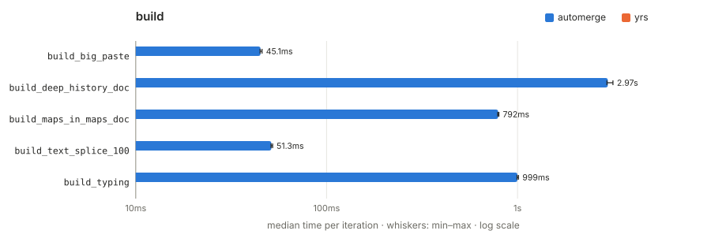

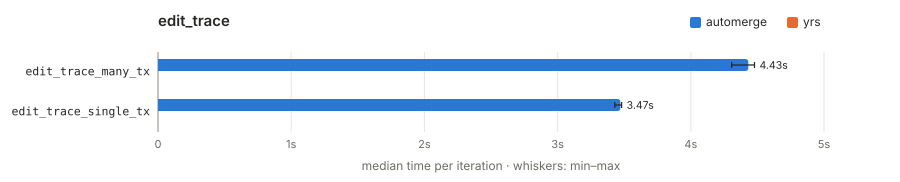

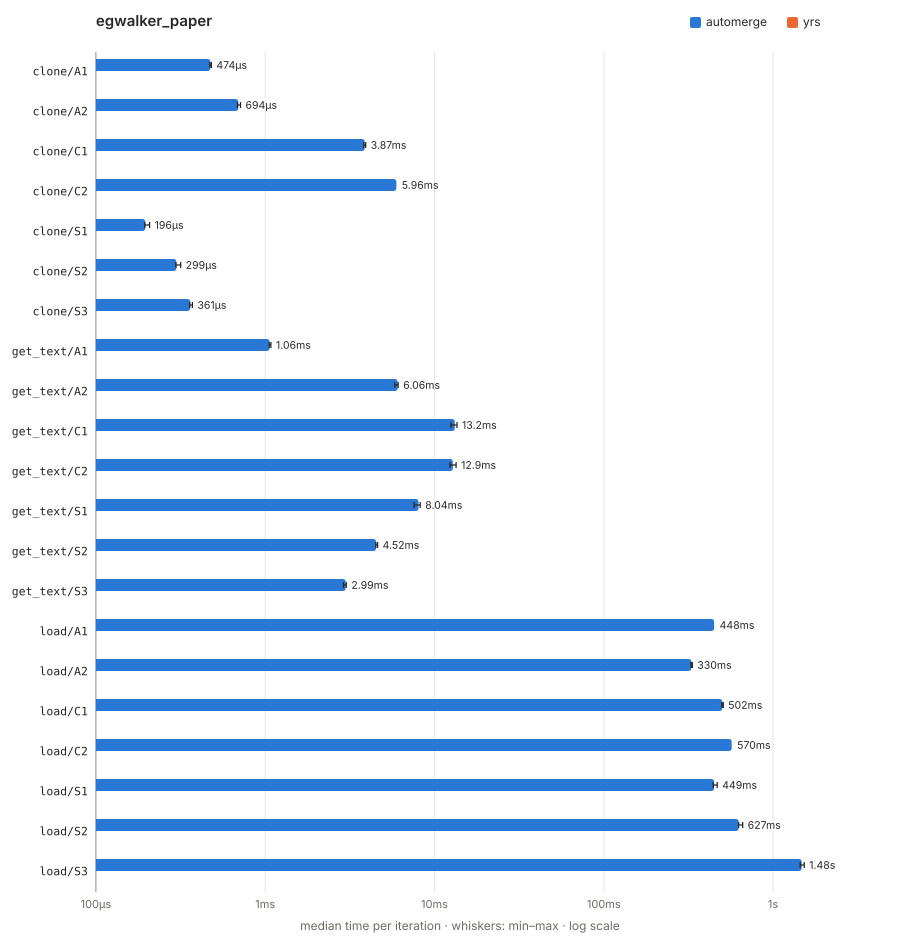

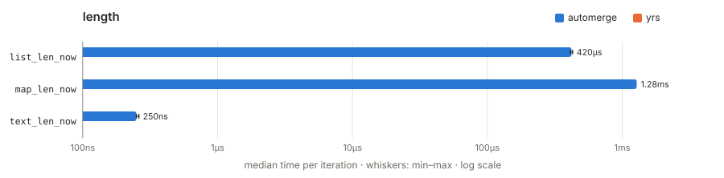

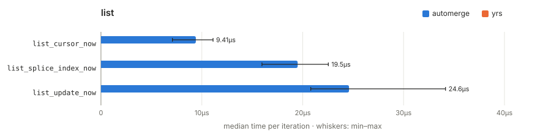

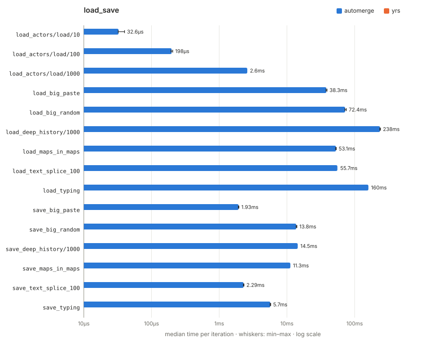

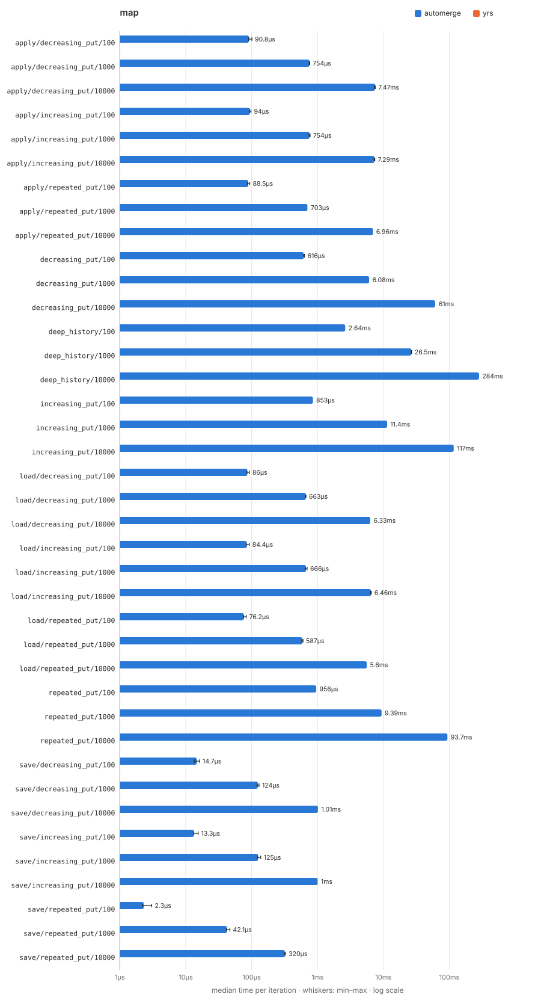

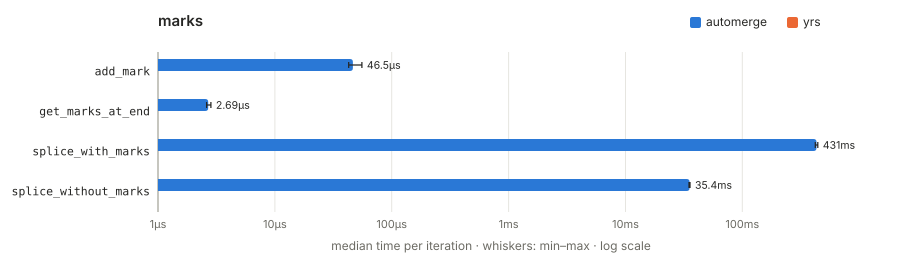

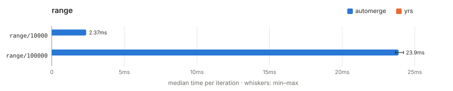

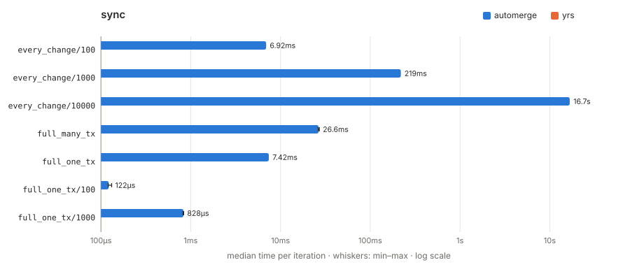

## Series benchmarks (total time over all steps)

| benchmark | automerge | yrs |
| --- | ---: | ---: |
| `apply/single_char_incremental_load` | 36.36s | – |
| `sync/tiny_list` | 30.86s | – |
| `sync/tiny_text` | 53.44s | – |
| `typing/single_char_100_bulk_incremental_load` | 4.13s | – |
| `typing/single_char_100_incremental_loads` | 384.79s | – |
| `typing/single_char_apply_change` | 36.72s | – |
| `typing/single_char_merge` | 37.15s | – |
| `typing/single_char_sync` | 37.31s | – |

## Peak memory

| benchmark | automerge | yrs |
| --- | ---: | ---: |
| `memory/clone/egwalker_paper/A1` | 2.73 MiB | n/a |
| `memory/clone/egwalker_paper/A2` | 5.22 MiB | n/a |
| `memory/clone/egwalker_paper/C1` | 14.72 MiB | n/a |
| `memory/clone/egwalker_paper/C2` | 23.36 MiB | n/a |
| `memory/clone/egwalker_paper/S1` | 1.30 MiB | n/a |
| `memory/clone/egwalker_paper/S2` | 1.83 MiB | n/a |
| `memory/clone/egwalker_paper/S3` | 2.59 MiB | n/a |
| `memory/load/big-paste` | 8.84 MiB | n/a |
| `memory/load/egwalker_paper/A1` | 91.32 MiB | n/a |
| `memory/load/egwalker_paper/A2` | 57.73 MiB | n/a |
| `memory/load/egwalker_paper/C1` | 180.91 MiB | n/a |
| `memory/load/egwalker_paper/C2` | 208.07 MiB | n/a |
| `memory/load/egwalker_paper/S1` | 234.70 MiB | n/a |
| `memory/load/egwalker_paper/S2` | 317.46 MiB | n/a |
| `memory/load/egwalker_paper/S3` | 680.13 MiB | n/a |
| `memory/load/text-splice-100` | 31.87 MiB | n/a |
| `memory/load/typing` | 92.61 MiB | n/a |

## Steady-state memory

| benchmark | automerge | yrs |
| --- | ---: | ---: |
| `memory/clone/egwalker_paper/A1` | 2.73 MiB | n/a |
| `memory/clone/egwalker_paper/A2` | 5.22 MiB | n/a |
| `memory/clone/egwalker_paper/C1` | 14.72 MiB | n/a |
| `memory/clone/egwalker_paper/C2` | 23.36 MiB | n/a |
| `memory/clone/egwalker_paper/S1` | 1.30 MiB | n/a |
| `memory/clone/egwalker_paper/S2` | 1.83 MiB | n/a |
| `memory/clone/egwalker_paper/S3` | 2.59 MiB | n/a |
| `memory/load/big-paste` | 109.57 KiB | n/a |
| `memory/load/egwalker_paper/A1` | 3.02 MiB | n/a |
| `memory/load/egwalker_paper/A2` | 5.46 MiB | n/a |
| `memory/load/egwalker_paper/C1` | 17.91 MiB | n/a |
| `memory/load/egwalker_paper/C2` | 30.41 MiB | n/a |
| `memory/load/egwalker_paper/S1` | 1.38 MiB | n/a |
| `memory/load/egwalker_paper/S2` | 2.01 MiB | n/a |
| `memory/load/egwalker_paper/S3` | 2.73 MiB | n/a |
| `memory/load/text-splice-100` | 149.02 KiB | n/a |
| `memory/load/typing` | 13.19 MiB | n/a |

## Series details

### `apply/single_char_incremental_load`

| library | total | median | mean | last-window median |
| --- | ---: | ---: | ---: | ---: |
| automerge | 36.36s | 36.55ms | 36.36ms | 36.68ms |

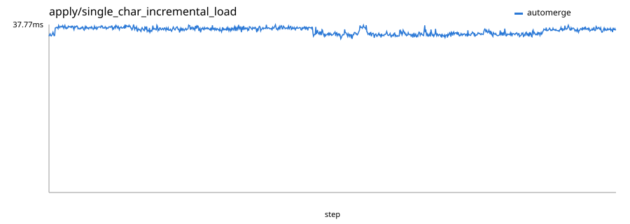

### `sync/tiny_list`

| library | total | median | mean | last-window median |
| --- | ---: | ---: | ---: | ---: |
| automerge | 30.86s | 30.78ms | 30.86ms | 30.98ms |

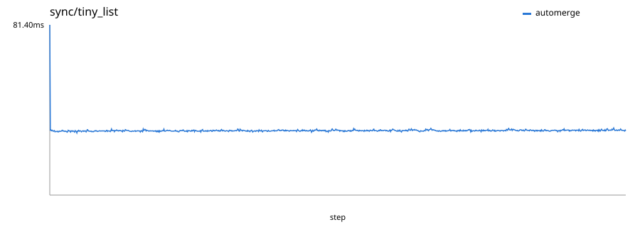

### `sync/tiny_text`

| library | total | median | mean | last-window median |
| --- | ---: | ---: | ---: | ---: |
| automerge | 53.44s | 53.31ms | 53.44ms | 54.58ms |

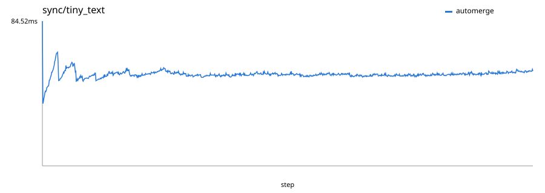

### `typing/single_char_100_bulk_incremental_load`

| library | total | median | mean | last-window median |
| --- | ---: | ---: | ---: | ---: |
| automerge | 4.13s | 41.33ms | 41.26ms | 42.77ms |

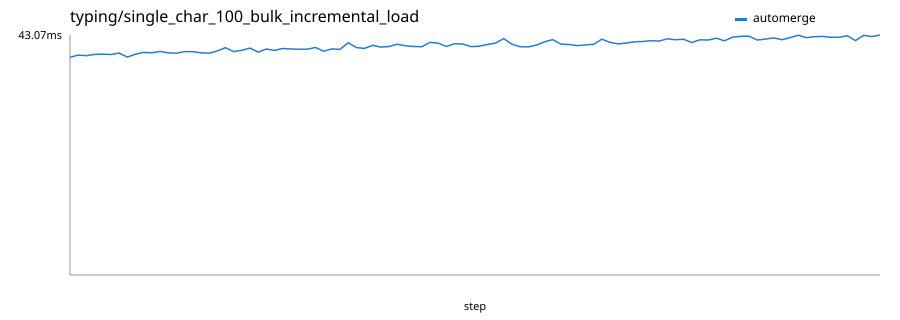

### `typing/single_char_100_incremental_loads`

| library | total | median | mean | last-window median |
| --- | ---: | ---: | ---: | ---: |
| automerge | 384.79s | 3.84s | 3.85s | 4.03s |

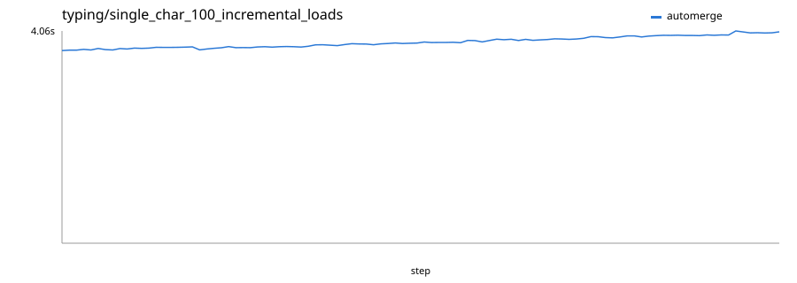

### `typing/single_char_apply_change`

| library | total | median | mean | last-window median |
| --- | ---: | ---: | ---: | ---: |
| automerge | 36.72s | 36.72ms | 36.72ms | 37.15ms |

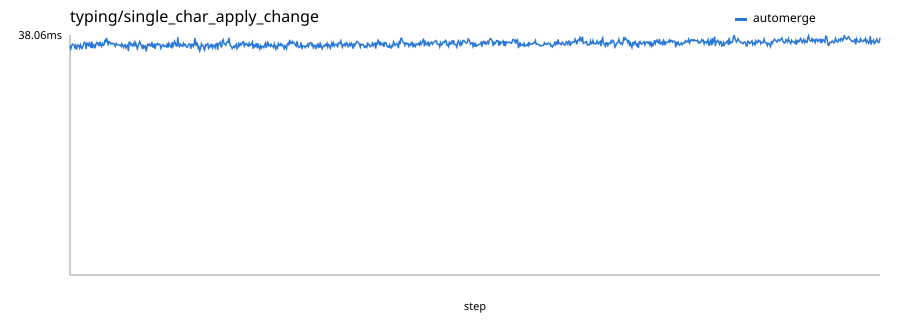

### `typing/single_char_merge`

| library | total | median | mean | last-window median |
| --- | ---: | ---: | ---: | ---: |
| automerge | 37.15s | 37.18ms | 37.15ms | 36.66ms |

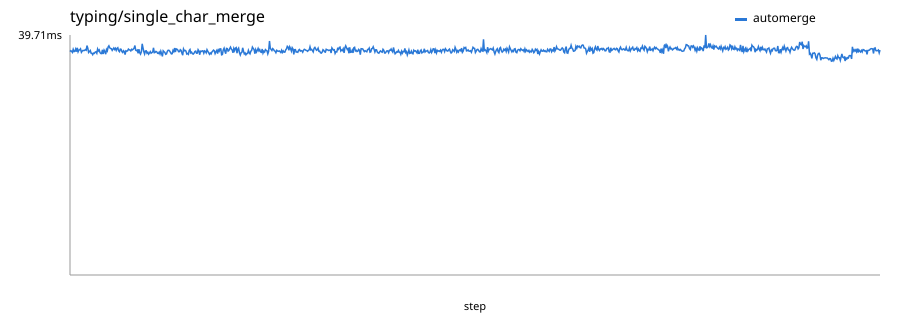

### `typing/single_char_sync`

| library | total | median | mean | last-window median |
| --- | ---: | ---: | ---: | ---: |
| automerge | 37.31s | 37.24ms | 37.31ms | 37.45ms |

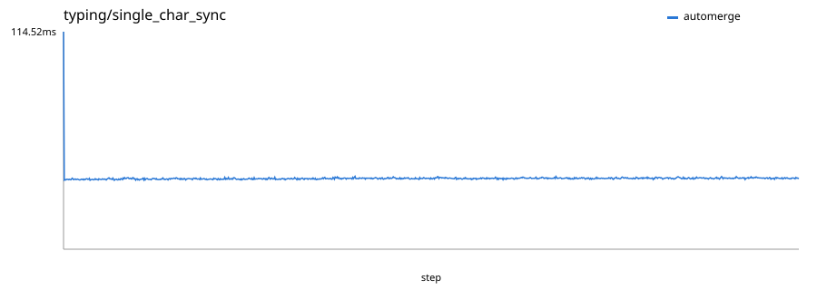

## Not runnable

| benchmark | library | reason |
| --- | --- | --- |
| `bestiary/fork/godot-modeled` | automerge | not ported yet: needs real-world fixtures for every library (docs/tickets/3-fixtures.md) |
| `bestiary/fork/godot-modeled` | yrs | not ported yet: needs real-world fixtures for every library (docs/tickets/3-fixtures.md) |
| `bestiary/fork/godot-thread` | automerge | not ported yet: needs real-world fixtures for every library (docs/tickets/3-fixtures.md) |
| `bestiary/fork/godot-thread` | yrs | not ported yet: needs real-world fixtures for every library (docs/tickets/3-fixtures.md) |
| `bestiary/iter/godot-modeled` | automerge | not ported yet: needs real-world fixtures for every library (docs/tickets/3-fixtures.md) |
| `bestiary/iter/godot-modeled` | yrs | not ported yet: needs real-world fixtures for every library (docs/tickets/3-fixtures.md) |
| `bestiary/iter/godot-thread` | automerge | not ported yet: needs real-world fixtures for every library (docs/tickets/3-fixtures.md) |
| `bestiary/iter/godot-thread` | yrs | not ported yet: needs real-world fixtures for every library (docs/tickets/3-fixtures.md) |
| `bestiary/load/godot-modeled` | automerge | not ported yet: needs real-world fixtures for every library (docs/tickets/3-fixtures.md) |
| `bestiary/load/godot-modeled` | yrs | not ported yet: needs real-world fixtures for every library (docs/tickets/3-fixtures.md) |
| `bestiary/load/godot-thread` | automerge | not ported yet: needs real-world fixtures for every library (docs/tickets/3-fixtures.md) |
| `bestiary/load/godot-thread` | yrs | not ported yet: needs real-world fixtures for every library (docs/tickets/3-fixtures.md) |
| `bestiary/reload/godot-modeled` | automerge | not ported yet: needs real-world fixtures for every library (docs/tickets/3-fixtures.md) |
| `bestiary/reload/godot-modeled` | yrs | not ported yet: needs real-world fixtures for every library (docs/tickets/3-fixtures.md) |
| `bestiary/reload/godot-thread` | automerge | not ported yet: needs real-world fixtures for every library (docs/tickets/3-fixtures.md) |
| `bestiary/reload/godot-thread` | yrs | not ported yet: needs real-world fixtures for every library (docs/tickets/3-fixtures.md) |
| `bestiary/save/godot-modeled` | automerge | not ported yet: needs real-world fixtures for every library (docs/tickets/3-fixtures.md) |
| `bestiary/save/godot-modeled` | yrs | not ported yet: needs real-world fixtures for every library (docs/tickets/3-fixtures.md) |
| `bestiary/save/godot-thread` | automerge | not ported yet: needs real-world fixtures for every library (docs/tickets/3-fixtures.md) |
| `bestiary/save/godot-thread` | yrs | not ported yet: needs real-world fixtures for every library (docs/tickets/3-fixtures.md) |
| `diff/diff` | automerge | not ported yet: needs real-world fixtures for every library (docs/tickets/3-fixtures.md) |
| `diff/diff` | yrs | not ported yet: needs real-world fixtures for every library (docs/tickets/3-fixtures.md) |
| `egwalker_paper/apply_fragment_to_clone/A1` | automerge | not ported yet: needs an Automerge-only feature (docs/tickets/2-automerge-only.md) |
| `egwalker_paper/apply_fragment_to_clone/A1` | yrs | not ported yet: needs an Automerge-only feature (docs/tickets/2-automerge-only.md) |
| `egwalker_paper/apply_fragment_to_clone/A2` | automerge | not ported yet: needs an Automerge-only feature (docs/tickets/2-automerge-only.md) |
| `egwalker_paper/apply_fragment_to_clone/A2` | yrs | not ported yet: needs an Automerge-only feature (docs/tickets/2-automerge-only.md) |
| `egwalker_paper/apply_fragment_to_clone/C1` | automerge | not ported yet: needs an Automerge-only feature (docs/tickets/2-automerge-only.md) |
| `egwalker_paper/apply_fragment_to_clone/C1` | yrs | not ported yet: needs an Automerge-only feature (docs/tickets/2-automerge-only.md) |
| `egwalker_paper/apply_fragment_to_clone/C2` | automerge | not ported yet: needs an Automerge-only feature (docs/tickets/2-automerge-only.md) |
| `egwalker_paper/apply_fragment_to_clone/C2` | yrs | not ported yet: needs an Automerge-only feature (docs/tickets/2-automerge-only.md) |
| `egwalker_paper/apply_fragment_to_clone/S1` | automerge | not ported yet: needs an Automerge-only feature (docs/tickets/2-automerge-only.md) |
| `egwalker_paper/apply_fragment_to_clone/S1` | yrs | not ported yet: needs an Automerge-only feature (docs/tickets/2-automerge-only.md) |
| `egwalker_paper/apply_fragment_to_clone/S2` | automerge | not ported yet: needs an Automerge-only feature (docs/tickets/2-automerge-only.md) |
| `egwalker_paper/apply_fragment_to_clone/S2` | yrs | not ported yet: needs an Automerge-only feature (docs/tickets/2-automerge-only.md) |
| `egwalker_paper/apply_fragment_to_clone/S3` | automerge | not ported yet: needs an Automerge-only feature (docs/tickets/2-automerge-only.md) |
| `egwalker_paper/apply_fragment_to_clone/S3` | yrs | not ported yet: needs an Automerge-only feature (docs/tickets/2-automerge-only.md) |
| `length/map_len_at` | automerge | not ported yet: needs an Automerge-only feature (docs/tickets/2-automerge-only.md) |
| `length/map_len_at` | yrs | not ported yet: needs an Automerge-only feature (docs/tickets/2-automerge-only.md) |
| `length/text_len_at` | automerge | not ported yet: needs an Automerge-only feature (docs/tickets/2-automerge-only.md) |
| `length/text_len_at` | yrs | not ported yet: needs an Automerge-only feature (docs/tickets/2-automerge-only.md) |
| `list/list_cursor_at` | automerge | not ported yet: needs an Automerge-only feature (docs/tickets/2-automerge-only.md) |
| `list/list_cursor_at` | yrs | not ported yet: needs an Automerge-only feature (docs/tickets/2-automerge-only.md) |
| `list/list_splice_index_at` | automerge | not ported yet: needs an Automerge-only feature (docs/tickets/2-automerge-only.md) |
| `list/list_splice_index_at` | yrs | not ported yet: needs an Automerge-only feature (docs/tickets/2-automerge-only.md) |
| `list/list_update_at` | automerge | not ported yet: needs an Automerge-only feature (docs/tickets/2-automerge-only.md) |
| `list/list_update_at` | yrs | not ported yet: needs an Automerge-only feature (docs/tickets/2-automerge-only.md) |
| `load_save/load_actors/load_masked_half/10` | automerge | not ported yet: needs an Automerge-only feature (docs/tickets/2-automerge-only.md) |
| `load_save/load_actors/load_masked_half/10` | yrs | not ported yet: needs an Automerge-only feature (docs/tickets/2-automerge-only.md) |
| `load_save/load_actors/load_masked_half/100` | automerge | not ported yet: needs an Automerge-only feature (docs/tickets/2-automerge-only.md) |
| `load_save/load_actors/load_masked_half/100` | yrs | not ported yet: needs an Automerge-only feature (docs/tickets/2-automerge-only.md) |
| `load_save/load_actors/load_masked_half/1000` | automerge | not ported yet: needs an Automerge-only feature (docs/tickets/2-automerge-only.md) |
| `load_save/load_actors/load_masked_half/1000` | yrs | not ported yet: needs an Automerge-only feature (docs/tickets/2-automerge-only.md) |
| `map/apply/repeated_increment/100` | automerge | not ported yet: needs an Automerge-only feature (docs/tickets/2-automerge-only.md) |
| `map/apply/repeated_increment/100` | yrs | not ported yet: needs an Automerge-only feature (docs/tickets/2-automerge-only.md) |
| `map/apply/repeated_increment/1000` | automerge | not ported yet: needs an Automerge-only feature (docs/tickets/2-automerge-only.md) |
| `map/apply/repeated_increment/1000` | yrs | not ported yet: needs an Automerge-only feature (docs/tickets/2-automerge-only.md) |
| `map/apply/repeated_increment/10000` | automerge | not ported yet: needs an Automerge-only feature (docs/tickets/2-automerge-only.md) |
| `map/apply/repeated_increment/10000` | yrs | not ported yet: needs an Automerge-only feature (docs/tickets/2-automerge-only.md) |
| `map/load/repeated_increment/100` | automerge | not ported yet: needs an Automerge-only feature (docs/tickets/2-automerge-only.md) |
| `map/load/repeated_increment/100` | yrs | not ported yet: needs an Automerge-only feature (docs/tickets/2-automerge-only.md) |
| `map/load/repeated_increment/1000` | automerge | not ported yet: needs an Automerge-only feature (docs/tickets/2-automerge-only.md) |
| `map/load/repeated_increment/1000` | yrs | not ported yet: needs an Automerge-only feature (docs/tickets/2-automerge-only.md) |
| `map/load/repeated_increment/10000` | automerge | not ported yet: needs an Automerge-only feature (docs/tickets/2-automerge-only.md) |
| `map/load/repeated_increment/10000` | yrs | not ported yet: needs an Automerge-only feature (docs/tickets/2-automerge-only.md) |
| `map/repeated_increment/100` | automerge | not ported yet: needs an Automerge-only feature (docs/tickets/2-automerge-only.md) |
| `map/repeated_increment/100` | yrs | not ported yet: needs an Automerge-only feature (docs/tickets/2-automerge-only.md) |
| `map/repeated_increment/1000` | automerge | not ported yet: needs an Automerge-only feature (docs/tickets/2-automerge-only.md) |
| `map/repeated_increment/1000` | yrs | not ported yet: needs an Automerge-only feature (docs/tickets/2-automerge-only.md) |
| `map/repeated_increment/10000` | automerge | not ported yet: needs an Automerge-only feature (docs/tickets/2-automerge-only.md) |
| `map/repeated_increment/10000` | yrs | not ported yet: needs an Automerge-only feature (docs/tickets/2-automerge-only.md) |
| `map/save/repeated_increment/100` | automerge | not ported yet: needs an Automerge-only feature (docs/tickets/2-automerge-only.md) |
| `map/save/repeated_increment/100` | yrs | not ported yet: needs an Automerge-only feature (docs/tickets/2-automerge-only.md) |
| `map/save/repeated_increment/1000` | automerge | not ported yet: needs an Automerge-only feature (docs/tickets/2-automerge-only.md) |
| `map/save/repeated_increment/1000` | yrs | not ported yet: needs an Automerge-only feature (docs/tickets/2-automerge-only.md) |
| `map/save/repeated_increment/10000` | automerge | not ported yet: needs an Automerge-only feature (docs/tickets/2-automerge-only.md) |
| `map/save/repeated_increment/10000` | yrs | not ported yet: needs an Automerge-only feature (docs/tickets/2-automerge-only.md) |
| `memory/clone/egwalker_paper/A1` | yrs | built without the `memory` feature |
| `memory/clone/egwalker_paper/A2` | yrs | built without the `memory` feature |
| `memory/clone/egwalker_paper/C1` | yrs | built without the `memory` feature |
| `memory/clone/egwalker_paper/C2` | yrs | built without the `memory` feature |
| `memory/clone/egwalker_paper/S1` | yrs | built without the `memory` feature |
| `memory/clone/egwalker_paper/S2` | yrs | built without the `memory` feature |
| `memory/clone/egwalker_paper/S3` | yrs | built without the `memory` feature |
| `memory/load/big-paste` | yrs | built without the `memory` feature |
| `memory/load/egwalker_paper/A1` | yrs | built without the `memory` feature |
| `memory/load/egwalker_paper/A2` | yrs | built without the `memory` feature |
| `memory/load/egwalker_paper/C1` | yrs | built without the `memory` feature |
| `memory/load/egwalker_paper/C2` | yrs | built without the `memory` feature |
| `memory/load/egwalker_paper/S1` | yrs | built without the `memory` feature |
| `memory/load/egwalker_paper/S2` | yrs | built without the `memory` feature |
| `memory/load/egwalker_paper/S3` | yrs | built without the `memory` feature |
| `memory/load/essay` | automerge | not ported yet: needs real-world fixtures for every library (docs/tickets/3-fixtures.md) |
| `memory/load/essay` | yrs | not ported yet: needs real-world fixtures for every library (docs/tickets/3-fixtures.md) |
| `memory/load/moby-dick` | automerge | not ported yet: needs real-world fixtures for every library (docs/tickets/3-fixtures.md) |
| `memory/load/moby-dick` | yrs | not ported yet: needs real-world fixtures for every library (docs/tickets/3-fixtures.md) |
| `memory/load/monday-meeting-notes` | automerge | not ported yet: needs real-world fixtures for every library (docs/tickets/3-fixtures.md) |
| `memory/load/monday-meeting-notes` | yrs | not ported yet: needs real-world fixtures for every library (docs/tickets/3-fixtures.md) |
| `memory/load/pathological` | automerge | not ported yet: needs real-world fixtures for every library (docs/tickets/3-fixtures.md) |
| `memory/load/pathological` | yrs | not ported yet: needs real-world fixtures for every library (docs/tickets/3-fixtures.md) |
| `memory/load/stephen` | automerge | not ported yet: needs real-world fixtures for every library (docs/tickets/3-fixtures.md) |
| `memory/load/stephen` | yrs | not ported yet: needs real-world fixtures for every library (docs/tickets/3-fixtures.md) |
| `memory/load/text-splice-100` | yrs | built without the `memory` feature |
| `memory/load/typing` | yrs | built without the `memory` feature |
| `memory/load/unsinkable` | automerge | not ported yet: needs real-world fixtures for every library (docs/tickets/3-fixtures.md) |
| `memory/load/unsinkable` | yrs | not ported yet: needs real-world fixtures for every library (docs/tickets/3-fixtures.md) |
| `memory/load/webstraits` | automerge | not ported yet: needs real-world fixtures for every library (docs/tickets/3-fixtures.md) |
| `memory/load/webstraits` | yrs | not ported yet: needs real-world fixtures for every library (docs/tickets/3-fixtures.md) |
| `range/range_at/10000` | automerge | not ported yet: needs an Automerge-only feature (docs/tickets/2-automerge-only.md) |
| `range/range_at/10000` | yrs | not ported yet: needs an Automerge-only feature (docs/tickets/2-automerge-only.md) |
| `range/range_at/100000` | automerge | not ported yet: needs an Automerge-only feature (docs/tickets/2-automerge-only.md) |
| `range/range_at/100000` | yrs | not ported yet: needs an Automerge-only feature (docs/tickets/2-automerge-only.md) |
| `sync/big_chunky_sync_message` | automerge | not ported yet: needs an Automerge-only feature (docs/tickets/2-automerge-only.md) |
| `sync/big_chunky_sync_message` | yrs | not ported yet: needs an Automerge-only feature (docs/tickets/2-automerge-only.md) |

