# CRDT benchmark battery

Each cell is the median; `(N.N×)` is relative to the best library on that row.

## Sampled benchmarks (median time per iteration)

| benchmark | automerge | automerge-hashless | yrs |
| --- | ---: | ---: | ---: |
| `build/build_big_paste` | 62.01ms (88.6×) | 79.81ms (114.0×) | **700.17µs** (1.0×) |
| `build/build_deep_history_doc` | 3.48s (13.5×) | 6.82s (26.4×) | **258.35ms** (1.0×) |
| `build/build_maps_in_maps_doc` | 959.02ms (13.2×) | 1.60s (22.0×) | **72.92ms** (1.0×) |
| `build/build_text_splice_100` | 65.15ms (35.8×) | 90.56ms (49.8×) | **1.82ms** (1.0×) |
| `build/build_typing` | 1.16s (9.8×) | 1.62s (13.7×) | **118.57ms** (1.0×) |
| `edit_trace/edit_trace_many_tx` | **5.20s** (1.0×) | 5.37s (1.0×) | 8.62s (1.7×) |
| `edit_trace/edit_trace_single_tx` | **4.13s** (1.0×) | 5.68s (1.4×) | 199.50s (48.3×) |
| `egwalker_paper/clone/A1` | **584.21µs** (1.0×) | 882.68µs (1.5×) | 26.14ms (44.7×) |
| `egwalker_paper/clone/A2` | 862.41µs (1.2×) | **706.82µs** (1.0×) | 27.05ms (38.3×) |
| `egwalker_paper/clone/C1` | 5.71ms (3.5×) | **1.65ms** (1.0×) | 28.87ms (17.5×) |
| `egwalker_paper/clone/C2` | 10.04ms (7.8×) | **1.29ms** (1.0×) | 19.56ms (15.2×) |
| `egwalker_paper/clone/S1` | **243.83µs** (1.0×) | 254.33µs (1.0×) | 18.17ms (74.5×) |
| `egwalker_paper/clone/S2` | **369.44µs** (1.0×) | 384.28µs (1.0×) | 24.79ms (67.1×) |
| `egwalker_paper/clone/S3` | **438.44µs** (1.0×) | 740.92µs (1.7×) | 21.11ms (48.2×) |
| `egwalker_paper/get_text/A1` | 1.22ms (4.5×) | 2.03ms (7.4×) | **273.47µs** (1.0×) |
| `egwalker_paper/get_text/A2` | 6.86ms (16.3×) | 11.80ms (28.0×) | **421.32µs** (1.0×) |
| `egwalker_paper/get_text/C1` | 25.30ms (55.4×) | 26.48ms (58.0×) | **456.86µs** (1.0×) |
| `egwalker_paper/get_text/C2` | 26.65ms (87.5×) | 25.84ms (84.9×) | **304.37µs** (1.0×) |
| `egwalker_paper/get_text/S1` | 9.24ms (22.8×) | 9.61ms (23.8×) | **404.30µs** (1.0×) |
| `egwalker_paper/get_text/S2` | 5.20ms (11.2×) | 5.52ms (11.9×) | **463.57µs** (1.0×) |
| `egwalker_paper/get_text/S3` | 3.53ms (10.2×) | 6.07ms (17.5×) | **346.38µs** (1.0×) |
| `egwalker_paper/load/A1` | 542.77ms (23.3×) | 75.70ms (3.3×) | **23.29ms** (1.0×) |
| `egwalker_paper/load/A2` | 395.95ms (16.6×) | 69.14ms (2.9×) | **23.89ms** (1.0×) |
| `egwalker_paper/load/C1` | 622.32ms (25.8×) | 127.14ms (5.3×) | **24.16ms** (1.0×) |
| `egwalker_paper/load/C2` | 699.73ms (42.7×) | 149.66ms (9.1×) | **16.39ms** (1.0×) |
| `egwalker_paper/load/S1` | 563.23ms (37.2×) | 39.30ms (2.6×) | **15.14ms** (1.0×) |
| `egwalker_paper/load/S2` | 790.80ms (37.6×) | 48.81ms (2.3×) | **21.03ms** (1.0×) |
| `egwalker_paper/load/S3` | 1.85s (100.8×) | 84.86ms (4.6×) | **18.34ms** (1.0×) |
| `length/list_len_now` | 882.53µs (14708.9×) | 334.36µs (5572.6×) | **60ns** (1.0×) |
| `length/map_len_now` | 2.82ms (3.5×) | 2.37ms (2.9×) | **807.98µs** (1.0×) |
| `length/text_len_now` | 501ns (8.3×) | 301ns (5.0×) | **60ns** (1.0×) |
| `list/list_cursor_now` | 18.35µs (1.8×) | 16.69µs (1.6×) | **10.29µs** (1.0×) |
| `list/list_splice_index_now` | 41.28µs (4.7×) | 23.84µs (2.7×) | **8.70µs** (1.0×) |
| `list/list_update_now` | 50.15µs (2.3×) | 57.47µs (2.6×) | **21.89µs** (1.0×) |
| `load_save/load_actors/load/10` | 63.91µs (7.7×) | 63.55µs (7.7×) | **8.27µs** (1.0×) |
| `load_save/load_actors/load/100` | 423.81µs (4.6×) | 347.20µs (3.8×) | **92.28µs** (1.0×) |
| `load_save/load_actors/load/1000` | 5.56ms (5.9×) | 1.46ms (1.5×) | **947.63µs** (1.0×) |
| `load_save/load_big_paste` | 78.58ms (1266.3×) | 9.80ms (157.9×) | **62.06µs** (1.0×) |
| `load_save/load_big_random` | 148.19ms (5.4×) | **27.50ms** (1.0×) | 107.84ms (3.9×) |
| `load_save/load_deep_history/1000` | 500.22ms (6.1×) | 93.89ms (1.2×) | **81.34ms** (1.0×) |
| `load_save/load_maps_in_maps` | 112.15ms (2.3×) | 126.44ms (2.6×) | **48.64ms** (1.0×) |
| `load_save/load_text_splice_100` | 116.02ms (126.2×) | 10.60ms (11.5×) | **919.31µs** (1.0×) |
| `load_save/load_typing` | 352.47ms (5682.1×) | 37.44ms (603.6×) | **62.03µs** (1.0×) |
| `load_save/save_big_paste` | 4.25ms (34.6×) | 4.18ms (34.1×) | **122.80µs** (1.0×) |
| `load_save/save_big_random` | 29.17ms (4.8×) | 16.36ms (2.7×) | **6.14ms** (1.0×) |
| `load_save/save_deep_history/1000` | 30.55ms (2.8×) | 27.95ms (2.6×) | **10.84ms** (1.0×) |
| `load_save/save_maps_in_maps` | 24.44ms (3.3×) | 23.52ms (3.2×) | **7.41ms** (1.0×) |
| `load_save/save_text_splice_100` | 5.05ms (15.4×) | 4.92ms (15.0×) | **327.29µs** (1.0×) |
| `load_save/save_typing` | 11.65ms (94.9×) | 9.66ms (78.6×) | **122.84µs** (1.0×) |
| `map/apply/decreasing_put/100` | 191.23µs (3.5×) | 113.94µs (2.1×) | **55.28µs** (1.0×) |
| `map/apply/decreasing_put/1000` | 1.57ms (2.8×) | 921.54µs (1.6×) | **569.80µs** (1.0×) |
| `map/apply/decreasing_put/10000` | 8.94ms (1.7×) | 15.97ms (3.0×) | **5.37ms** (1.0×) |
| `map/apply/increasing_put/100` | 193.33µs (3.4×) | 111.69µs (2.0×) | **56.24µs** (1.0×) |
| `map/apply/increasing_put/1000` | 1.57ms (2.7×) | 1.49ms (2.6×) | **576.04µs** (1.0×) |
| `map/apply/increasing_put/10000` | 8.88ms (1.6×) | 15.59ms (2.9×) | **5.40ms** (1.0×) |
| `map/apply/repeated_put/100` | 178.73µs (91.9×) | 112.14µs (57.7×) | **1.94µs** (1.0×) |
| `map/apply/repeated_put/1000` | 1.47ms (746.9×) | 875.65µs (445.9×) | **1.96µs** (1.0×) |
| `map/apply/repeated_put/10000` | 14.28ms (7287.7×) | 8.36ms (4265.6×) | **1.96µs** (1.0×) |
| `map/decreasing_put/100` | 1.24ms (26.2×) | 739.15µs (15.6×) | **47.33µs** (1.0×) |
| `map/decreasing_put/1000` | 12.53ms (24.6×) | 12.12ms (23.8×) | **510.15µs** (1.0×) |
| `map/decreasing_put/10000` | 71.58ms (15.1×) | 131.47ms (27.7×) | **4.75ms** (1.0×) |
| `map/deep_history/100` | 5.27ms (37.5×) | 3.74ms (26.6×) | **140.65µs** (1.0×) |
| `map/deep_history/1000` | 53.42ms (38.0×) | 37.78ms (26.9×) | **1.40ms** (1.0×) |
| `map/deep_history/10000` | 324.61ms (23.1×) | 684.17ms (48.8×) | **14.03ms** (1.0×) |
| `map/increasing_put/100` | 1.73ms (36.0×) | 1.02ms (21.2×) | **47.89µs** (1.0×) |
| `map/increasing_put/1000` | 23.91ms (46.5×) | 14.15ms (27.5×) | **514.63µs** (1.0×) |
| `map/increasing_put/10000` | 246.34ms (51.8×) | 253.89ms (53.4×) | **4.76ms** (1.0×) |
| `map/load/decreasing_put/100` | 174.40µs (2.8×) | 118.98µs (1.9×) | **61.24µs** (1.0×) |
| `map/load/decreasing_put/1000` | 1.38ms (2.1×) | 809.66µs (1.3×) | **643.12µs** (1.0×) |
| `map/load/decreasing_put/10000` | 7.50ms (1.8×) | **4.07ms** (1.0×) | 6.01ms (1.5×) |
| `map/load/increasing_put/100` | 170.30µs (2.7×) | 117.02µs (1.9×) | **61.98µs** (1.0×) |
| `map/load/increasing_put/1000` | 1.38ms (2.1×) | 1.30ms (2.0×) | **645.32µs** (1.0×) |
| `map/load/increasing_put/10000` | 7.55ms (1.9×) | **4.06ms** (1.0×) | 6.06ms (1.5×) |
| `map/load/repeated_put/100` | 155.99µs (70.8×) | 111.31µs (50.5×) | **2.20µs** (1.0×) |
| `map/load/repeated_put/1000` | 1.23ms (549.8×) | 739.01µs (330.8×) | **2.23µs** (1.0×) |
| `map/load/repeated_put/10000` | 11.59ms (5174.6×) | 2.06ms (921.4×) | **2.24µs** (1.0×) |
| `map/repeated_put/100` | 1.94ms (41.4×) | 1.27ms (26.9×) | **46.99µs** (1.0×) |
| `map/repeated_put/1000` | 19.34ms (43.3×) | 12.54ms (28.1×) | **446.61µs** (1.0×) |
| `map/repeated_put/10000` | 192.71ms (44.2×) | 125.50ms (28.8×) | **4.36ms** (1.0×) |
| `map/save/decreasing_put/100` | 28.00µs (6.5×) | 19.75µs (4.6×) | **4.30µs** (1.0×) |
| `map/save/decreasing_put/1000` | 262.81µs (6.3×) | 149.13µs (3.5×) | **42.01µs** (1.0×) |
| `map/save/decreasing_put/10000` | 1.21ms (2.9×) | 2.03ms (4.9×) | **414.86µs** (1.0×) |
| `map/save/increasing_put/100` | 26.95µs (6.3×) | 19.73µs (4.6×) | **4.26µs** (1.0×) |
| `map/save/increasing_put/1000` | 262.70µs (6.2×) | 248.78µs (5.9×) | **42.08µs** (1.0×) |
| `map/save/increasing_put/10000` | 2.12ms (5.1×) | 2.05ms (4.9×) | **415.64µs** (1.0×) |
| `map/save/repeated_put/100` | 4.82µs (11.7×) | 5.90µs (14.4×) | **411ns** (1.0×) |
| `map/save/repeated_put/1000` | 89.85µs (213.4×) | 55.78µs (132.5×) | **421ns** (1.0×) |
| `map/save/repeated_put/10000` | 700.02µs (1552.1×) | 391.69µs (868.5×) | **451ns** (1.0×) |
| `marks/add_mark` | 54.61µs (3.8×) | 100.09µs (7.0×) | **14.25µs** (1.0×) |
| `marks/get_marks_at_end` | 20.55ms (3722.0×) | **5.52µs** (1.0×) | 120.76µs (21.9×) |
| `marks/splice_with_marks` | 514.12ms (3.8×) | 872.50ms (6.4×) | **135.77ms** (1.0×) |
| `marks/splice_without_marks` | 68.71ms (2.9×) | 80.61ms (3.4×) | **23.83ms** (1.0×) |
| `range/range/10000` | 4.71ms (10.4×) | 5.41ms (12.0×) | **451.31µs** (1.0×) |
| `range/range/100000` | 47.38ms (2.7×) | 54.94ms (3.1×) | **17.44ms** (1.0×) |
| `sync/every_change/100` | 12.42ms (33.9×) | n/a | **366.49µs** (1.0×) |
| `sync/every_change/1000` | 345.95ms (71.4×) | n/a | **4.85ms** (1.0×) |
| `sync/every_change/10000` | 19.28s (107.0×) | n/a | **180.15ms** (1.0×) |
| `sync/full_many_tx` | 53.06ms (9.2×) | n/a | **5.77ms** (1.0×) |
| `sync/full_one_tx` | 14.35ms (2.5×) | n/a | **5.80ms** (1.0×) |
| `sync/full_one_tx/100` | 229.46µs (3.8×) | n/a | **60.51µs** (1.0×) |
| `sync/full_one_tx/1000` | 1.60ms (2.6×) | n/a | **604.66µs** (1.0×) |

<!-- figures:sampled -->
One chart per group: the bar is the median, the whisker spans the fastest and slowest sample.

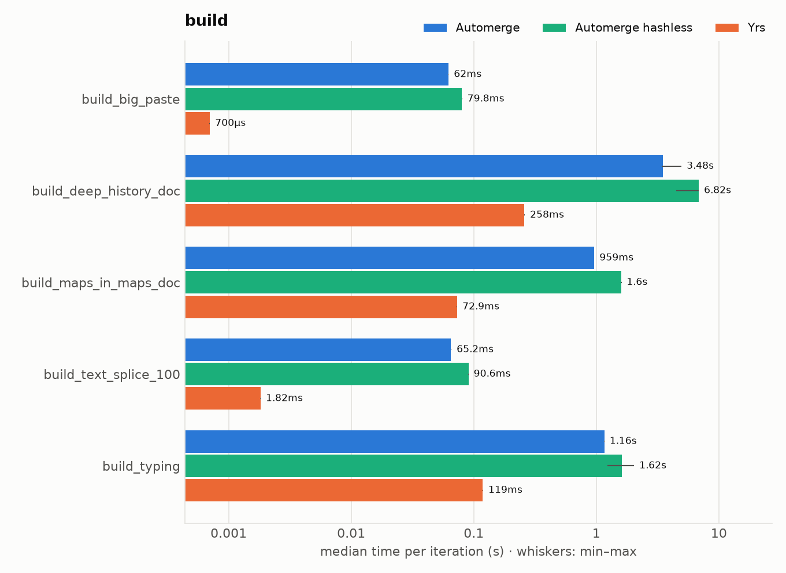

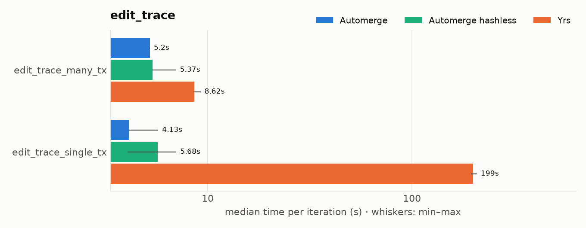

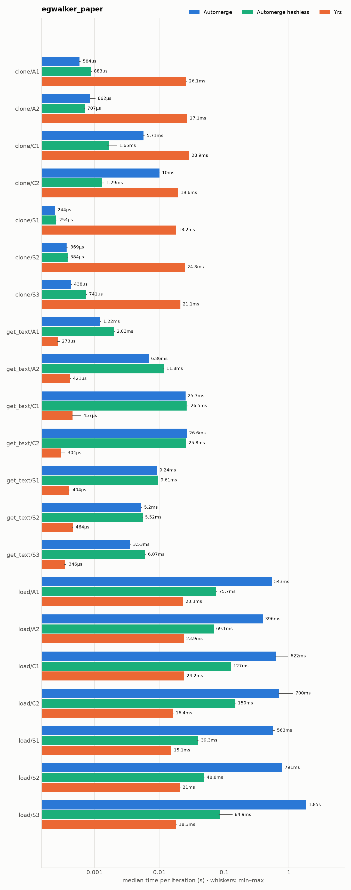

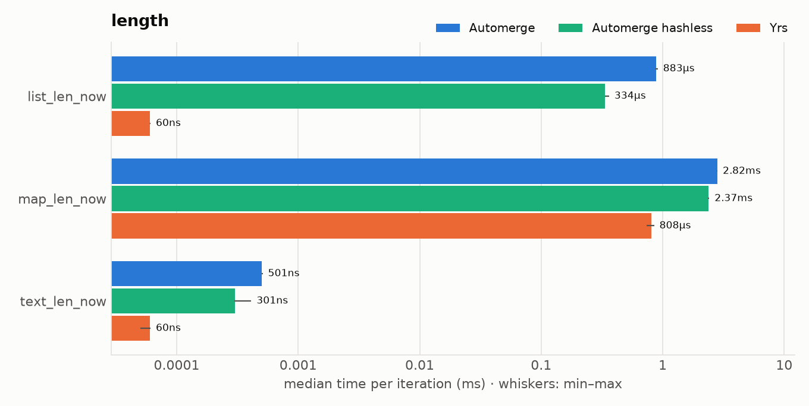

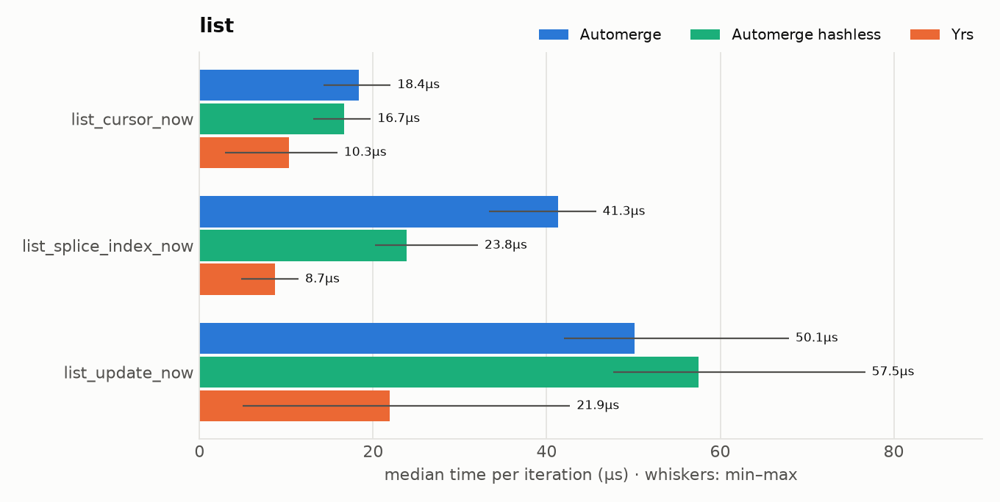

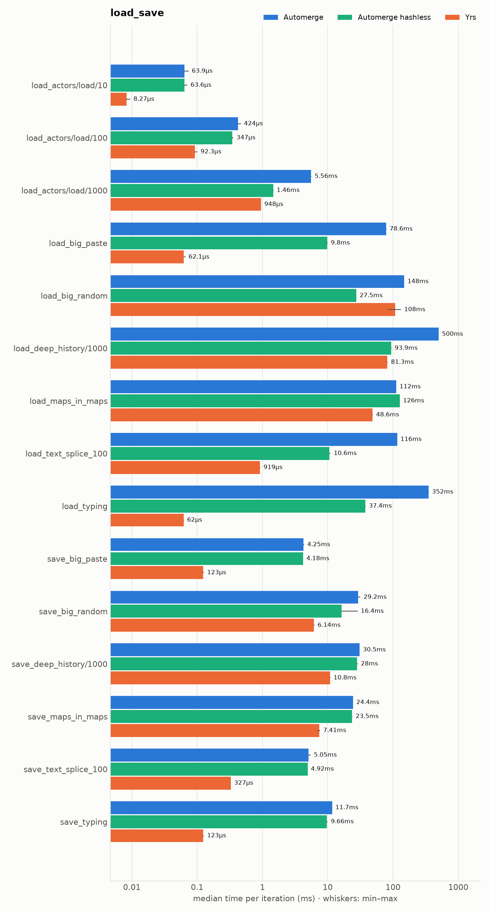

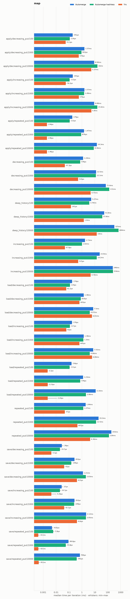

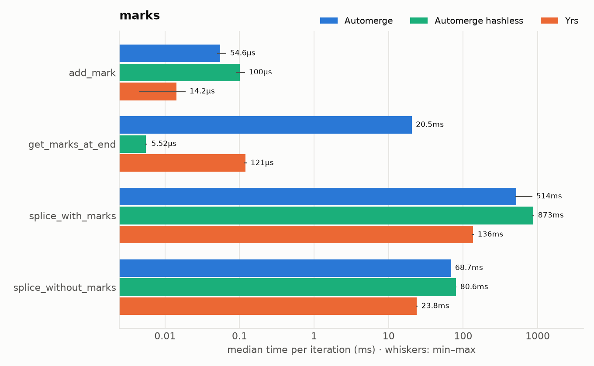

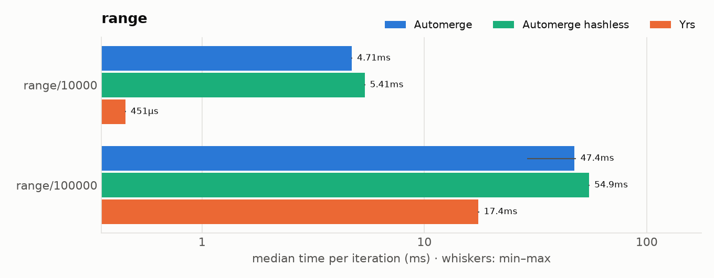

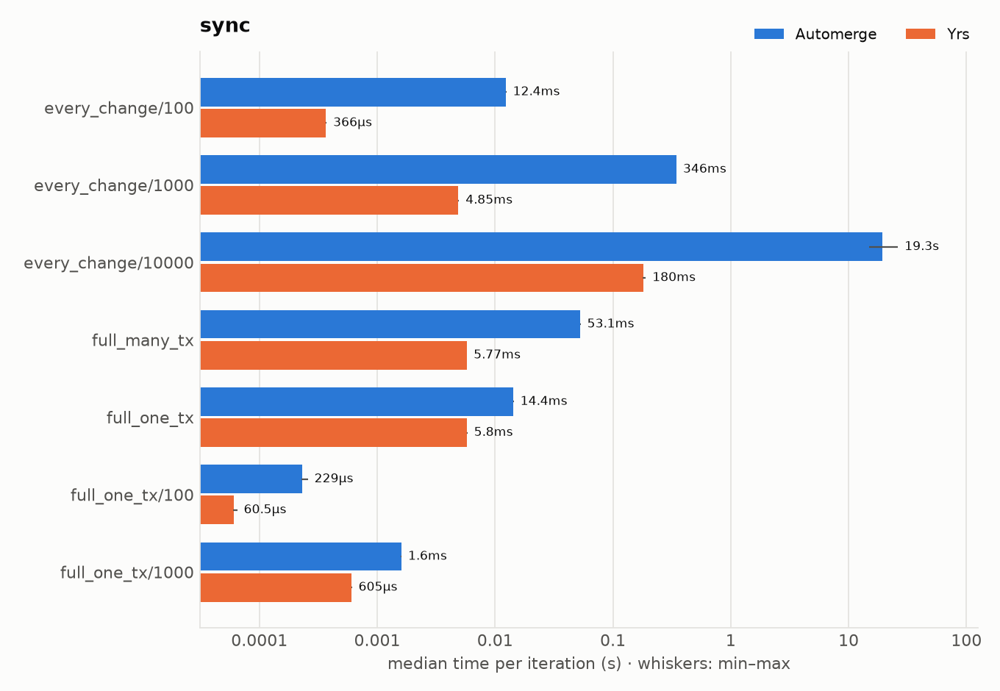

<!-- /figures:sampled -->

## Series benchmarks (total time over all steps)

| benchmark | automerge | automerge-hashless | yrs |
| --- | ---: | ---: | ---: |
| `apply/single_char_incremental_load` | 33.92s (151.0×) | **224.58ms** (1.0×) | 4.75s (21.2×) |
| `sync/tiny_list` | 41.65s (1213.5×) | n/a | **34.32ms** (1.0×) |
| `sync/tiny_text` | 32.46s (229.8×) | n/a | **141.27ms** (1.0×) |
| `typing/single_char_100_bulk_incremental_load` | 3.74s (7.6×) | **492.08ms** (1.0×) | 24.97s (50.8×) |
| `typing/single_char_100_incremental_loads` | 424.22s (182.6×) | **2.32s** (1.0×) | 45.59s (19.6×) |
| `typing/single_char_apply_change` | 33.73s (22.2×) | **1.52s** (1.0×) | 2.16s (1.4×) |
| `typing/single_char_merge` | 47.84s (230.2×) | **207.82ms** (1.0×) | 4.23s (20.3×) |
| `typing/single_char_sync` | 57.28s (7.2×) | n/a | **7.94s** (1.0×) |

## Peak memory

| benchmark | automerge | automerge-hashless | yrs |
| --- | ---: | ---: | ---: |
| `memory/clone/egwalker_paper/A1` | 2.73 MiB (1.1×) | **2.41 MiB** (1.0×) | 11.72 MiB (4.9×) |
| `memory/clone/egwalker_paper/A2` | 5.25 MiB (2.3×) | **2.32 MiB** (1.0×) | 9.44 MiB (4.1×) |
| `memory/clone/egwalker_paper/C1` | 15.38 MiB (2.7×) | **5.74 MiB** (1.0×) | 13.42 MiB (2.3×) |
| `memory/clone/egwalker_paper/C2` | 24.20 MiB (3.4×) | **7.06 MiB** (1.0×) | 8.85 MiB (1.3×) |
| `memory/clone/egwalker_paper/S1` | **1.30 MiB** (1.0×) | 1.30 MiB (1.0×) | 8.68 MiB (6.7×) |
| `memory/clone/egwalker_paper/S2` | **1.83 MiB** (1.0×) | 1.83 MiB (1.0×) | 10.83 MiB (5.9×) |
| `memory/clone/egwalker_paper/S3` | **2.59 MiB** (1.0×) | 2.61 MiB (1.0×) | 11.11 MiB (4.3×) |
| `memory/load/big-paste` | 8.84 MiB (90.4×) | 427.43 KiB (4.3×) | **100.09 KiB** (1.0×) |
| `memory/load/egwalker_paper/A1` | 91.32 MiB (16.6×) | **5.51 MiB** (1.0×) | 10.72 MiB (1.9×) |
| `memory/load/egwalker_paper/A2` | 57.73 MiB (12.1×) | **4.77 MiB** (1.0×) | 8.44 MiB (1.8×) |
| `memory/load/egwalker_paper/C1` | 180.91 MiB (16.5×) | **10.97 MiB** (1.0×) | 11.42 MiB (1.0×) |
| `memory/load/egwalker_paper/C2` | 208.07 MiB (26.5×) | 15.74 MiB (2.0×) | **7.85 MiB** (1.0×) |
| `memory/load/egwalker_paper/S1` | 234.70 MiB (75.9×) | **3.09 MiB** (1.0×) | 7.68 MiB (2.5×) |
| `memory/load/egwalker_paper/S2` | 317.46 MiB (72.7×) | **4.37 MiB** (1.0×) | 9.83 MiB (2.2×) |
| `memory/load/egwalker_paper/S3` | 680.13 MiB (104.1×) | **6.53 MiB** (1.0×) | 10.11 MiB (1.5×) |
| `memory/load/text-splice-100` | 31.87 MiB (65.4×) | 503.02 KiB (1.0×) | **499.04 KiB** (1.0×) |
| `memory/load/typing` | 92.61 MiB (947.5×) | 6.68 MiB (68.3×) | **100.09 KiB** (1.0×) |

<!-- figures:memory-peak -->
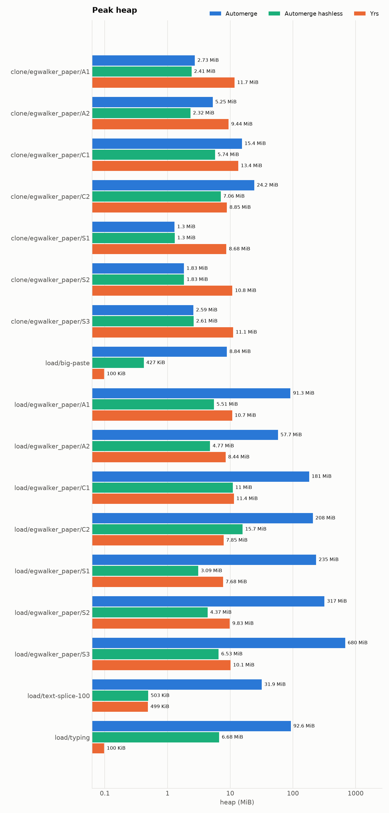

<!-- /figures:memory-peak -->

## Steady-state memory

| benchmark | automerge | automerge-hashless | yrs |
| --- | ---: | ---: | ---: |
| `memory/clone/egwalker_paper/A1` | 2.73 MiB (1.1×) | **2.41 MiB** (1.0×) | 9.58 MiB (4.0×) |
| `memory/clone/egwalker_paper/A2` | 5.25 MiB (2.3×) | **2.32 MiB** (1.0×) | 7.44 MiB (3.2×) |
| `memory/clone/egwalker_paper/C1` | 15.38 MiB (2.7×) | **5.74 MiB** (1.0×) | 9.97 MiB (1.7×) |
| `memory/clone/egwalker_paper/C2` | 24.20 MiB (3.5×) | 7.06 MiB (1.0×) | **6.87 MiB** (1.0×) |
| `memory/clone/egwalker_paper/S1` | **1.30 MiB** (1.0×) | 1.30 MiB (1.0×) | 6.80 MiB (5.2×) |
| `memory/clone/egwalker_paper/S2` | **1.83 MiB** (1.0×) | 1.83 MiB (1.0×) | 8.54 MiB (4.7×) |
| `memory/clone/egwalker_paper/S3` | **2.59 MiB** (1.0×) | 2.61 MiB (1.0×) | 8.97 MiB (3.5×) |
| `memory/load/big-paste` | 109.57 KiB (1.1×) | 105.43 KiB (1.1×) | **99.21 KiB** (1.0×) |
| `memory/load/egwalker_paper/A1` | 3.02 MiB (1.1×) | **2.73 MiB** (1.0×) | 9.58 MiB (3.5×) |
| `memory/load/egwalker_paper/A2` | 5.49 MiB (2.2×) | **2.49 MiB** (1.0×) | 7.44 MiB (3.0×) |
| `memory/load/egwalker_paper/C1` | 18.25 MiB (2.9×) | **6.26 MiB** (1.0×) | 9.97 MiB (1.6×) |
| `memory/load/egwalker_paper/C2` | 30.31 MiB (4.4×) | 8.01 MiB (1.2×) | **6.87 MiB** (1.0×) |
| `memory/load/egwalker_paper/S1` | **1.38 MiB** (1.0×) | 1.40 MiB (1.0×) | 6.80 MiB (4.9×) |
| `memory/load/egwalker_paper/S2` | **2.01 MiB** (1.0×) | 2.03 MiB (1.0×) | 8.54 MiB (4.2×) |
| `memory/load/egwalker_paper/S3` | **2.73 MiB** (1.0×) | 2.74 MiB (1.0×) | 8.97 MiB (3.3×) |
| `memory/load/text-splice-100` | 149.02 KiB (1.0×) | **145.07 KiB** (1.0×) | 452.28 KiB (3.1×) |
| `memory/load/typing` | 14.09 MiB (145.4×) | 3.85 MiB (39.8×) | **99.21 KiB** (1.0×) |

<!-- figures:memory-steady -->
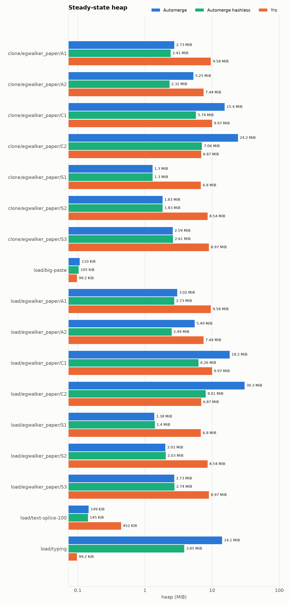

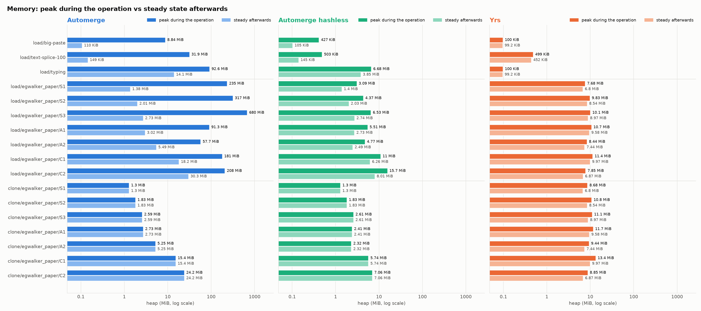

Peak against steady state, per library: a long dark bar over a short light one is memory the operation needed only while it ran.

<!-- /figures:memory-steady -->

## Series details

### `apply/single_char_incremental_load`

| library | total | median | mean | last-window median |
| --- | ---: | ---: | ---: | ---: |
| automerge | 33.92s | 32.79ms | 33.92ms | 33.07ms |
| automerge-hashless | 224.58ms | 222.29µs | 224.58µs | 222.34µs |
| yrs | 4.75s | 4.47ms | 4.75ms | 5.93ms |

<!-- figures:series:apply/single_char_incremental_load -->
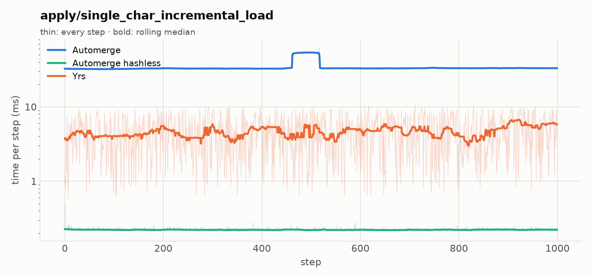

<!-- /figures:series:apply/single_char_incremental_load -->

### `sync/tiny_list`

| library | total | median | mean | last-window median |
| --- | ---: | ---: | ---: | ---: |
| automerge | 41.65s | 45.24ms | 41.65ms | 46.07ms |
| yrs | 34.32ms | 33.40µs | 34.32µs | 43.74µs |

<!-- figures:series:sync/tiny_list -->
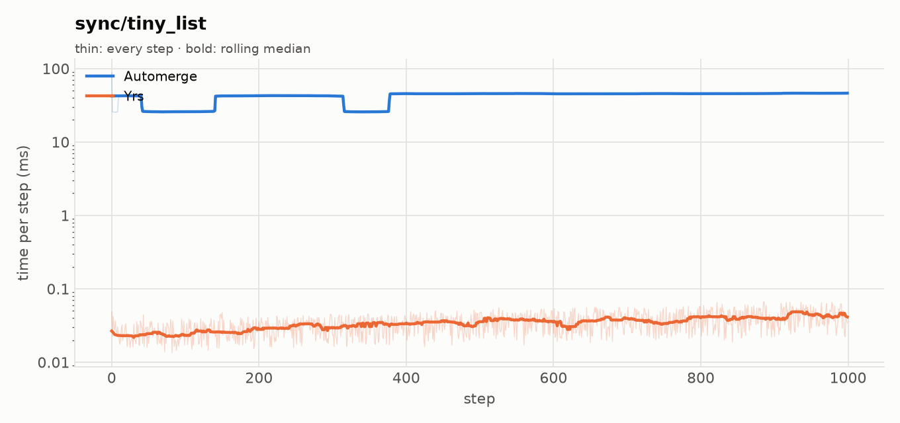

<!-- /figures:series:sync/tiny_list -->

### `sync/tiny_text`

| library | total | median | mean | last-window median |
| --- | ---: | ---: | ---: | ---: |
| automerge | 32.46s | 32.17ms | 32.46ms | 32.33ms |
| yrs | 141.27ms | 138.71µs | 141.27µs | 248.31µs |

<!-- figures:series:sync/tiny_text -->
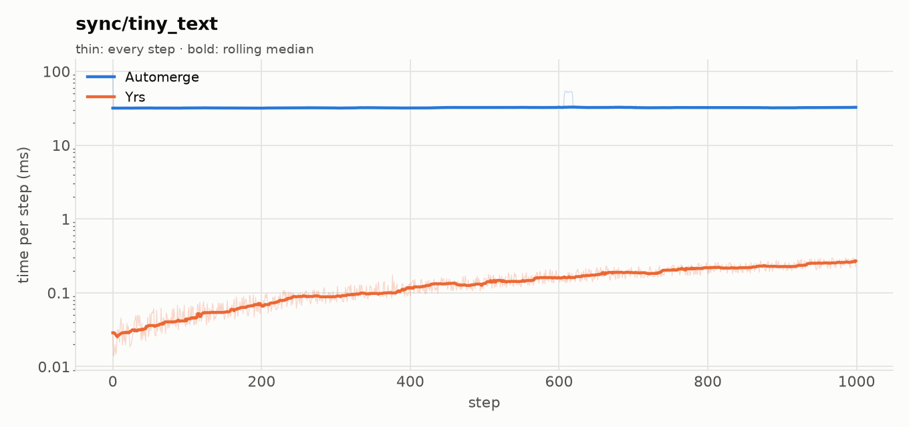

<!-- /figures:series:sync/tiny_text -->

### `typing/single_char_100_bulk_incremental_load`

| library | total | median | mean | last-window median |
| --- | ---: | ---: | ---: | ---: |
| automerge | 3.74s | 37.24ms | 37.45ms | 38.90ms |
| automerge-hashless | 492.08ms | 4.91ms | 4.92ms | 4.91ms |
| yrs | 24.97s | 246.42ms | 249.75ms | 240.04ms |

<!-- figures:series:typing/single_char_100_bulk_incremental_load -->
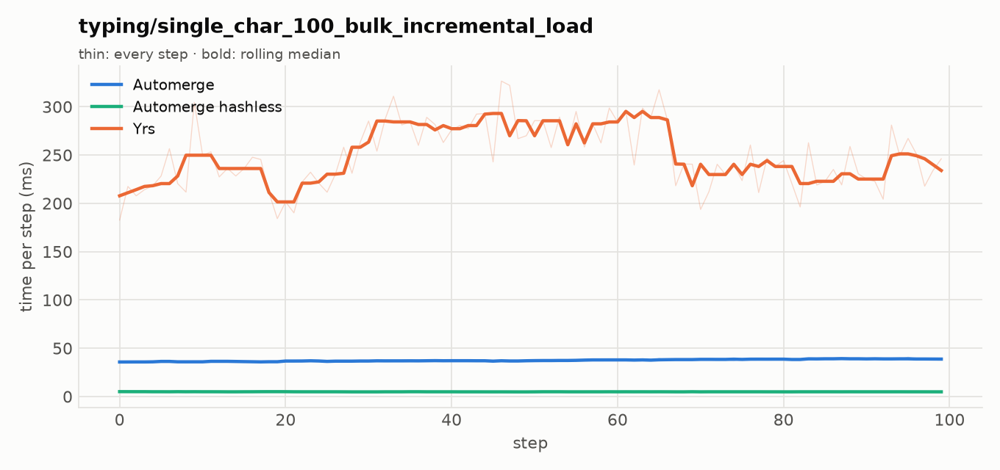

<!-- /figures:series:typing/single_char_100_bulk_incremental_load -->

### `typing/single_char_100_incremental_loads`

| library | total | median | mean | last-window median |
| --- | ---: | ---: | ---: | ---: |
| automerge | 424.22s | 3.49s | 4.24s | 6.29s |
| automerge-hashless | 2.32s | 23.23ms | 23.23ms | 23.26ms |
| yrs | 45.59s | 455.65ms | 455.87ms | 480.55ms |

<!-- figures:series:typing/single_char_100_incremental_loads -->
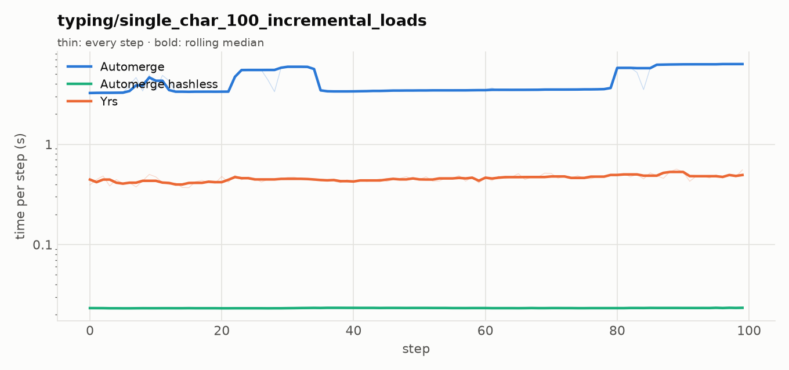

<!-- /figures:series:typing/single_char_100_incremental_loads -->

### `typing/single_char_apply_change`

| library | total | median | mean | last-window median |
| --- | ---: | ---: | ---: | ---: |
| automerge | 33.73s | 33.22ms | 33.73ms | 33.26ms |
| automerge-hashless | 1.52s | 1.50ms | 1.52ms | 1.59ms |
| yrs | 2.16s | 1.87ms | 2.16ms | 1.82ms |

<!-- figures:series:typing/single_char_apply_change -->
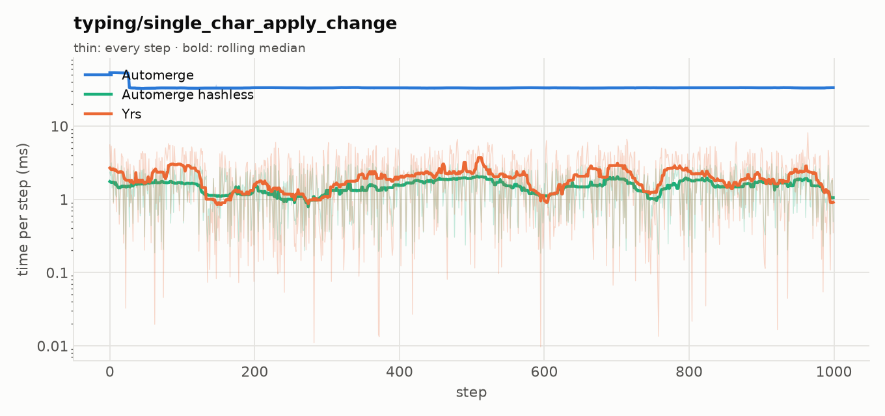

<!-- /figures:series:typing/single_char_apply_change -->

### `typing/single_char_merge`

| library | total | median | mean | last-window median |
| --- | ---: | ---: | ---: | ---: |
| automerge | 47.84s | 57.39ms | 47.84ms | 33.23ms |
| automerge-hashless | 207.82ms | 205.68µs | 207.82µs | 206.12µs |
| yrs | 4.23s | 4.21ms | 4.23ms | 4.23ms |

<!-- figures:series:typing/single_char_merge -->
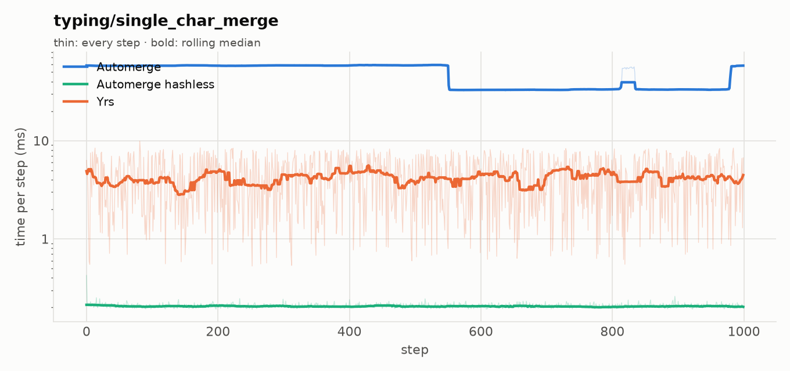

<!-- /figures:series:typing/single_char_merge -->

### `typing/single_char_sync`

| library | total | median | mean | last-window median |
| --- | ---: | ---: | ---: | ---: |
| automerge | 57.28s | 59.14ms | 57.28ms | 34.11ms |
| yrs | 7.94s | 8.07ms | 7.94ms | 7.82ms |

<!-- figures:series:typing/single_char_sync -->
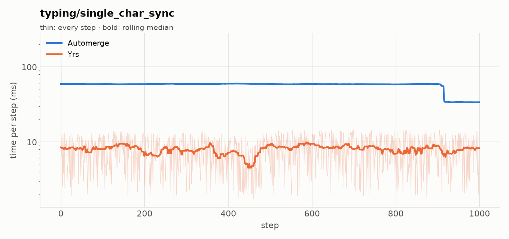

<!-- /figures:series:typing/single_char_sync -->

## Not runnable

| benchmark | library | reason |
| --- | --- | --- |
| `bestiary/fork/godot-modeled` | automerge | not ported yet: needs real-world fixtures for every library (docs/tickets/3-fixtures.md) |
| `bestiary/fork/godot-modeled` | automerge-hashless | not ported yet: needs real-world fixtures for every library (docs/tickets/3-fixtures.md) |
| `bestiary/fork/godot-modeled` | yrs | not ported yet: needs real-world fixtures for every library (docs/tickets/3-fixtures.md) |
| `bestiary/fork/godot-thread` | automerge | not ported yet: needs real-world fixtures for every library (docs/tickets/3-fixtures.md) |
| `bestiary/fork/godot-thread` | automerge-hashless | not ported yet: needs real-world fixtures for every library (docs/tickets/3-fixtures.md) |
| `bestiary/fork/godot-thread` | yrs | not ported yet: needs real-world fixtures for every library (docs/tickets/3-fixtures.md) |
| `bestiary/iter/godot-modeled` | automerge | not ported yet: needs real-world fixtures for every library (docs/tickets/3-fixtures.md) |
| `bestiary/iter/godot-modeled` | automerge-hashless | not ported yet: needs real-world fixtures for every library (docs/tickets/3-fixtures.md) |
| `bestiary/iter/godot-modeled` | yrs | not ported yet: needs real-world fixtures for every library (docs/tickets/3-fixtures.md) |
| `bestiary/iter/godot-thread` | automerge | not ported yet: needs real-world fixtures for every library (docs/tickets/3-fixtures.md) |
| `bestiary/iter/godot-thread` | automerge-hashless | not ported yet: needs real-world fixtures for every library (docs/tickets/3-fixtures.md) |
| `bestiary/iter/godot-thread` | yrs | not ported yet: needs real-world fixtures for every library (docs/tickets/3-fixtures.md) |
| `bestiary/load/godot-modeled` | automerge | not ported yet: needs real-world fixtures for every library (docs/tickets/3-fixtures.md) |
| `bestiary/load/godot-modeled` | automerge-hashless | not ported yet: needs real-world fixtures for every library (docs/tickets/3-fixtures.md) |
| `bestiary/load/godot-modeled` | yrs | not ported yet: needs real-world fixtures for every library (docs/tickets/3-fixtures.md) |
| `bestiary/load/godot-thread` | automerge | not ported yet: needs real-world fixtures for every library (docs/tickets/3-fixtures.md) |
| `bestiary/load/godot-thread` | automerge-hashless | not ported yet: needs real-world fixtures for every library (docs/tickets/3-fixtures.md) |
| `bestiary/load/godot-thread` | yrs | not ported yet: needs real-world fixtures for every library (docs/tickets/3-fixtures.md) |
| `bestiary/reload/godot-modeled` | automerge | not ported yet: needs real-world fixtures for every library (docs/tickets/3-fixtures.md) |
| `bestiary/reload/godot-modeled` | automerge-hashless | not ported yet: needs real-world fixtures for every library (docs/tickets/3-fixtures.md) |
| `bestiary/reload/godot-modeled` | yrs | not ported yet: needs real-world fixtures for every library (docs/tickets/3-fixtures.md) |
| `bestiary/reload/godot-thread` | automerge | not ported yet: needs real-world fixtures for every library (docs/tickets/3-fixtures.md) |
| `bestiary/reload/godot-thread` | automerge-hashless | not ported yet: needs real-world fixtures for every library (docs/tickets/3-fixtures.md) |
| `bestiary/reload/godot-thread` | yrs | not ported yet: needs real-world fixtures for every library (docs/tickets/3-fixtures.md) |
| `bestiary/save/godot-modeled` | automerge | not ported yet: needs real-world fixtures for every library (docs/tickets/3-fixtures.md) |
| `bestiary/save/godot-modeled` | automerge-hashless | not ported yet: needs real-world fixtures for every library (docs/tickets/3-fixtures.md) |
| `bestiary/save/godot-modeled` | yrs | not ported yet: needs real-world fixtures for every library (docs/tickets/3-fixtures.md) |
| `bestiary/save/godot-thread` | automerge | not ported yet: needs real-world fixtures for every library (docs/tickets/3-fixtures.md) |
| `bestiary/save/godot-thread` | automerge-hashless | not ported yet: needs real-world fixtures for every library (docs/tickets/3-fixtures.md) |
| `bestiary/save/godot-thread` | yrs | not ported yet: needs real-world fixtures for every library (docs/tickets/3-fixtures.md) |
| `diff/diff` | automerge | not ported yet: needs real-world fixtures for every library (docs/tickets/3-fixtures.md) |
| `diff/diff` | automerge-hashless | not ported yet: needs real-world fixtures for every library (docs/tickets/3-fixtures.md) |
| `diff/diff` | yrs | not ported yet: needs real-world fixtures for every library (docs/tickets/3-fixtures.md) |
| `egwalker_paper/apply_fragment_to_clone/A1` | automerge | not ported yet: needs an Automerge-only feature (docs/tickets/2-automerge-only.md) |
| `egwalker_paper/apply_fragment_to_clone/A1` | automerge-hashless | not ported yet: needs an Automerge-only feature (docs/tickets/2-automerge-only.md) |
| `egwalker_paper/apply_fragment_to_clone/A1` | yrs | not ported yet: needs an Automerge-only feature (docs/tickets/2-automerge-only.md) |
| `egwalker_paper/apply_fragment_to_clone/A2` | automerge | not ported yet: needs an Automerge-only feature (docs/tickets/2-automerge-only.md) |
| `egwalker_paper/apply_fragment_to_clone/A2` | automerge-hashless | not ported yet: needs an Automerge-only feature (docs/tickets/2-automerge-only.md) |
| `egwalker_paper/apply_fragment_to_clone/A2` | yrs | not ported yet: needs an Automerge-only feature (docs/tickets/2-automerge-only.md) |
| `egwalker_paper/apply_fragment_to_clone/C1` | automerge | not ported yet: needs an Automerge-only feature (docs/tickets/2-automerge-only.md) |
| `egwalker_paper/apply_fragment_to_clone/C1` | automerge-hashless | not ported yet: needs an Automerge-only feature (docs/tickets/2-automerge-only.md) |
| `egwalker_paper/apply_fragment_to_clone/C1` | yrs | not ported yet: needs an Automerge-only feature (docs/tickets/2-automerge-only.md) |
| `egwalker_paper/apply_fragment_to_clone/C2` | automerge | not ported yet: needs an Automerge-only feature (docs/tickets/2-automerge-only.md) |
| `egwalker_paper/apply_fragment_to_clone/C2` | automerge-hashless | not ported yet: needs an Automerge-only feature (docs/tickets/2-automerge-only.md) |
| `egwalker_paper/apply_fragment_to_clone/C2` | yrs | not ported yet: needs an Automerge-only feature (docs/tickets/2-automerge-only.md) |
| `egwalker_paper/apply_fragment_to_clone/S1` | automerge | not ported yet: needs an Automerge-only feature (docs/tickets/2-automerge-only.md) |
| `egwalker_paper/apply_fragment_to_clone/S1` | automerge-hashless | not ported yet: needs an Automerge-only feature (docs/tickets/2-automerge-only.md) |
| `egwalker_paper/apply_fragment_to_clone/S1` | yrs | not ported yet: needs an Automerge-only feature (docs/tickets/2-automerge-only.md) |
| `egwalker_paper/apply_fragment_to_clone/S2` | automerge | not ported yet: needs an Automerge-only feature (docs/tickets/2-automerge-only.md) |
| `egwalker_paper/apply_fragment_to_clone/S2` | automerge-hashless | not ported yet: needs an Automerge-only feature (docs/tickets/2-automerge-only.md) |
| `egwalker_paper/apply_fragment_to_clone/S2` | yrs | not ported yet: needs an Automerge-only feature (docs/tickets/2-automerge-only.md) |
| `egwalker_paper/apply_fragment_to_clone/S3` | automerge | not ported yet: needs an Automerge-only feature (docs/tickets/2-automerge-only.md) |
| `egwalker_paper/apply_fragment_to_clone/S3` | automerge-hashless | not ported yet: needs an Automerge-only feature (docs/tickets/2-automerge-only.md) |
| `egwalker_paper/apply_fragment_to_clone/S3` | yrs | not ported yet: needs an Automerge-only feature (docs/tickets/2-automerge-only.md) |
| `length/map_len_at` | automerge | not ported yet: needs an Automerge-only feature (docs/tickets/2-automerge-only.md) |
| `length/map_len_at` | automerge-hashless | not ported yet: needs an Automerge-only feature (docs/tickets/2-automerge-only.md) |
| `length/map_len_at` | yrs | not ported yet: needs an Automerge-only feature (docs/tickets/2-automerge-only.md) |
| `length/text_len_at` | automerge | not ported yet: needs an Automerge-only feature (docs/tickets/2-automerge-only.md) |
| `length/text_len_at` | automerge-hashless | not ported yet: needs an Automerge-only feature (docs/tickets/2-automerge-only.md) |
| `length/text_len_at` | yrs | not ported yet: needs an Automerge-only feature (docs/tickets/2-automerge-only.md) |
| `list/list_cursor_at` | automerge | not ported yet: needs an Automerge-only feature (docs/tickets/2-automerge-only.md) |
| `list/list_cursor_at` | automerge-hashless | not ported yet: needs an Automerge-only feature (docs/tickets/2-automerge-only.md) |
| `list/list_cursor_at` | yrs | not ported yet: needs an Automerge-only feature (docs/tickets/2-automerge-only.md) |
| `list/list_splice_index_at` | automerge | not ported yet: needs an Automerge-only feature (docs/tickets/2-automerge-only.md) |
| `list/list_splice_index_at` | automerge-hashless | not ported yet: needs an Automerge-only feature (docs/tickets/2-automerge-only.md) |
| `list/list_splice_index_at` | yrs | not ported yet: needs an Automerge-only feature (docs/tickets/2-automerge-only.md) |
| `list/list_update_at` | automerge | not ported yet: needs an Automerge-only feature (docs/tickets/2-automerge-only.md) |
| `list/list_update_at` | automerge-hashless | not ported yet: needs an Automerge-only feature (docs/tickets/2-automerge-only.md) |
| `list/list_update_at` | yrs | not ported yet: needs an Automerge-only feature (docs/tickets/2-automerge-only.md) |
| `load_save/load_actors/load_masked_half/10` | automerge | not ported yet: needs an Automerge-only feature (docs/tickets/2-automerge-only.md) |
| `load_save/load_actors/load_masked_half/10` | automerge-hashless | not ported yet: needs an Automerge-only feature (docs/tickets/2-automerge-only.md) |
| `load_save/load_actors/load_masked_half/10` | yrs | not ported yet: needs an Automerge-only feature (docs/tickets/2-automerge-only.md) |
| `load_save/load_actors/load_masked_half/100` | automerge | not ported yet: needs an Automerge-only feature (docs/tickets/2-automerge-only.md) |
| `load_save/load_actors/load_masked_half/100` | automerge-hashless | not ported yet: needs an Automerge-only feature (docs/tickets/2-automerge-only.md) |
| `load_save/load_actors/load_masked_half/100` | yrs | not ported yet: needs an Automerge-only feature (docs/tickets/2-automerge-only.md) |
| `load_save/load_actors/load_masked_half/1000` | automerge | not ported yet: needs an Automerge-only feature (docs/tickets/2-automerge-only.md) |
| `load_save/load_actors/load_masked_half/1000` | automerge-hashless | not ported yet: needs an Automerge-only feature (docs/tickets/2-automerge-only.md) |
| `load_save/load_actors/load_masked_half/1000` | yrs | not ported yet: needs an Automerge-only feature (docs/tickets/2-automerge-only.md) |
| `map/apply/repeated_increment/100` | automerge | not ported yet: needs an Automerge-only feature (docs/tickets/2-automerge-only.md) |
| `map/apply/repeated_increment/100` | automerge-hashless | not ported yet: needs an Automerge-only feature (docs/tickets/2-automerge-only.md) |
| `map/apply/repeated_increment/100` | yrs | not ported yet: needs an Automerge-only feature (docs/tickets/2-automerge-only.md) |
| `map/apply/repeated_increment/1000` | automerge | not ported yet: needs an Automerge-only feature (docs/tickets/2-automerge-only.md) |
| `map/apply/repeated_increment/1000` | automerge-hashless | not ported yet: needs an Automerge-only feature (docs/tickets/2-automerge-only.md) |
| `map/apply/repeated_increment/1000` | yrs | not ported yet: needs an Automerge-only feature (docs/tickets/2-automerge-only.md) |
| `map/apply/repeated_increment/10000` | automerge | not ported yet: needs an Automerge-only feature (docs/tickets/2-automerge-only.md) |
| `map/apply/repeated_increment/10000` | automerge-hashless | not ported yet: needs an Automerge-only feature (docs/tickets/2-automerge-only.md) |
| `map/apply/repeated_increment/10000` | yrs | not ported yet: needs an Automerge-only feature (docs/tickets/2-automerge-only.md) |
| `map/load/repeated_increment/100` | automerge | not ported yet: needs an Automerge-only feature (docs/tickets/2-automerge-only.md) |
| `map/load/repeated_increment/100` | automerge-hashless | not ported yet: needs an Automerge-only feature (docs/tickets/2-automerge-only.md) |
| `map/load/repeated_increment/100` | yrs | not ported yet: needs an Automerge-only feature (docs/tickets/2-automerge-only.md) |
| `map/load/repeated_increment/1000` | automerge | not ported yet: needs an Automerge-only feature (docs/tickets/2-automerge-only.md) |
| `map/load/repeated_increment/1000` | automerge-hashless | not ported yet: needs an Automerge-only feature (docs/tickets/2-automerge-only.md) |
| `map/load/repeated_increment/1000` | yrs | not ported yet: needs an Automerge-only feature (docs/tickets/2-automerge-only.md) |
| `map/load/repeated_increment/10000` | automerge | not ported yet: needs an Automerge-only feature (docs/tickets/2-automerge-only.md) |
| `map/load/repeated_increment/10000` | automerge-hashless | not ported yet: needs an Automerge-only feature (docs/tickets/2-automerge-only.md) |
| `map/load/repeated_increment/10000` | yrs | not ported yet: needs an Automerge-only feature (docs/tickets/2-automerge-only.md) |
| `map/repeated_increment/100` | automerge | not ported yet: needs an Automerge-only feature (docs/tickets/2-automerge-only.md) |
| `map/repeated_increment/100` | automerge-hashless | not ported yet: needs an Automerge-only feature (docs/tickets/2-automerge-only.md) |
| `map/repeated_increment/100` | yrs | not ported yet: needs an Automerge-only feature (docs/tickets/2-automerge-only.md) |
| `map/repeated_increment/1000` | automerge | not ported yet: needs an Automerge-only feature (docs/tickets/2-automerge-only.md) |
| `map/repeated_increment/1000` | automerge-hashless | not ported yet: needs an Automerge-only feature (docs/tickets/2-automerge-only.md) |
| `map/repeated_increment/1000` | yrs | not ported yet: needs an Automerge-only feature (docs/tickets/2-automerge-only.md) |
| `map/repeated_increment/10000` | automerge | not ported yet: needs an Automerge-only feature (docs/tickets/2-automerge-only.md) |
| `map/repeated_increment/10000` | automerge-hashless | not ported yet: needs an Automerge-only feature (docs/tickets/2-automerge-only.md) |
| `map/repeated_increment/10000` | yrs | not ported yet: needs an Automerge-only feature (docs/tickets/2-automerge-only.md) |
| `map/save/repeated_increment/100` | automerge | not ported yet: needs an Automerge-only feature (docs/tickets/2-automerge-only.md) |
| `map/save/repeated_increment/100` | automerge-hashless | not ported yet: needs an Automerge-only feature (docs/tickets/2-automerge-only.md) |
| `map/save/repeated_increment/100` | yrs | not ported yet: needs an Automerge-only feature (docs/tickets/2-automerge-only.md) |
| `map/save/repeated_increment/1000` | automerge | not ported yet: needs an Automerge-only feature (docs/tickets/2-automerge-only.md) |
| `map/save/repeated_increment/1000` | automerge-hashless | not ported yet: needs an Automerge-only feature (docs/tickets/2-automerge-only.md) |
| `map/save/repeated_increment/1000` | yrs | not ported yet: needs an Automerge-only feature (docs/tickets/2-automerge-only.md) |
| `map/save/repeated_increment/10000` | automerge | not ported yet: needs an Automerge-only feature (docs/tickets/2-automerge-only.md) |
| `map/save/repeated_increment/10000` | automerge-hashless | not ported yet: needs an Automerge-only feature (docs/tickets/2-automerge-only.md) |
| `map/save/repeated_increment/10000` | yrs | not ported yet: needs an Automerge-only feature (docs/tickets/2-automerge-only.md) |
| `memory/load/essay` | automerge | not ported yet: needs real-world fixtures for every library (docs/tickets/3-fixtures.md) |
| `memory/load/essay` | automerge-hashless | not ported yet: needs real-world fixtures for every library (docs/tickets/3-fixtures.md) |
| `memory/load/essay` | yrs | not ported yet: needs real-world fixtures for every library (docs/tickets/3-fixtures.md) |
| `memory/load/moby-dick` | automerge | not ported yet: needs real-world fixtures for every library (docs/tickets/3-fixtures.md) |
| `memory/load/moby-dick` | automerge-hashless | not ported yet: needs real-world fixtures for every library (docs/tickets/3-fixtures.md) |
| `memory/load/moby-dick` | yrs | not ported yet: needs real-world fixtures for every library (docs/tickets/3-fixtures.md) |
| `memory/load/monday-meeting-notes` | automerge | not ported yet: needs real-world fixtures for every library (docs/tickets/3-fixtures.md) |
| `memory/load/monday-meeting-notes` | automerge-hashless | not ported yet: needs real-world fixtures for every library (docs/tickets/3-fixtures.md) |
| `memory/load/monday-meeting-notes` | yrs | not ported yet: needs real-world fixtures for every library (docs/tickets/3-fixtures.md) |
| `memory/load/pathological` | automerge | not ported yet: needs real-world fixtures for every library (docs/tickets/3-fixtures.md) |
| `memory/load/pathological` | automerge-hashless | not ported yet: needs real-world fixtures for every library (docs/tickets/3-fixtures.md) |
| `memory/load/pathological` | yrs | not ported yet: needs real-world fixtures for every library (docs/tickets/3-fixtures.md) |
| `memory/load/stephen` | automerge | not ported yet: needs real-world fixtures for every library (docs/tickets/3-fixtures.md) |
| `memory/load/stephen` | automerge-hashless | not ported yet: needs real-world fixtures for every library (docs/tickets/3-fixtures.md) |
| `memory/load/stephen` | yrs | not ported yet: needs real-world fixtures for every library (docs/tickets/3-fixtures.md) |
| `memory/load/unsinkable` | automerge | not ported yet: needs real-world fixtures for every library (docs/tickets/3-fixtures.md) |
| `memory/load/unsinkable` | automerge-hashless | not ported yet: needs real-world fixtures for every library (docs/tickets/3-fixtures.md) |
| `memory/load/unsinkable` | yrs | not ported yet: needs real-world fixtures for every library (docs/tickets/3-fixtures.md) |
| `memory/load/webstraits` | automerge | not ported yet: needs real-world fixtures for every library (docs/tickets/3-fixtures.md) |
| `memory/load/webstraits` | automerge-hashless | not ported yet: needs real-world fixtures for every library (docs/tickets/3-fixtures.md) |
| `memory/load/webstraits` | yrs | not ported yet: needs real-world fixtures for every library (docs/tickets/3-fixtures.md) |
| `range/range_at/10000` | automerge | not ported yet: needs an Automerge-only feature (docs/tickets/2-automerge-only.md) |
| `range/range_at/10000` | automerge-hashless | not ported yet: needs an Automerge-only feature (docs/tickets/2-automerge-only.md) |
| `range/range_at/10000` | yrs | not ported yet: needs an Automerge-only feature (docs/tickets/2-automerge-only.md) |
| `range/range_at/100000` | automerge | not ported yet: needs an Automerge-only feature (docs/tickets/2-automerge-only.md) |
| `range/range_at/100000` | automerge-hashless | not ported yet: needs an Automerge-only feature (docs/tickets/2-automerge-only.md) |
| `range/range_at/100000` | yrs | not ported yet: needs an Automerge-only feature (docs/tickets/2-automerge-only.md) |
| `sync/big_chunky_sync_message` | automerge | not ported yet: needs an Automerge-only feature (docs/tickets/2-automerge-only.md) |
| `sync/big_chunky_sync_message` | automerge-hashless | not ported yet: needs an Automerge-only feature (docs/tickets/2-automerge-only.md) |
| `sync/big_chunky_sync_message` | yrs | not ported yet: needs an Automerge-only feature (docs/tickets/2-automerge-only.md) |
| `sync/every_change/100` | automerge-hashless | unsupported: automerge-hashless has no sync protocol that works out what a peer is missing |
| `sync/every_change/1000` | automerge-hashless | unsupported: automerge-hashless has no sync protocol that works out what a peer is missing |
| `sync/every_change/10000` | automerge-hashless | unsupported: automerge-hashless has no sync protocol that works out what a peer is missing |
| `sync/full_many_tx` | automerge-hashless | unsupported: automerge-hashless has no sync protocol that works out what a peer is missing |
| `sync/full_one_tx` | automerge-hashless | unsupported: automerge-hashless has no sync protocol that works out what a peer is missing |
| `sync/full_one_tx/100` | automerge-hashless | unsupported: automerge-hashless has no sync protocol that works out what a peer is missing |
| `sync/full_one_tx/1000` | automerge-hashless | unsupported: automerge-hashless has no sync protocol that works out what a peer is missing |
| `sync/tiny_list` | automerge-hashless | unsupported: automerge-hashless has no sync protocol that works out what a peer is missing |
| `sync/tiny_text` | automerge-hashless | unsupported: automerge-hashless has no sync protocol that works out what a peer is missing |
| `typing/single_char_sync` | automerge-hashless | unsupported: automerge-hashless has no sync protocol that works out what a peer is missing |

